## Today’s agenda

• Why teleoperation is hard, and what shared autonomy means

• Shared autonomy via hindsight optimization (Javdani et al., RSS 2015)

• Shared autonomy via deep reinforcement learning (Reddy et al., RSS 2018)

• Controlling assistive robots with learned latent actions (Losey et al., ICRA 2020)

• RelaxedIK: real-time, feasible robot arm motion (Rakita et al., RSS 2018)

• Fleet-DAgger: many robots learning from a few remote humans (Hoque et al., CoRL 2022)

• Synthesis: what does each method assume about the human?

::: aside
Acknowledgments\
Parts of today’s slides are based on student presentations from 2019 by: Andrei Barsan, Bin Yang, and Tingwu Wang. Revised in 2026.
:::

## Motivation {.center}

## Teleoperation

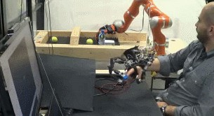{width="30%"} 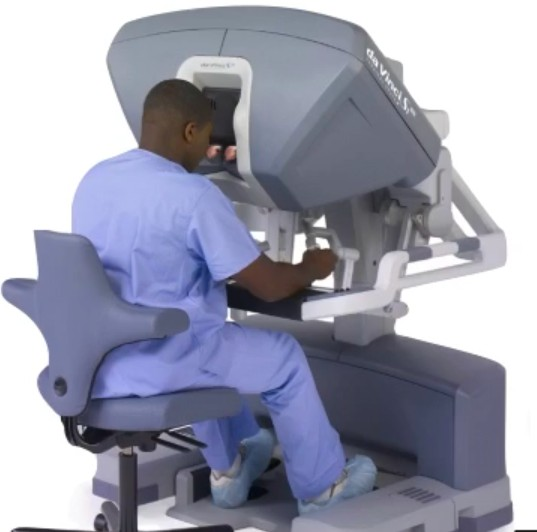{width="30%" height="200"} 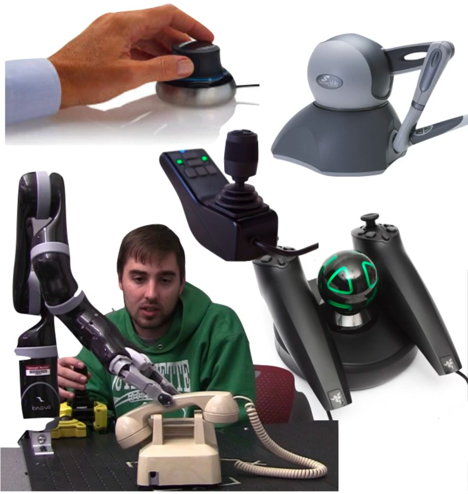{width="30%" height="200"}

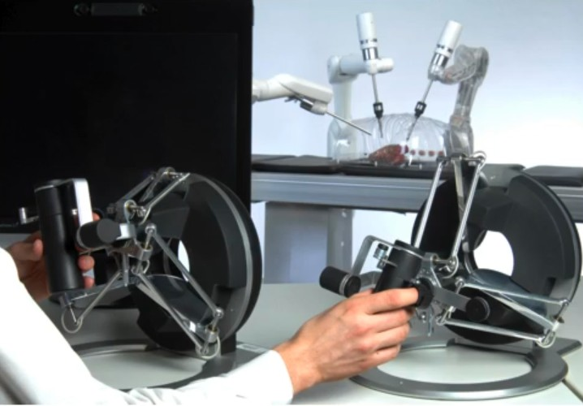{width="30%"} 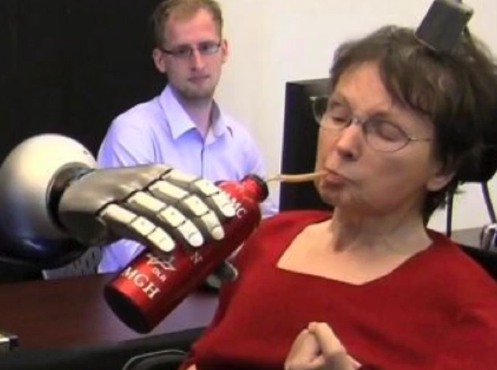{width="30%"} 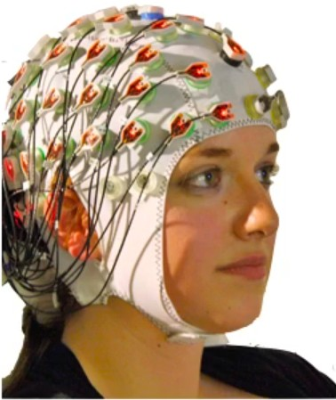{width="30%" height="200"}

**Noisy, insufficient degrees of freedom, tedious**

::: {.tiny-font .absolute bottom="0" left="0"}
Image credit: Javdani RSS2015 talk
:::

## Why is teleoperation hard?

:::::: columns
::: {.column width="60%"}
• **Hard**: actuating a robot with many DoF and/or unfamiliar dynamics through a low-DoF interface (joystick, mouse, brain-computer interface).

• **Hard**: specifying a goal formally (e.g., coordinates, grasp poses).

• **Easy**: demonstrating the goal indirectly, through imperfect inputs.

• …let the machine figure out what I want, and help me get there!
:::

:::: {.column width="40%"}
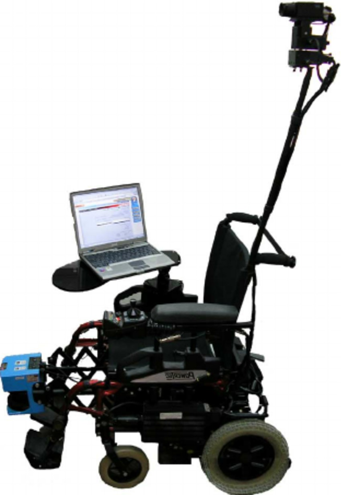{height="400"}

::: tiny-font
Image source: “Multihierarchical Interactive Task Planning. Application to Mobile Robotics” Galindo et al., 2008
:::
::::
::::::

## Shared Autonomy

:::::::: columns
::: {.column width="30%"}
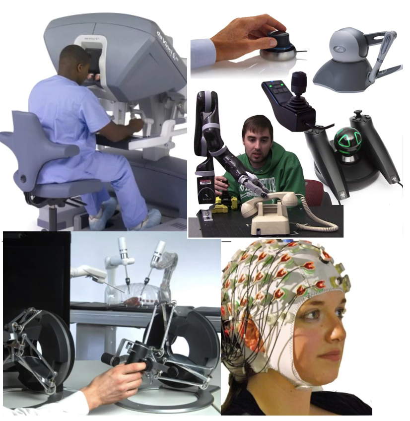 **User Input**
:::

::: {.column width="3%"}
   

\+
:::

::: {.column width="30%"}
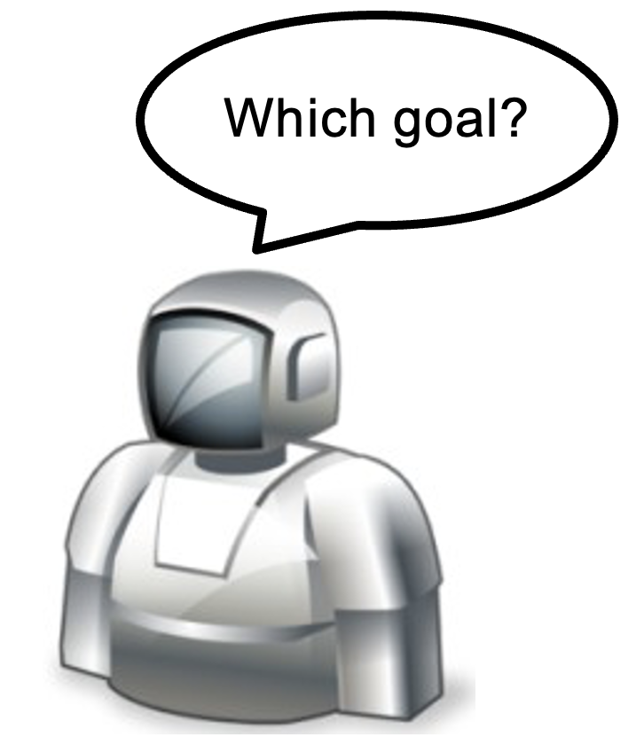 **Autonomous Assistance**
:::

::: {.column width="3%"}
   

**=**
:::

::: {.column width="30%"}
 

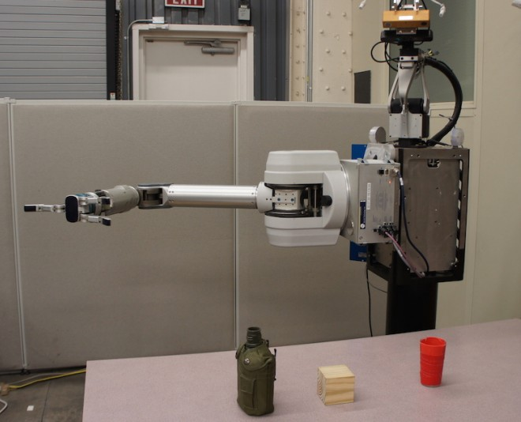 **Achieve Goal**
:::
::::::::

 

The catch: the robot usually does **not know the user’s goal** a priori. It has to infer it from the user’s inputs while it is helping.

## Two ways to assist under goal uncertainty

::::: columns
::: {.column width="50%"}
**Predict-then-blend**

1. Predict the single most likely goal
2. Assist for that goal, blending user input and autonomy based on prediction confidence

::: small-math
\[Dragan and Srinivasa 13\], \[Kofman et al. 05\], \[Kragic et al. 05\], \[Yu et al. 05\], \[McMullen et al. 14\], …
:::

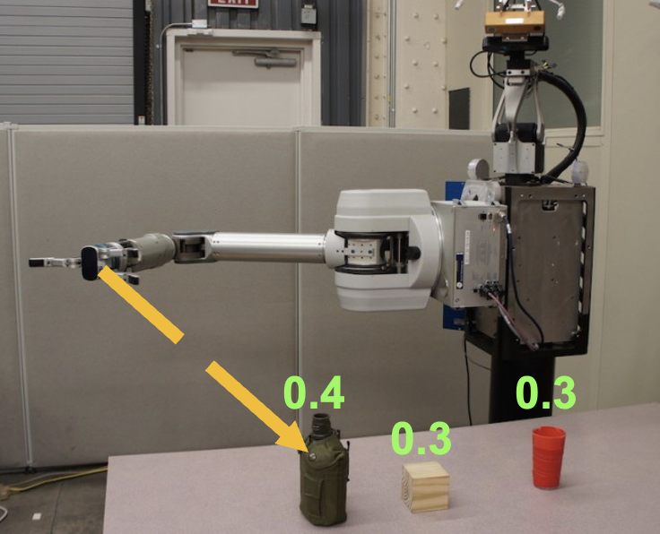{height="200"}
:::

::: {.column width="50%"}
**Assist for the whole goal distribution**

1. Maintain a distribution over goals
2. Choose actions that are good in expectation over that distribution

::: small-math
\[Hauser 13\], \[Javdani et al. 15\]
:::

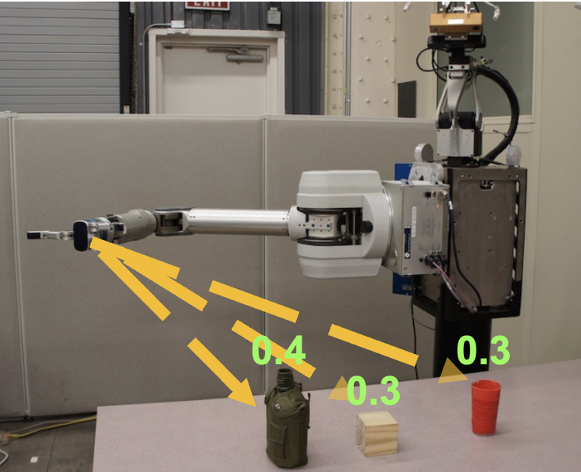{height="200"}
:::
:::::

The second option can help even when no single goal is confidently predicted, e.g., in clutter.

## Single goal vs. goal distribution

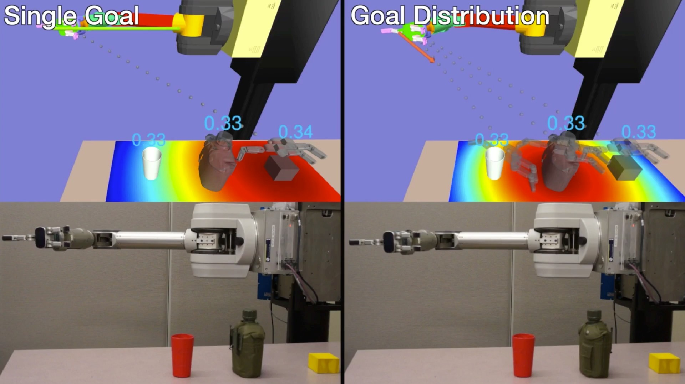{fig-align="center" height="480"}

::: {.tiny-font}
Image credit: Javdani RSS2015 talk
:::

## Key question for today

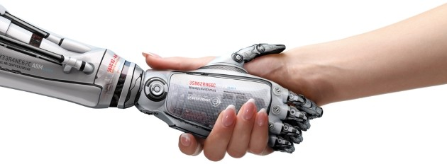{width="400" height="200"}

How can a robot **collaborating** with a human infer the human’s goals, and help achieve them, with as few **assumptions** as possible?

We will move from methods that assume a lot (known dynamics, goals, user model) to methods that assume very little.

## Aside: teleoperation is also how we collect demonstrations



::: small-math
Mandlekar et al., “Human-in-the-Loop Imitation Learning using Remote Teleoperation”. Easier teleoperation means cheaper demonstration and intervention data.
:::

## Shared Autonomy via Hindsight Optimization {.center}

Shervin Javdani, Siddhartha S. Srinivasa, J. Andrew Bagnell

Robotics: Science and Systems (RSS), 2015

[Paper](https://www.roboticsproceedings.org/rss11/p32.html) · [arXiv](https://arxiv.org/abs/1503.07619)

## Problem setup

::::: columns
::: {.column width="60%"}
-   Robot state $x \in X$ (continuous), robot action $a \in A$ (continuous)

-   Deterministic dynamics: $x' = T(x, a)$

-   User input $u \in U$ (e.g., joystick), mapped to robot actions by direct teleoperation $D: U \to A$

-   A **discrete set of goals** $g \in G$. The user knows their goal; the robot does not.

-   Each goal may have several **targets** $\kappa$ (e.g., grasp poses for one object)
:::

::: {.column width="40%"}
<video controls preload="metadata" width="100%" src="videos/javdani-problem-setup.mp4"></video>

::: tiny-font
Clip from Javdani’s RSS 2015 talk (1:38–2:16)
:::
:::
:::::

## Modeling the user: MaxEnt inverse optimal control

::::: columns
::: {.column width="60%"}
-   User as a goal-specific MDP $(X, U, T, C_g^{\text{usr}})$: they approximately optimize a cost $C_g^{\text{usr}} : X \times U \to \mathbb{R}$

-   MaxEnt IOC: $p(\xi \mid g) \propto \exp(-C_g^{\text{usr}}(\xi))$, where $\xi$ is a sequence of states and inputs

-   Soft value iteration computes the normalizer, with $\text{softmin}_u f(u) = -\log \int_u \exp(-f(u))\, du$ and $x' = T(x, D(u))$:

$$
\begin{aligned}
Q^{\approx}_{g}(x, u) &= C_g^{\text{usr}}(x, u) + V^{\approx}_{g}(x') \\
V^{\approx}_{g}(x) &= \underset{u}{\text{softmin}}\, Q^{\approx}_{g}(x, u) \\
\pi_g^{\text{usr}}(u \mid x) &= \exp\big(V^{\approx}_g(x) - Q^{\approx}_g(x, u)\big) \quad \text{(user policy)}
\end{aligned}
$$
:::

::: {.column width="40%"}
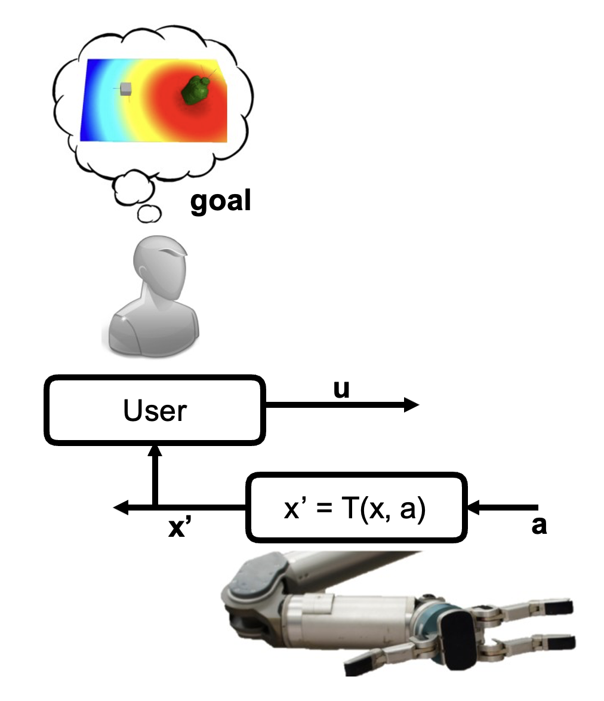
:::
:::::

## Goal prediction from user inputs only

::::: columns
::: {.column width="60%"}
-   Likelihood of the history uses **only the user’s inputs**:

$$
p(\xi^{0 \to t} \mid g) = \prod_{\tau \le t} \pi^{\text{usr}}_g(u_\tau \mid x_\tau)
$$

-   Bayes’ rule gives the belief over goals:

$$
p(g \mid \xi^{0 \to t}) = \frac{p(\xi^{0 \to t} \mid g)\, p(g)}{\sum_{g'} p(\xi^{0 \to t} \mid g')\, p(g')}
$$

-   Why not use the robot’s motion as evidence? Assistance moves the robot toward goals it already believes in, which would create a **positive feedback loop** of overconfidence.
:::

::: {.column width="40%"}
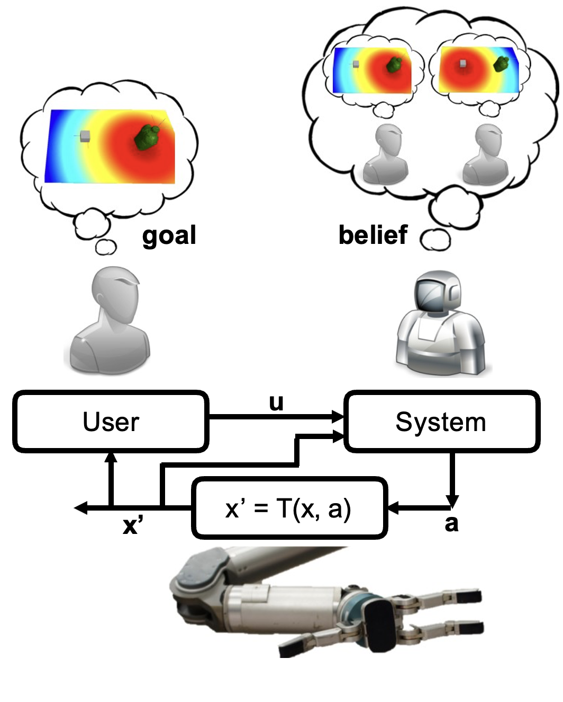
:::
:::::

## Shared autonomy as a POMDP

-   System state $s = (x, g) \in X \times G$: the robot state is known, all uncertainty is over the goal

-   Belief $b(g) = p(g \mid \xi^{0 \to t})$; observations are user inputs $u$; the observation model $\Omega$ is the user model + Bayes’ rule

-   POMDP $(S, A, T, C^{\text{rob}}, U, \Omega)$ with robot cost $C^{\text{rob}} : S \times A \times U \to \mathbb{R}$

-   The cost depends on the user input $u$, which is non-standard. This lets it penalize robot actions that deviate from what the user commanded, because users want to keep **control authority**. In the experiments:

$$
C_\kappa^{\text{rob}}(x, a, u) = C_\kappa^{\text{usr}}(x, u) + \big(a - D(u)\big)^2
$$

-   Solving this POMDP exactly is intractable, so we need an approximation.

## Hindsight Optimization

::::::::: columns
::::: {.column .small-math width="35%"}
-   MDP solution:

    $$V^{\pi^r}(s) = \mathbb{E}\left[\sum_t C^r(s_t, u_t, a_t) \mid s_0 = s\right]$$

    $$V^*(s) = \min_{\pi^r} V^{\pi^r}(s)$$

::: fragment
-   POMDP solution:

    $$V^{\pi^r}(b) = \mathbb{E}\left[\sum_t C^r(s_t, u_t, a_t) \mid b_0 = b\right]$$

    $$V^*(b) = \min_{\pi^r} V^{\pi^r}(b)$$
:::

::: fragment
-   HOP approximation:

    $$V^{\text{HS}}(b) = \mathbb{E}_b\left[\min_{\pi^r} V^{\pi^r}(s)\right]$$

    $$= \mathbb{E}_g[V_g(x)]$$
:::
:::::

::::: {.column width="65%"}
:::: fragment
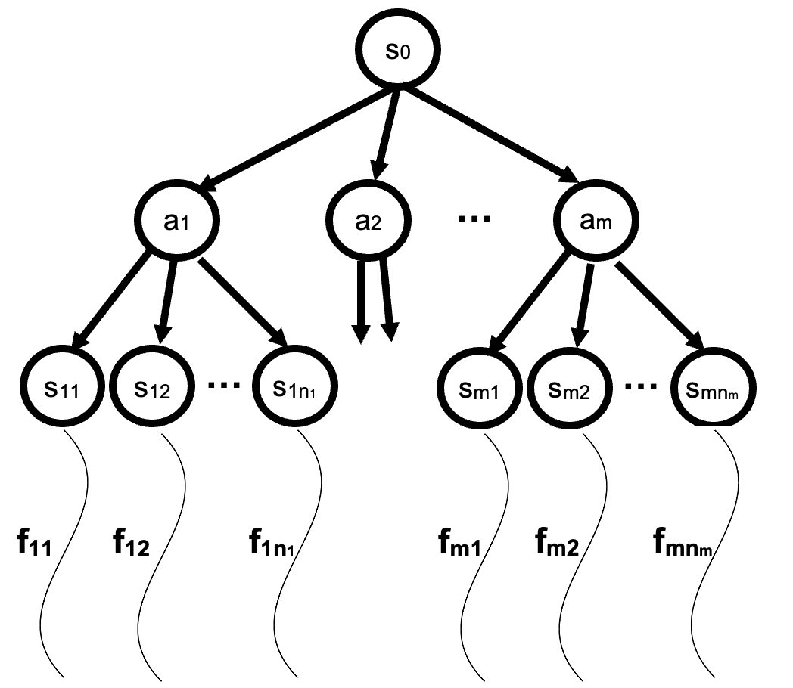{height="400" width="500" fig-align="center"}

::: {.absolute .small-math bottom="200" right="0"}
Deterministic\
problem for\
each future
:::
::::
:::::
:::::::::

## Hindsight optimization = QMDP

-   Action-value of the belief is the belief-weighted average of the per-goal action-values:

$$
Q(b, a, u) = \sum_{g} b(g)\, Q_g(x, a, u)
$$

-   It assumes the goal will be **fully revealed after the next step** (“in hindsight”). So the robot never takes an action just to gather information.

-   Continuous actions: instead of solving $\arg\min_a Q(b, a, u)$, take a first-order step along the gradient of $Q(b, a, u)$ with respect to $a$.

-   Why this fits shared autonomy:

    -   the user provides inputs all the time, so information arrives without deliberate information gathering;
    -   treating the user as an oracle to be queried would likely be frustrating;
    -   it is cheap to compute in continuous spaces, so the system reacts quickly to user input.

## Computing $Q_g$: let the robot take over

Two options for the per-goal action-value $Q_g(x, a, u)$:

1.  **Robot and user both act**: predict future user inputs with $\pi^{\text{usr}}_g$ and run Q-learning on $C^{\text{rob}}$. This is the standard QMDP approach, but it is expensive and depends on the user model.

2.  **Robot takes over** [(used in the paper)]{.green}: assume the user stops giving inputs and the robot completes the task optimally, $C^{\text{rob}}(s, a, u) \to C^{\text{rob}}(s, a, 0)$ in the future.

    -   For many costs the value can be computed **analytically**, e.g., the cost of moving toward the goal at a fixed velocity
    -   The assistance values make **no assumptions about the user policy**, so they are more robust to user-modeling errors

## Goals with multiple targets

A goal (e.g., “grasp the canteen”) can be achieved through many targets $\kappa \in K$ (grasp poses). Both assistance and prediction **decompose over targets**:

-   **Assistance** (Theorem 1, deterministic dynamics):

$$
V_g(x) = \min_\kappa V_\kappa(x), \qquad Q_g(x, a) = C_{\kappa^*}(x, a) + V_{\kappa^*}(x'), \quad \kappa^* = \arg\min_\kappa V_\kappa(x')
$$

-   **Prediction** (Theorem 2, MaxEnt model):

$$
V^{\approx}_g(x) = \underset{\kappa}{\text{softmin}}\, V^{\approx}_\kappa(x), \qquad Q^{\approx}_g(x, u) = \underset{\kappa}{\text{softmin}}\, Q^{\approx}_\kappa(x, u)
$$

-   So we only need value functions for each individual target: hard min to act, soft min to predict.

## Emergent behavior: blending without a blending rule

Confidence $= \max_g p(g) - \min_g p(g)$, with two goals:

-   **The hand is directly between two goals**, so no action helps both. Assistance grows roughly **linearly with confidence**, which looks like predict-then-blend arbitration.

-   **Moving forward helps both goals.** The policy makes progress **even with zero confidence**, which predict-then-blend cannot do.

Nobody designs the arbitration; it falls out of minimizing expected cost-to-go.

::: small-math
See Fig. 2 in the paper.
:::

## Results (video)

<video controls preload="metadata" width="800" src="videos/javdani-results.mp4"></video>

::: tiny-font
Clip from Javdani’s RSS 2015 talk (3:00–4:45)
:::

## Results: efficiency

::::: columns
::: {.column width="40%"}
-   10 users, within-subjects, grasping 3 objects with a joystick-teleoperated arm

-   **policy** (this paper) vs. **blend** (predict-then-blend, Dragan & Srinivasa)

-   policy was significantly **faster** ($F(1,9) = 12.98$, $p = 0.006$)

-   and needed significantly **less user input** ($F(1,9) = 7.76$, $p = 0.021$)

-   The gap grows on trials where blend is slow
:::

::: {.column width="60%"}
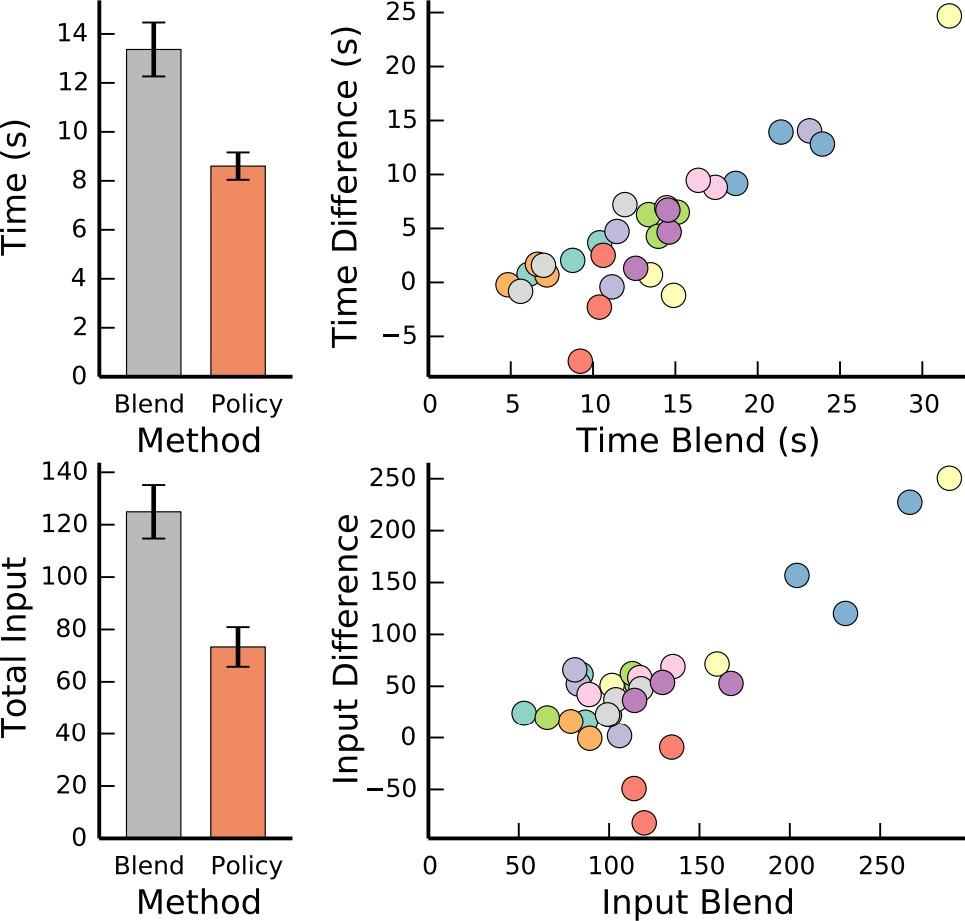{height="500" fig-align="center"}
:::
:::::

## Results: …but users did not prefer it

::::: columns
::: {.column width="45%"}
-   Users felt **less in control** with policy, even though they knew they were faster

-   The “which do you prefer” score trended toward **blend** (mean 2.9 on a scale where 1 = blend, 7 = policy), although not significantly

-   *“I was able to do things a little faster. However, I still don’t like feeling it has a mind of its own.”*

-   **Key tension:** task efficiency vs. control authority
:::

::: {.column width="55%"}
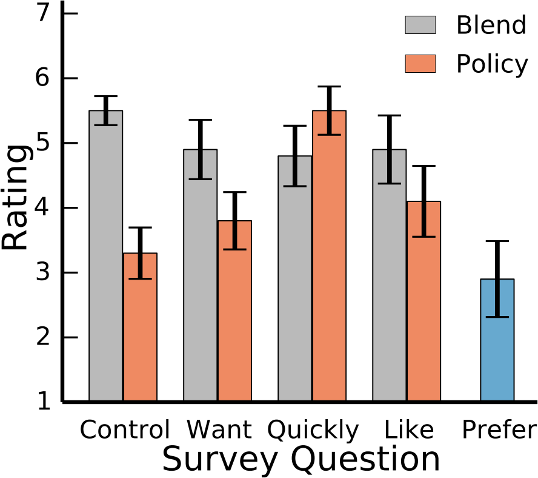{fig-align="center" height="450"}
:::
:::::

## Limitations

-   Needs a **known, discrete set of goals** (and their targets)

-   Needs a **dynamics model** and **hand-designed costs** $C^{\text{usr}}$, $C^{\text{rob}}$; the study used a very simple distance-based cost

-   QMDP never gathers information on purpose, which is fine only when user inputs are informative

-   Users lose some **control authority** and, in this study, tended to prefer the less efficient method

-   Small study: 10 participants, all with robotics experience

The next two papers each remove some of these assumptions.

## References

-   Javdani, S., Srinivasa, S. S., & Bagnell, J. A. (2015). Shared autonomy via hindsight optimization. Robotics: Science and Systems.

-   RSS2015 talk: “Shared autonomy via hindsight optimization”

-   Javdani, S., Admoni, H., Pellegrinelli, S., Srinivasa, S. S., & Bagnell, J. A. (2018). Shared autonomy via hindsight optimization for teleoperation and teaming. The International Journal of Robotics Research, 37(7), 717-742.

-   Dragan, A. D., & Srinivasa, S. S. (2013). A policy-blending formalism for shared control. The International Journal of Robotics Research, 32(7), 790-805.

-   ICAPS 2015 talk: “Hindsight Optimization for Probabilistic Planning with Factored Actions”

## Shared Autonomy via Deep Reinforcement Learning {.center}

Siddharth Reddy, Anca D. Dragan, Sergey Levine

Robotics: Science and Systems (RSS), 2018

[Paper](https://arxiv.org/abs/1802.01744) · [Blog post](http://bair.berkeley.edu/blog/2018/04/18/shared-autonomy/) · [Project website and code](https://sites.google.com/view/deep-assist)

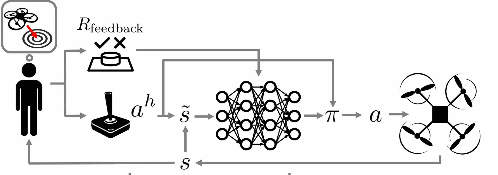{width="400" height="200" fig-align="right"}

## Motivation: Unknown Dynamics are Hard for Humans

<video controls preload="metadata" width="800" src="videos/lander-human-solo.mp4"></video>

::: tiny-font
Human pilot playing Lunar Lander alone. Video from <https://sites.google.com/view/deep-assist>
:::

## It can get even worse than Lunar Lander…

::::: columns
::: {.column width="70%"}
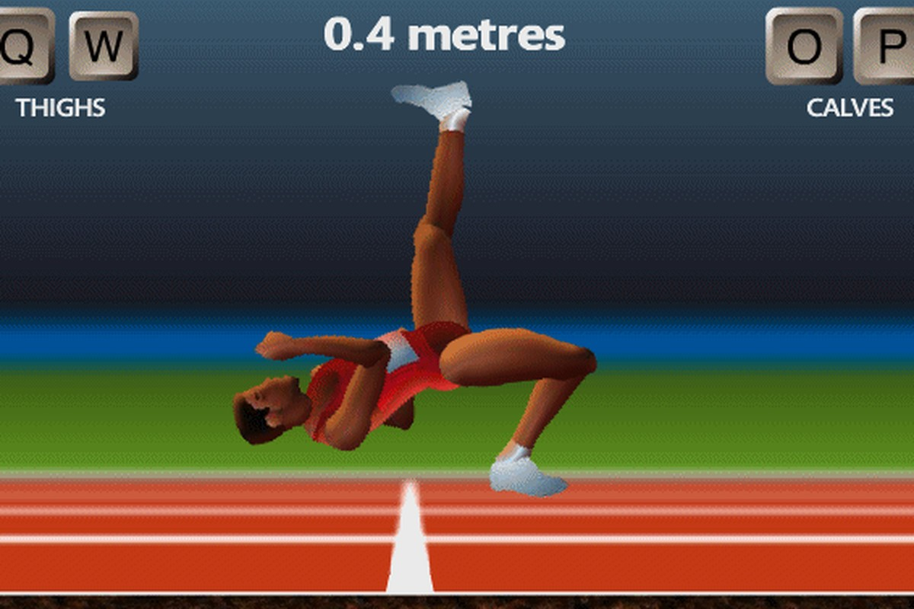
:::

::: {.column .small-math width="30%"}
<https://www.foddy.net/Athletics.html> or Google “qwop”
:::
:::::

## Key idea: drop the models

-   Prior work (e.g., Javdani et al.) assumes:

    1.  known dynamics $T$,
    2.  a known goal space $\mathcal{G}$,
    3.  a known user policy $\pi_h(a^h \mid s, g)$.

-   **Reddy et al.:** use model-free deep RL to learn an end-to-end mapping from (observation, user input) to action values, with **task reward as the only supervision**.

-   User input plays **two** roles:

    1.  a **prior policy** that the agent fine-tunes;

    2.  a **sensor** from which the agent decodes the user’s private information (e.g., the goal).

## Challenges

-   **Challenge #1:** follow the user closely enough that they keep getting feedback from their own actions, but deviate when their actions are bad. Consistently ignoring the user degrades the quality of their inputs.

-   **Challenge #2:** learn with few interactions, because a human is in the loop.

## Formulation: Reward

 

$$
R(s, a, s') = \underbrace{R_{\text{general}}(s, a, s')}_{\text{known}} + \underbrace{R_{\text{feedback}}(s, a, s')}_{\text{unknown, but observed}}
$$

:::::: small-math
::: {.absolute top="210" left="100"}
$\qquad \qquad \quad \uparrow$\
Agent’s reward\
(what we want to maximize)
:::

::: {.absolute top="230" left="350"}
$\qquad \qquad \qquad \uparrow$\
Handcrafted “common sense”\
knowledge: do not crash, do\
not tip, etc.
:::

::: {.absolute top="230" right="150"}
$\uparrow$\
Depends on the user’s private\
intent, e.g., success or crash\
signaled at the end of an episode
:::
::::::

## Three settings: what does the agent know?

::::: columns
::: {.column width="65%"}
1.  **Known user policy:** known $\mathcal{G}$ and $\pi_h$ $\Rightarrow$ infer the goal $\hat g_t$ with Bayesian inference (MaxEnt IRL), as in Javdani et al.

2.  **Known goal space:** known $\mathcal{G}$, unknown $\pi_h$ $\Rightarrow$ predict $\hat g_t$ with an LSTM trained on the user’s data.

3.  **Minimal assumptions:** nothing is known $\Rightarrow$ feed the user’s raw action $a^h_t$ to the agent [(main focus)]{.green}.

In settings 1-2, $R_{\text{feedback}}$ is parameterized by the goal (reward when $s' = g$). In setting 3, it is only observed, typically as a sparse terminal success/failure signal from the user.
:::

::: {.column width="35%"}
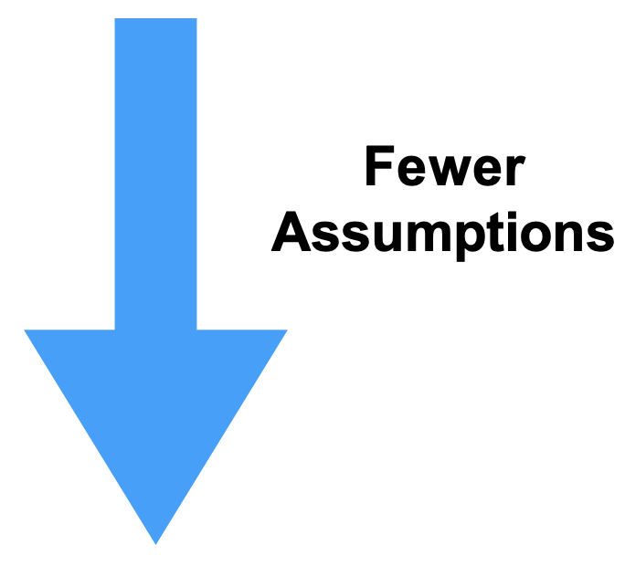
:::
:::::

## Input to the RL agent

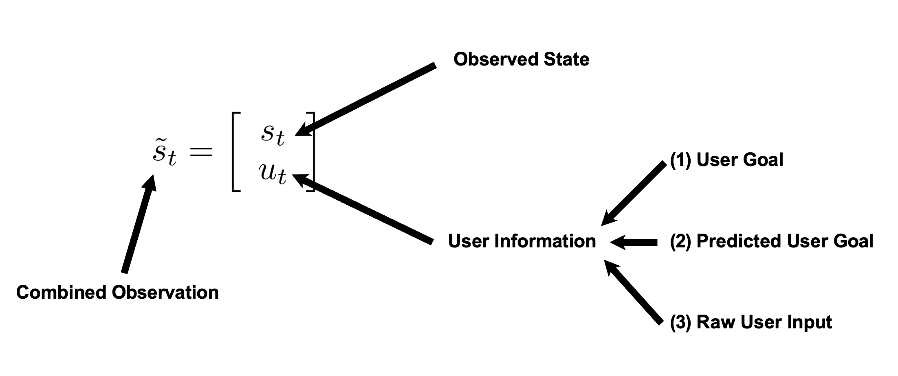

-   Concatenate the observation with the user information: $\tilde s_t = [s_t;\, u_t]$, with $u_t = \hat g_t$ (settings 1-2) or $u_t = a^h_t$ (setting 3)

-   In setting 3 the agent must decode the user’s intent **implicitly** from their actions

## Why Q-learning?

-   **Off-policy**: the executed actions do not have to be the agent’s greedy actions, so control can be explicitly traded off between user and agent

-   Off-policy Q-learning tends to be **more sample-efficient** than policy gradients and Monte Carlo methods

-   Implementation: neural fitted Q-iteration with experience replay, a target network, and double Q-learning

    -   Gradient updates happen only at the end of each episode. Per-step DQN updates would make the interface lag and disrupt human control.

## Control sharing: execute the closest high-value action

$$
\pi_\alpha(a \mid \tilde s, a^h) = \delta\Big(a = \operatorname*{arg\,max}_{\{a \,:\, Q'(\tilde s, a) \ge (1-\alpha)\, Q'(\tilde s, a^*)\}} f(a, a^h)\Big)
$$

$$
Q'(\tilde s, a) = Q(\tilde s, a) - \min_{a'} Q(\tilde s, a')
$$

-   **Feasible set**: actions not much worse than the optimal action $a^*$; among these, execute the one **most similar** to the user’s action, where $f$ counts agreeing action dimensions

-   Subtracting $\min_{a'} Q$ keeps the comparison meaningful for negative Q-values, and makes the condition invariant to affine scaling of $Q$

-   $\alpha \in [0, 1]$ is the **tolerance for suboptimal user actions**, i.e., how much the copilot defers to the pilot:

    -   $\alpha = 0$: only the optimal action is feasible $\Rightarrow$ fully autonomous copilot
    -   $\alpha = 1$: every action is feasible $\Rightarrow$ the user’s action is executed unchanged

## The Method

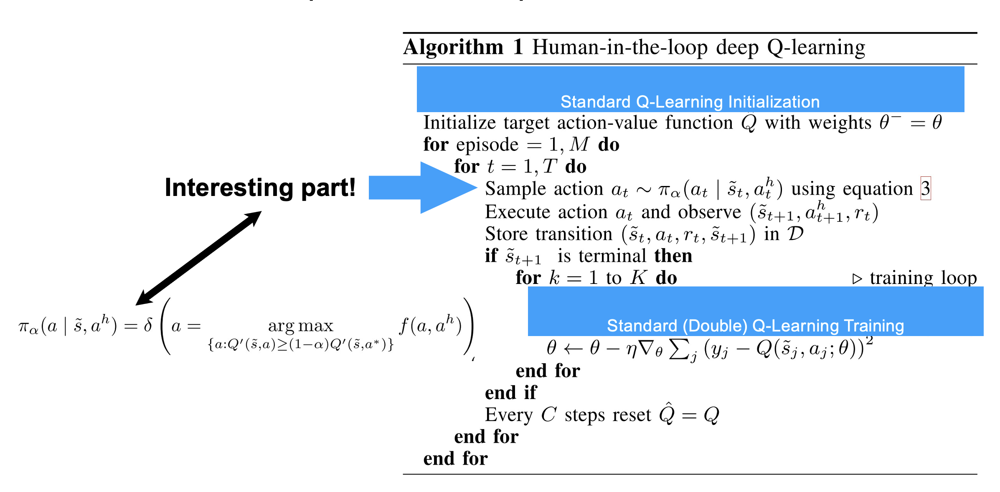

Like Q-learning, but execute the closest high-value action to the user’s input instead of the highest-value action.

## Effect of the tolerance $\alpha$

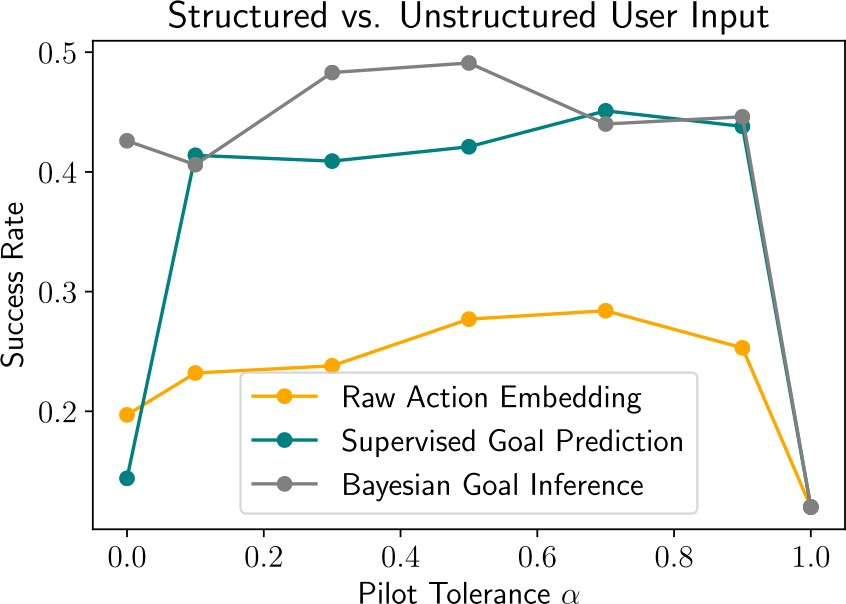{fig-align="center" height="300"}

-   Simulated LaggyPilot on Lunar Lander. At $\alpha = 1$ the copilot never overrides the pilot, and performance collapses.

-   When the goal space and user model are known, structured inputs (goal inference or prediction) beat raw actions.

-   The best $\alpha$ depends on the pilot: $\alpha = 0$ for SensorPilot, $\alpha \approx 0.5$ for LaggyPilot and NoisyPilot.

## Experiments

-   **Simulated pilots** on Lunar Lander (OpenAI Gym): pilots that are laggy, noisy, or only signal the landing-site direction. The copilot does not observe the landing site.

-   **Human pilots** on Lunar Lander ($n = 12$): assistance significantly increased success and reduced crashes.

-   **Physical** experiments with a real quadrotor ($n = 4$).

-   **Practical caveat: pretraining.** The copilot is first trained **without a pilot**, in simulation (an idealized point-mass model for the drone), and then fine-tuned with the human. Learning from scratch with a human in the loop would need too much data.

    -   In simulation, a copilot trained with no pilot helped LaggyPilot as much as one trained with LaggyPilot.

## Real-World Experiments

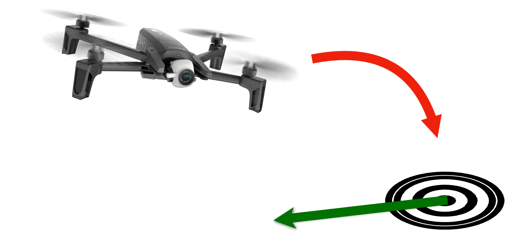{.absolute top="50" right="0" width="300"}

 

-   **Goal**: land the drone on a pad **with the camera facing a target object**.

-   **Pilot**: human, knows the target object.

-   **Copilot**: our agent, knows where the pad is, but not the target object.

## Real-World Results

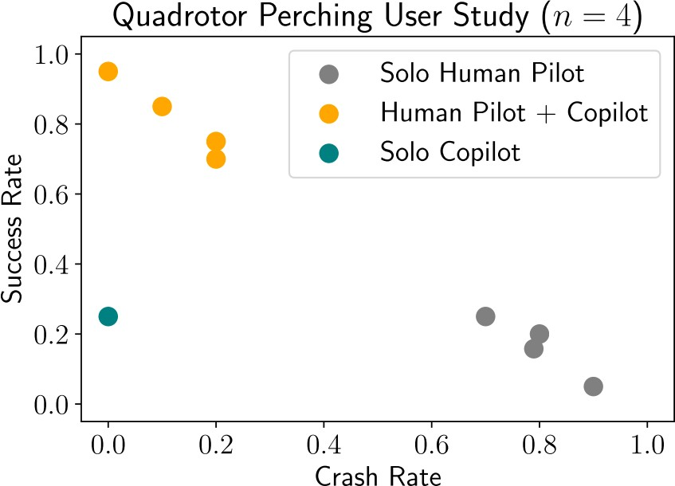{fig-align="center" height="450"}

**Important caveat: only n = 4 humans in the drone study.** The evidence is mostly anecdotal.

## Lunar Lander with an RL copilot

<video controls preload="metadata" width="800" src="videos/lander-human-copilot.mp4"></video>

::: tiny-font
Human pilot with the RL copilot. Video from <https://sites.google.com/view/deep-assist>
:::

## Strengths and weaknesses

::::: columns
::: {.column width="50%"}
**Strengths**

-   Assists with **no assumptions** about dynamics, the user’s policy, or the goal representation

-   Can still exploit a goal space or user model when available

-   A single knob, $\alpha$, sets the level of assistance

-   Clear writing; code released
:::

::: {.column width="50%"}
**Weaknesses**

-   Needs a reward signal and a lot of data, so in practice it relies on **simulator pretraining**

-   Reactive (memoryless) policy: it cannot integrate evidence about intent over time

-   Discrete, low-dimensional action spaces

-   Small user studies; users found the copilot somewhat inconsistent and too aggressive at stabilizing
:::
:::::

## References

-   Reddy, S., Dragan, A. D., & Levine, S. (2018). Shared autonomy via deep reinforcement learning. Robotics: Science and Systems.

-   BAIR blog post: [Shared Autonomy via Deep Reinforcement Learning](http://bair.berkeley.edu/blog/2018/04/18/shared-autonomy/)

-   Project website and code: <https://sites.google.com/view/deep-assist>

-   Schwarting, W., Alonso-Mora, J., Pauli, L., Karaman, S., & Rus, D. (2017). Parallel autonomy in automated vehicles: Safe motion generation with minimal intervention. ICRA.

## Controlling Assistive Robots with Learned Latent Actions {.center}

Dylan P. Losey, Krishnan Srinivasan, Ajay Mandlekar, Animesh Garg, Dorsa Sadigh

IEEE International Conference on Robotics and Automation (ICRA), 2020

[Paper](https://ieeexplore.ieee.org/abstract/document/9197197) · [arXiv](https://arxiv.org/abs/1909.09674)

## 



## Problem: low-DoF interfaces, high-DoF arms

-   Wheelchair-mounted assistive arms can help with eating, pouring, cooking, … but they are controlled with **low-DoF joysticks**

-   The arm has many more DoF (here, 7). Users must switch between modes, such as translation and rotation, which is slow and tiring.

-   Shared autonomy (Javdani et al.) helps reach one of a **discrete, known set of goals**, but the mapping from joystick to robot action is still hand-designed

-   Reddy et al. learn assistance, but the user’s input has the **same dimension** as the robot’s action

**Insight:** high-DoF robot actions can often be embedded into intuitive, low-DoF **latent actions** that the user controls directly.

## Formulation

-   Task MDP $(\mathcal{S}, \mathcal{A}, \mathcal{T}, R, \gamma, \rho_0)$ with $a \in \mathbb{R}^m$, plus a dataset of demonstrations $\mathcal{D} = \{(s_0, a_0), (s_1, a_1), \ldots\}$

-   Learn a latent action space $\mathcal{Z} \subset \mathbb{R}^d$ with $d < m$, and a decoder

$$
\phi : \mathcal{Z} \times \mathcal{S} \to \mathcal{A}
$$

-   Algorithm:

    1.  Collect kinesthetic demonstrations of related tasks (e.g., from a caregiver)
    2.  Train an autoencoder on $\mathcal{D}$
    3.  Align the learned latent dimensions with the joystick axes (done manually)
    4.  At run time, treat the joystick input as $z_t$ and execute $\hat a_t = \phi(z_t, s_t)$

## What makes latent actions user-friendly?

-   **Controllability**: for any two states $s_i, s_j$ in the data, there is a sequence of latent actions that takes the robot from $s_i$ to $s_j$ via $s_k = \mathcal{T}(s_{k-1}, \phi(z_{k-1}, s_{k-1}))$

-   **Consistency**: the same $z$ has a similar effect in nearby states, measured with a task-dependent metric $d_M$:

$$
d_M\big(\mathcal{T}(s_1, \phi(z, s_1)),\, \mathcal{T}(s_2, \phi(z, s_2))\big) < \epsilon \quad \text{whenever } \|s_1 - s_2\| < \delta
$$

-   **Scaling**: larger latent actions cause larger changes in state, $\|s - s'\| \to \infty$ as $\|z\| \to \infty$, with $s' = \mathcal{T}(s, \phi(z, s))$

## Models: why condition on the state?

-   Encoder $\psi(s, a) \to z$ and decoder back to $\hat a$, trained with the reconstruction loss $\|a - \hat a\|^2$

-   **VAE regularizer** $KL(\mathcal{N}(\mu, \sigma) \,\|\, \mathcal{N}(0, 1))$: a small joystick tilt should not suddenly pour the whole glass, which helps consistency and scaling

-   **State conditioning**: the meaning of a joystick input depends on what the robot is doing. Pushing down means “pour” when holding a glass, but means nothing when the gripper is empty. So the decoder is $\phi(z, s)$ rather than $\phi(z)$.

-   Compared models: PCA (prior teleoperation baseline), AE, VAE, and the state-conditioned **cAE** and **cVAE**

## Simulation results

Planar 5-DoF arms with tasks: Sine (1-D latent), Rotate (two arms holding a box), Circle (2-D latent), Reach

-   **Reconstruction** (Sine): cAE and cVAE reach 1.4% and 3.7% of PCA’s loss; AE and VAE are no better than PCA (98-100%)

-   **Controllability** (Sine): cAE and cVAE end up 5.6% and 11.1% as far from the goal as PCA; AE and VAE are worse than PCA

-   **Consistency/scaling**: all models map $z$ to motion roughly linearly ($R^2 \approx 0.94$ or more)

-   **Disentanglement** (Circle): the angle between the motions caused by $z_1$ and $z_2$ is about 72-74° for cAE/cVAE vs. 27-34° for AE/VAE (ideal: 90°)

Only state-conditioned models reconstruct actions accurately **and** give controllable latent spaces.

## User study 1: discrete goals (eating)

-   Feeding task from the HARMONIC dataset: guide a fork to one of 3 morsels with a 2-DoF joystick on a 7-DoF arm

-   Baselines: no / low / high / full shared-autonomy assistance from the dataset (24 people); 10 new participants used the cVAE

-   cVAE: 44 of 50 trials successful, with significantly lower completion time, joystick input, and trajectory length than **High Assist**

-   Caveat: a comparison across studies, since the new participants only used the cVAE

## User study 2: continuous goals (cooking)

-   Make a simplified “apple pie”: pick up and pour eggs and flour, recycle or return containers, add an apple, stir

-   Shared autonomy with discrete goals does not apply here: the goals are continuous, and the user also controls the **style** of motion (e.g., pouring vs. upright)

-   11 participants, within-subjects: **cVAE** (one 2-DoF joystick) vs. **End-Effector** teleoperation (two joysticks plus a translation/rotation mode toggle)

-   The cVAE was trained on **under 7 minutes** of kinesthetic demonstrations

-   With the cVAE, participants finished faster and used the joystick less. They rated it easier, less effortful, and more natural.

-   …but they **did not clearly prefer** it: they enjoyed the extra freedom of end-effector control

## Limitations

-   Outside the demonstration distribution, the latent actions become **erratic**. One participant rotated the arm upside-down and could not recover.

-   Needs task-relevant demonstrations and a manual alignment of latent axes with the joystick

-   Performance does not equal preference: as with Javdani et al., users value freedom of control

-   The authors propose switching between latent actions and standard teleoperation when latent actions stop helping

## References

-   Losey, D. P., Srinivasan, K., Mandlekar, A., Garg, A., & Sadigh, D. (2020). Controlling assistive robots with learned latent actions. ICRA.

-   Newman, B. A., Aronson, R. M., Srinivasa, S. S., Kitani, K., & Admoni, H. (2018). HARMONIC: A multimodal dataset of assistive human-robot collaboration. arXiv.

-   Herlant, L. V., Holladay, R. M., & Srinivasa, S. S. (2016). Assistive teleoperation of robot arms via automatic time-optimal mode switching. HRI.

-   Kingma, D. P., & Welling, M. (2014). Auto-encoding variational Bayes. ICLR.

## RelaxedIK: Real-time Synthesis of Accurate and Feasible Robot Arm Motion {.center}

Daniel Rakita, Bilge Mutlu, Michael Gleicher

Robotics: Science and Systems (RSS), 2018

[Paper](https://www.roboticsproceedings.org/rss14/p43.html) · [Code](https://github.com/uwgraphics/relaxed_ik)

## Why this paper in a shared autonomy lecture?

-   Every method so far outputs an **end-effector command** at each time step. Something has to turn it into joint motion, in real time.

-   In teleoperation there is **no lookahead**: the next pose goal comes from the human, e.g., mimicry-based teleoperation that maps the user’s hand pose to the robot’s end effector (Rakita et al., HRI 2017)

-   Example: a robot spoon-feeding a person must track a moving head, keep the spoon level, and move smoothly without self-collisions, all at once

-   Goal: **match end-effector pose goals as well as possible without sacrificing motion feasibility**

## Recap: Forward Kinematics (FK)

-   A common robotic skeleton is a tree (or chain) of rigid links connected by joints

-   The joint angles $\Theta$ (the robot configuration) determine the end-effector pose through forward kinematics, $FK(\Theta)$

-   End effector: the tool at the end of a robot arm (gripper, spoon, …)

::::: columns
::: {.column width="35%"}
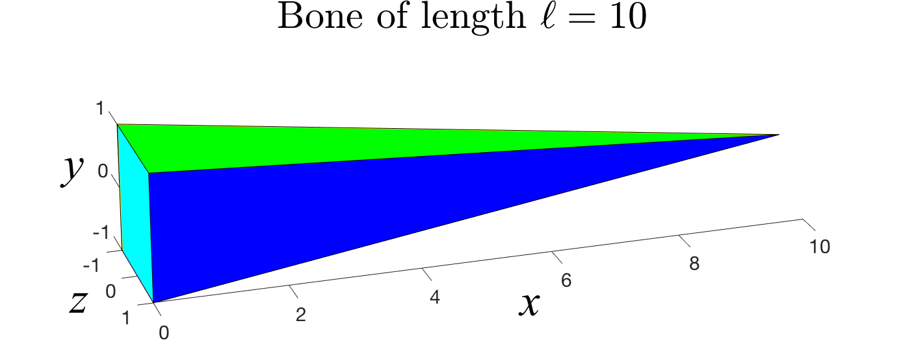{height="100"}

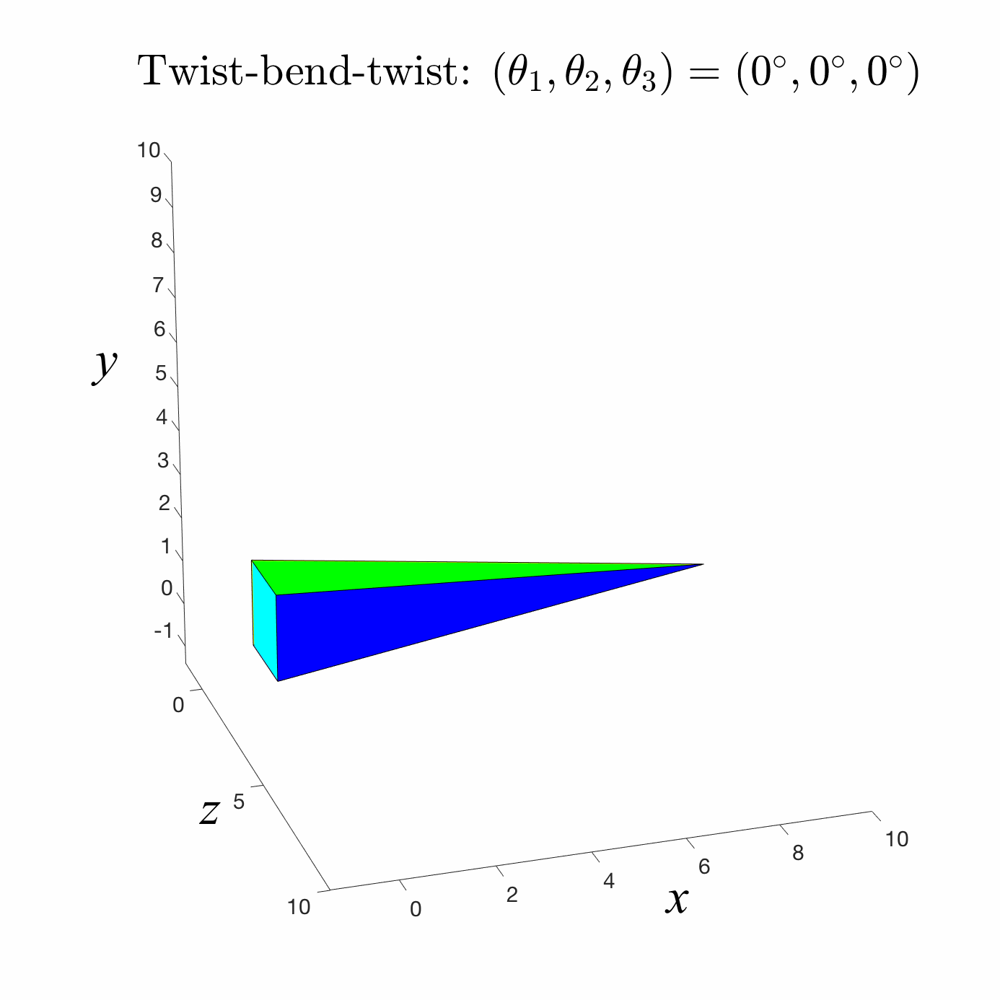{height="200"}
:::

::: {.column width="65%"}
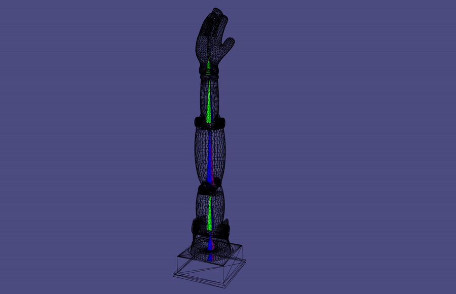{height="300"}
:::
:::::

::: {.tiny-font .absolute bottom="0"}
materials from <https://github.com/alecjacobson/computer-graphics-csc418>
:::

## Recap: Inverse Kinematics (IK)

-   Inverse kinematics: find joint angles that achieve a desired end-effector pose, $\Theta = IK(p)$

-   Closed-form solutions exist only for special kinematic structures. A pose may have many solutions or none.

-   In practice, IK is solved as an optimization problem:

$$
\min_\Theta \; \chi_p(\Theta) = \| p_g - FK(\Theta) \|_2
$$

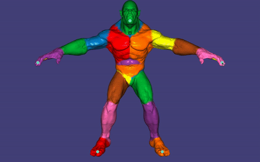{fig-align="right" height="200"}

## Following a stream of pose goals

-   **Input**: a new end-effector goal $(p_g, q_g)$ at every update, e.g., from a human teleoperator

-   **Output**: a joint configuration $\Theta$ at every update

-   Requirements:

    -   match each pose goal (per-frame IK)
    -   **feasibility across frames**: no joint-space jumps, no self-collisions, no kinematic singularities

## Baselines and their problems

-   **Direct point-to-point**: solve IK at every update with a state-of-the-art solver (Trac-IK), seeded with the previous solution

    -   Accurate per frame, but ignores constraints between frames: self-collisions, discontinuities, singularities

-   **Real-time motion planning**: predict the future pose, solve IK, plan a feasible path (RRT-Connect / PRM), and execute

    -   Feasible, but the end effector does not follow the goal well along the planned path, and the robot stalls when planning fails

## Failure mode: self-collision

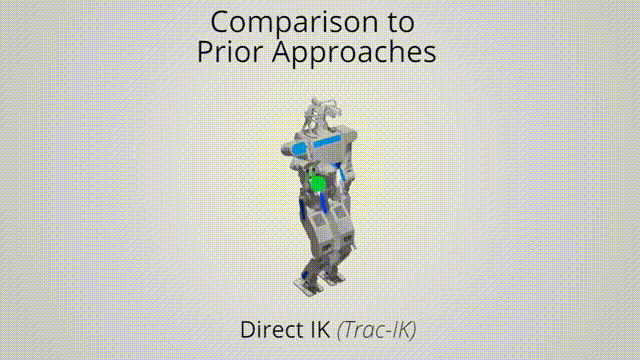{fig-align="center" height="450"}

## Failure mode: joint-space discontinuities

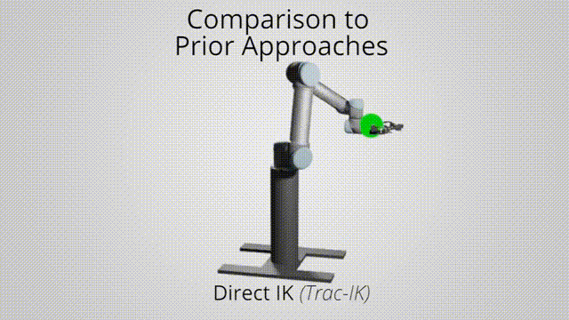{fig-align="center" height="450"}

## Failure mode: goal mistracking

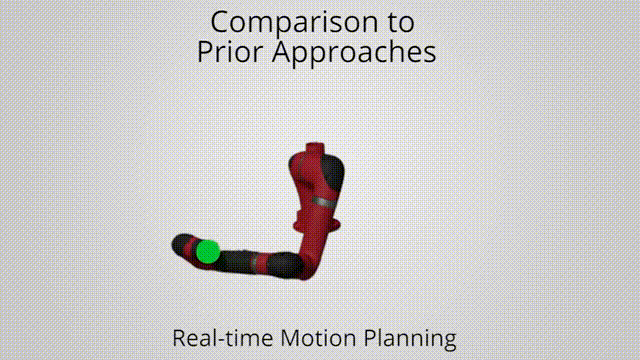{fig-align="center" height="450"}

## Failure mode: unpredictable behavior

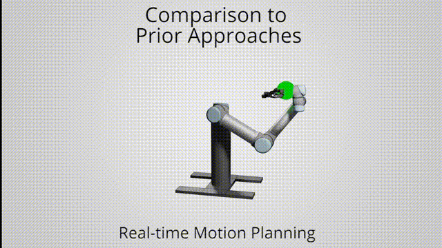{fig-align="center" height="450"}

## RelaxedIK: IK as a weighted-sum optimization

$$
\Theta = \arg\min_\Theta f(\Theta) \quad \text{s.t.} \quad c_i(\Theta) \ge 0, \; c_e(\Theta) = 0, \; l_i \le \Theta_i \le u_i
$$

$$
f(\Theta) = \sum_{i=1}^{k} w_i \, h_i(\Theta, v(t)) \, f_i(\Theta, \Omega_i)
$$

-   Static weights $w_i$ and optional dynamic weights $h_i$; each $f_i$ encodes one sub-goal

-   **7 objective terms**: end-effector position; end-effector orientation; minimal joint velocity, acceleration, and jerk; minimal end-effector velocity; self-collision avoidance

-   **2 constraints**: joint-velocity limits per update, and singularity avoidance

-   Pose matching is **not a hard constraint**: it can be *relaxed* when it conflicts with more important terms. This works even without redundant joints.

## Key contribution: normalizing the objectives

-   Terms live in different units and scales, such as joint velocities vs. Euclidean distances. With plain quadratic losses, the weights do not mean anything.

-   Each term’s value $\chi_i(\Theta)$ is passed through a parametric normalization function:

$$
f_i(\Theta, \Omega_i) = (-1)^n \exp\!\left(\frac{-(\chi_i(\Theta) - s)^2}{2c^2}\right) + r\,(\chi_i(\Theta) - s)^4
$$

-   A narrow Gaussian “groove” around the goal value, plus a gentler polynomial that keeps a consistent gradient pointing toward it

-   All terms share a common range, so **weights become interpretable**: weight 2 means roughly twice as important as weight 1

-   Example: for position matching, $\chi_p(\Theta) = \|p_g - FK(\Theta)\|_2$ with $n = 1, s = 0, c = 0.2, r = 5$

## Self-collision term

::::: columns
::: {.column width="55%"}
-   A smooth potential that rises as pairs of links get closer than in a reference collision-free configuration:

$$
\text{col}(\Theta) = \sum_{i,j} b \cdot \exp\left( -\frac{\text{dis}(l_i, l_j)^2}{2c^2} \right)
$$

-   About 1 ms per evaluation: too slow when the objective is called 100+ times per solve

-   An MLP trained on 1M random configurations approximates $\text{col}(\Theta)$ in about $10^{-5}$ s

-   The network only speeds up a hand-defined cost; it does not learn what a collision is
:::

::: {.column width="45%"}
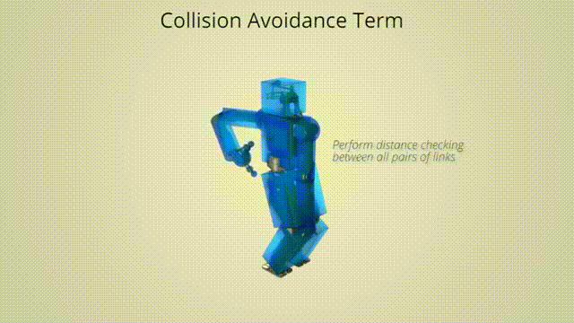
:::
:::::

## Singularity avoidance (a hard constraint)

-   Kinematic singularity: the Jacobian in $\dot{\mathbf{x}} = \mathbf{J}(\Theta)\, \dot{\Theta}$ loses full column rank. Near it, small end-effector motions require huge joint velocities.

-   Proxy distance to a singularity: the condition value from the SVD of $\mathbf{J}$, $\; c = \sigma_N / \sigma_1$ (small means nearly singular)

-   Why not Yoshikawa manipulability? This ratio favors a *round* manipulability ellipse rather than a large one, which generalizes better across robots.

-   Preprocessing: sample 500k configurations and estimate the mean $\mu_c$ and standard deviation $\text{std}_c$

-   Constraint: $c \ge \mu_c - b \cdot \text{std}_c$ with $b = 2$, which avoids roughly the worst 2.5% of configurations

## Results

::::: columns
::: {.column width="60%"}
-   7 robots (5 to 8 DoF), 5 tasks (circle and square tracing, isolated rotations, spoon feeding, two-arm cooking), 100 random starts each, about 1.5M solutions in total

-   Two weight settings: **(A)** emphasizes accuracy and **(B)** emphasizes smoothness

-   Setting (A) had the best end-effector accuracy; setting (B) had the smoothest joint motion

-   Both had **zero** discontinuities, singularities, and self-collisions. Trac-IK had many of each.

-   Real-time motion planning was feasible but tracked pose goals poorly

-   About **17 ms** per solution, vs. about 2 ms for Trac-IK
:::

::: {.column width="40%"}
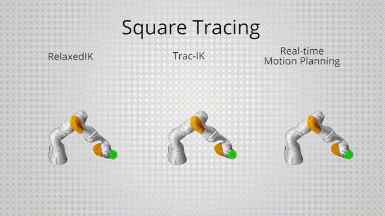{fig-align="center" height="300"}
:::
:::::

## Strengths and limitations

::::: columns
::: {.column width="50%"}
**Strengths**

-   Accurate *and* feasible motion in real time

-   Works without redundant joints, even on under-articulated arms

-   Interpretable weights thanks to normalization

-   Not tied to a particular solver; open source
:::

::: {.column width="50%"}
**Limitations**

-   Local non-linear optimization: no convergence guarantees

-   Weights and loss parameters are still hand-tuned

-   Self-collision only: no environment obstacles, no dynamics

-   Slower than plain IK; per-robot preprocessing takes 20-30 minutes
:::
:::::

## References

-   Rakita, D., Mutlu, B., & Gleicher, M. (2018). RelaxedIK: Real-time synthesis of accurate and feasible robot arm motion. Robotics: Science and Systems.

-   Rakita, D., Mutlu, B., & Gleicher, M. (2017). A motion retargeting method for effective mimicry-based teleoperation of robot arms. HRI.

-   Beeson, P., & Ames, B. (2015). TRAC-IK: An open-source library for improved solving of generic inverse kinematics. Humanoids.

-   Code: <https://github.com/uwgraphics/relaxed_ik>

## Fleet-DAgger: Interactive Robot Fleet Learning with Scalable Human Supervision {.center}

Ryan Hoque, Lawrence Yunliang Chen, Satvik Sharma, Karthik Dharmarajan, Brijen Thananjeyan, Pieter Abbeel, Ken Goldberg

Conference on Robot Learning (CoRL), 2022 (Oral)

[arXiv](https://arxiv.org/abs/2206.14349) · [Code](https://github.com/BerkeleyAutomation/ifl_benchmark)

## From one human and one robot to robot fleets

-   Amazon, Nimble, Plus One, Waymo, and Zoox already run robot fleets that call **remote human teleoperators** when a robot is at risk or stuck

-   Each intervention is also **training data**, which the whole fleet can share for continual learning

-   **Interactive Fleet Learning (IFL)**: $N$ robots, $M \ll N$ humans. The robots ask for help (**robot-gated**), and an allocation policy $\omega$ decides who gets it.

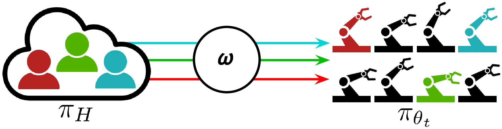{fig-align="center" width="60%"}

-   A human assigned to a robot either **teleoperates** it with $\pi_H$ or performs a **hard reset** $R$ (taking $t_R$ steps) after the robot violates a constraint ($c(s) = 1$, e.g., it fell over)

## Objective: Return on Human Effort

-   Allocation: each human helps at most one robot, and vice versa

$$
\omega : (\mathbf{s}^t, \pi_{\theta_t}, \boldsymbol{\alpha}^{t-1}, \mathbf{x}^t) \mapsto \boldsymbol{\alpha}^t \in \{0, 1\}^{N \times M}, \quad \textstyle\sum_j \alpha^t_{ij} \leq 1, \ \sum_i \alpha^t_{ij} \leq 1
$$

-   **Return on Human Effort (ROHE)** is fleet reward per unit of human time, where $\|\boldsymbol{\alpha}^t\|_F^2$ counts the humans busy at time $t$:

$$
\max_{\omega} \ \mathbb{E}_{\tau \sim p_{\omega, \theta_0}} \left[ \frac{M}{N} \cdot \frac{\sum_{t=0}^{T} \bar{r}(\mathbf{s}^t, \mathbf{a}^t)}{1 + \sum_{t=0}^{T} \|\boldsymbol{\alpha}^t\|_F^2} \right]
$$

-   DAgger-style learning: aggregate teleoperation data (not resets) and retrain. Unlike execution-time allocation, $\omega$ also shapes **what the policy learns**.

$$
D^{t+1} \leftarrow D^t \cup \{(s_i^t, \pi_H(s_i^t)) : \text{robot } i \text{ is teleoperated at } t\}, \qquad \pi_{\theta_{t+1}} \leftarrow f(\pi_{\theta_t}, D^{t+1})
$$

## Fleet-DAgger: allocation by priority

-   Fleet-DAgger is a family of algorithms. Each one is defined by a **priority function** $\hat{p}(s, \pi_{\theta_t}) \geq 0$ plus a minimum teleoperation time $t_T$, which prevents thrashing.

-   At each step: sort the robots by $\hat{p}$. Humans finish ongoing resets and teleoperation. Free humans go to the highest-priority unassisted robots, and robots with $\hat{p} = 0$ get no help.

-   Priority functions compared (all but Random also prioritize constraint-violating robots):

::: medium
| Algorithm | Priority |
|:---|:---|
| **C** | Only hard resets; the policy never improves |
| **Random** | Random priority with a threshold |
| **U.C.** (Fleet-EnsembleDAgger) | **U**ncertainty: ensemble variance |
| **U.G.C.** (Fleet-ThriftyDAgger) | Uncertainty + **G**oal critic (probability of task failure) |
| **C.U.R.** (new) | **C**onstraint, then **U**ncertainty, then **R**isk (safety critic: probability of constraint violation) |
:::

-   C.U.R. also **ignores hard resets during an initial period**. Early on, human time is better spent teleoperating a few robots to improve a bad policy than resetting many of them.

## Results and limitations

:::::: columns
::: {.column width="55%"}
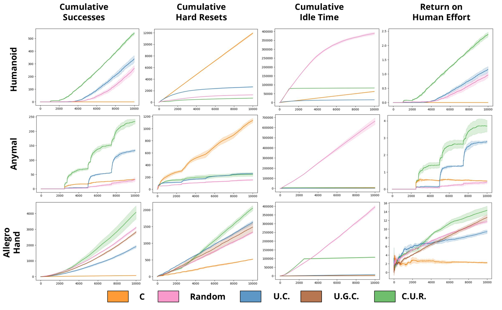{width="100%"}

::: tiny-font
Isaac Gym, $N = 100$ robots, $M = 10$ algorithmic (PPO) supervisors, $T = 10{,}000$ steps
:::

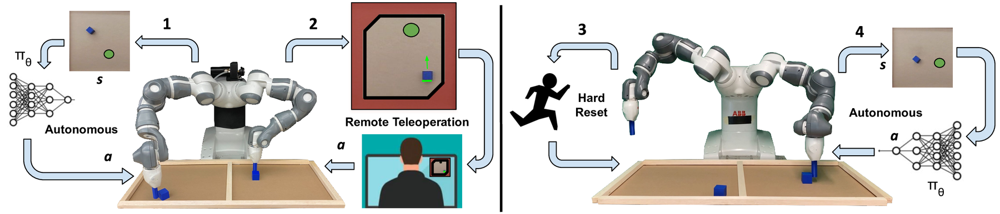{width="100%"}

::: tiny-font
Physical: 4 ABB YuMi arms pushing blocks, 2 remote humans
:::
:::

::: {.column width="45%"}
::: medium
-   **Allocation matters**: the choice of $\hat{p}$ changes every metric in every environment

-   C.U.R. has the most successes and highest ROHE everywhere. ROHE **grows** over time: the fleet learns when to stop asking for help.

-   On real robots, C.U.R. wins **by a small margin**. Real humans are **multimodal**, so high uncertainty does not mean help is needed.

-   **Limitations**: interchangeable humans, independent robots, instant switching between robots. In simulation, the "humans" are RL policies.

-   Unlike shared autonomy, control is **all-or-nothing**: fully teleoperated or fully autonomous
:::
:::
::::::

## References

-   Hoque, R., Chen, L. Y., Sharma, S., Dharmarajan, K., Thananjeyan, B., Abbeel, P., & Goldberg, K. (2022). Fleet-DAgger: Interactive robot fleet learning with scalable human supervision. CoRL.

-   Hoque, R., Balakrishna, A., Novoseller, E., Wilcox, A., Brown, D. S., & Goldberg, K. (2021). ThriftyDAgger: Budget-aware novelty and risk gating for interactive imitation learning. CoRL.

-   Menda, K., Driggs-Campbell, K., & Kochenderfer, M. J. (2019). EnsembleDAgger: A Bayesian approach to safe imitation learning. IROS.

-   Swamy, G., Reddy, S., Levine, S., & Dragan, A. D. (2020). Scaled autonomy: Enabling human operators to control robot fleets. ICRA.

-   Code: <https://github.com/BerkeleyAutomation/ifl_benchmark>

## Synthesis {.center}

## What does each method assume?

-   **Javdani et al. 2015 (hindsight optimization)**: model-based. Known dynamics, a known discrete goal set, a MaxEnt user model, and hand-designed costs. Assists for the **whole distribution** over goals.

-   **Reddy et al. 2018 (deep RL)**: model-free. No dynamics, goal set, or user model. Needs a reward signal and **simulator pretraining**. The user’s input is an observation and a prior policy.

-   **Losey et al. 2020 (latent actions)**: no goal set and no goal inference. Instead it **learns the control interface** from demonstrations, so the user stays in charge of both the goal and the style of motion.

-   **Rakita et al. 2018 (RelaxedIK)**: a low-level enabler that turns human-specified end-effector goals into **feasible** joint motion in real time.

-   **Hoque et al. 2022 (Fleet-DAgger)**: the robot decides when it needs help, and the human takes **full control** or resets it. Assumes interchangeable humans and independent robots. Turns that help into imitation data for the whole fleet.

## A recurring theme: performance $\neq$ preference

-   **Javdani et al.**: users were faster with the policy, but felt less in control and leaned toward predict-then-blend

-   **Reddy et al.**: users found the copilot helpful but somewhat inconsistent and overly aggressive

-   **Losey et al.**: users found latent actions easier, but enjoyed the freedom of end-effector control

The amount of **control authority** the user keeps is a design variable in its own right, not just a side effect of the assistance algorithm.

## Discussion questions

-   How should a system trade off task efficiency against the user’s sense of control? Should the user choose (e.g., $\alpha$ in Reddy et al.)?

-   Which assumptions are acceptable in assistive settings: a known goal set, a user model, a simulator, task demonstrations?

-   How do we evaluate these systems convincingly with small user studies ($n = 4$ to $12$), and users who adapt to the robot over time?
