## Today’s Agenda

-   Representation Learning for Imitation

    -   Is it better to separate representation learning from policy learning?
    -   Pretraining representations for data-efficient RL
    -   Does representation learning make multitask RL scale?

-   Provable generalization

    -   PAC-Bayes generalization bounds

-   Robustness and safety

    -   Robustness as stability

## Why separate representation learning from policy learning?

::: {.small-math .arrow-bullets}
▶ End-to-end behavioral cloning from pixels learns the visual features *and* the mapping to actions at the same time, from the same few demonstrations. The image encoder can easily overfit to nuisance factors: lighting, background, distractors, the particular object instance.

▶ Alternative: factor the policy as $\pi = g \circ \phi$

-   $\phi$: maps observations to a compact representation. Trained on cheap data **without action labels** (multi-view images, offline video, data from other tasks).
-   $g$: a small policy head, trained by behavioral cloning on the demonstrations.

::: fragment
▶ Why it can help: $g$ comes from a much smaller hypothesis class than the full image-to-action network, so it needs fewer demonstrations. The same $\phi$ can be reused across tasks.

▶ There's a risk that frozen $\phi$ trained on a different objective may discard information the task needs (precise pose, contact state, small objects).
:::
:::

## Representation learning for control: dynamics-centric families

::: rep-table
| Family | Data needed | Advantages | Disadvantages |
|---|---|---|---|
| **Predictive state representations** (PSRs), observable operator models [Littman, Sutton, Singh 2002; spectral PSRs, Boots et al. 2011]{.grey-text} | Action-observation sequences, no rewards | State = predictions of future observable events, so no hidden state to identify. Spectral learning is consistent. | Hard to scale to pixels. Assumes low-rank, linear-operator structure. |
| **Koopman operators**, linear latent dynamics [Embed to Control, Watter et al. 2015; Deep Koopman, Lusch et al. 2018]{.grey-text} | State or observation trajectories with actions | Dynamics are linear in the lifted space, so LQR, MPC and spectral analysis become easy. | A finite-dimensional lift is only approximate. Control inputs and contact break linearity. Choosing the lift is hard. |
| **Reconstruction-based**: autoencoders, VAEs, world models [Deep spatial autoencoders, Finn et al. 2016; World Models, Ha & Schmidhuber 2018; PlaNet, Dreamer]{.grey-text} | Unlabeled images. World models also need actions, and rewards for planning. | No labels, dense learning signal. Enables planning in latent space. | Capacity goes to task-irrelevant pixels (background, texture). Small but crucial objects get ignored. Decoders are expensive. |
| **Control-aware objectives**: inverse dynamics, bisimulation, latent self-prediction [Agrawal et al. 2016; ICM, Pathak et al. 2017; DBC, Zhang et al. 2021; SPR, SGI, MR.Q]{.grey-text} | Trajectories with actions. Rewards for bisimulation and value-based objectives. | Keeps what matters for control, ignores the rest. | Needs action or reward labels, can be task-specific. Latent prediction can collapse without a target network. |
:::

::: {.tiny-font .absolute bottom="0" left="0"}
[State Representation Learning for Control: An Overview.]{.red} Lesort, Díaz-Rodríguez, Goudou, Filliat. Neural Networks 2018
:::

## Representation learning for control: self-supervised visual families

::: rep-table
| Family | Data needed | Advantages | Disadvantages |
|---|---|---|---|
| **Contrastive** [CPC; TCN; CURL; R3M]{.grey-text} | Unlabeled images or video, plus augmentations or temporal pairs | No decoder, scales well. | Needs negatives or large batches. Augmentations may remove control-relevant detail. |
| **Non-contrastive, invariance-based** [BYOL; SimSiam; DINO; VICReg]{.grey-text} | Unlabeled images, plus hand-crafted augmentations | No negatives, no decoder. Two augmented views must share an embedding. | Needs anti-collapse tricks (EMA, stop-gradient). Inherits augmentation biases, e.g. invariance to position. |
| **Non-contrastive, predictive (JEPA)** [I-JEPA; V-JEPA; V-JEPA 2]{.grey-text} | Unlabeled images or video, masked instead of augmented | Predicts masked or future embeddings, keeping spatial and temporal structure. V-JEPA 2 plans in this latent space. | Needs anti-collapse tricks (EMA). Sensitive to masking design. Expensive pretraining. |
| **Dense correspondence, keypoints** [Dense Object Nets; Transporter nets]{.grey-text} | Multi-view RGB-D with camera poses, or video | Geometric, object-centric. Generalizes across object instances. | Needs 3D reconstruction or calibration. Often per object class. Struggles with deformables. |
| **Pretrained visual foundation models** [MVP; R3M; VIP; VC-1; DINOv2]{.grey-text} | Internet-scale images or egocentric video, sometimes language | Off-the-shelf, broad coverage. Data-efficient downstream BC. | Domain gap to robot views. May miss fine control detail. Gains don't always transfer to real robots. |
:::

::: {.tiny-font .absolute bottom="0" left="0"}
[State Representation Learning for Control: An Overview.]{.red} Lesort, Díaz-Rodríguez, Goudou, Filliat. Neural Networks 2018
:::

## Learning dense representations for manipulation



::: {.tiny-font .absolute bottom="0" left="0"}
[Dense Object Nets: Learning Dense Visual Object Descriptors By and For Robotic Manipulation.]{.red} Florence, Manuelli, Tedrake. 2018
:::

## How Dense Object Nets are trained

::: {.small-math .arrow-bullets}
▶ A fully convolutional network maps an RGB image $I \in \mathbb{R}^{W \times H \times 3}$ to a descriptor image $f(I) \in \mathbb{R}^{W \times H \times D}$: every pixel gets a $D$-dimensional descriptor ($D$ is small, e.g. 3).

▶ **Labels for free:** a wrist-mounted RGB-D camera scans a static scene. 3D reconstruction plus the known camera poses (from the arm's forward kinematics) tell us, for a pixel $u_a$ in image $I_a$, which pixel $u_b$ in image $I_b$ sees the same 3D point. No human annotation.

▶ **Pixelwise contrastive loss**, with descriptor distance $D(I_a, u_a, I_b, u_b) = \|f(I_a)(u_a) - f(I_b)(u_b)\|_2$:

$$
\mathcal{L}_{\text{matches}} = \frac{1}{N_{\text{matches}}} \sum_{\text{matches}} D^2,
\qquad
\mathcal{L}_{\text{non-matches}} = \frac{1}{N_{\text{hard-negatives}}} \sum_{\text{non-matches}} \max(0,\, M - D)^2
$$

Pull corresponding pixels together, push non-corresponding ones at least a margin $M$ apart. Normalizing by the number of *hard* negatives (those with $M - D > 0$) keeps the gradient from vanishing once most non-matches are easy.

▶ **What a manipulator gets:** click a point on a reference image ("the mug handle"), find the pixel with the nearest descriptor in a new image, and grasp the same semantic point under new poses, deformations and, with class-level training, new object instances.
:::

## From dense descriptors to keypoints

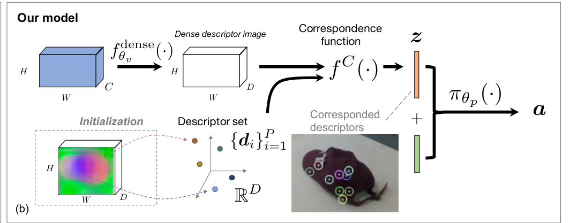{.nostretch fig-align="center" width="72%"}

::: {.small-math .arrow-bullets}
▶ Pretrain the dense descriptor network $f^{\text{dense}}_{\theta_v}$ with the self-supervised correspondence loss on the task's objects.

▶ Choose a set of $P$ reference descriptors $\{d_i\}_{i=1}^P$, e.g. sampled from a masked reference image. A correspondence function $f^C$ finds where each $d_i$ appears in the current image:

$$
z = f^C\big(f^{\text{dense}}_{\theta_v}(o_{\text{image}}),\, \{d_i\}_{i=1}^P\big) \in \mathbb{R}^{P \times K}
$$

▶ $z$ holds the pixel coordinates ($K = 2$) or 3D positions ($K = 3$) of the $P$ tracked points: a learned, object-centric keypoint representation.
:::

::: {.tiny-font .absolute bottom="0" left="0"}
[Self-Supervised Correspondence in Visuomotor Policy Learning.]{.red} Florence, Manuelli, Tedrake. RA-L 2020
:::

## From keypoints to a visuomotor policy

::: {.small-math .arrow-bullets}
▶ The keypoints $z$ are concatenated with the robot state $o_{\text{robot}}$ and fed to a small policy network:

$$
a = \pi_{\theta_p}(z,\, o_{\text{robot}})
$$

▶ What gets trained by behavioral cloning:

-   **Fixed descriptor set:** only the policy $\theta_p$.
-   **Descriptor set optimization:** $\theta_p$ and $\{d_i\}$, i.e. the policy also chooses *which* points to track.
-   **End-to-end:** also $\theta_v$. In the paper this gave no advantage over keeping the descriptor network fixed.

▶ Result: real-robot policies from as few as 50 demonstrations that generalize across object instances, handle deformable and textureless objects, and in simulation are more sample efficient than autoencoder or end-to-end visual training.
:::

::: {.tiny-font .absolute bottom="0" left="0"}
[Self-Supervised Correspondence in Visuomotor Policy Learning.]{.red} Florence, Manuelli, Tedrake. RA-L 2020
:::

## Another example of policy learning on pretrained representations



::: {.tiny-font .absolute bottom="0" left="0"}
[The Surprising Effectiveness of Representation Learning for Visual Imitation.]{.red} Pari, Shafiullah, Arunachalam, Pinto. RSS 2022
:::

## BYOL: Bootstrap Your Own Latent

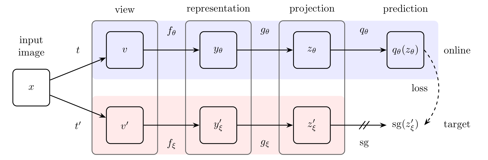{.nostretch fig-align="center" width="560"}

::: {.small-math .arrow-bullets}
▶ Two random augmentations (crop, color jitter, blur, ...) of an image $x$ give views $v$ and $v'$. The **online** network $\theta$ has an encoder $f_\theta$, a projector $g_\theta$ and a predictor $q_\theta$. The **target** network $\xi$ has the same encoder and projector, but no predictor.

▶ The online network predicts the target's projection of the *other* view, with both vectors $\ell_2$-normalized (bars). The loss is symmetrized by swapping $v$ and $v'$:

$$
\mathcal{L}_{\theta, \xi} = \big\| \bar q_\theta(z_\theta) - \bar z'_\xi \big\|_2^2,
\qquad
\xi \leftarrow \tau \xi + (1 - \tau)\, \theta
$$

▶ Gradients only update $\theta$ (stop-gradient "sg"). The target is an exponential moving average of the online network.

▶ **No negative pairs**, unlike contrastive methods such as SimCLR. A constant representation would minimize the loss, but empirically the predictor and the slowly moving target prevent this collapse. After training, only $f_\theta$ is kept: $y_\theta$ is VINN's $\phi$.
:::

::: {.tiny-font .absolute bottom="0" left="0"}
[Bootstrap Your Own Latent: A New Approach to Self-Supervised Learning.]{.red} Grill et al. NeurIPS 2020
:::

## VINN: a self-supervised encoder plus nearest neighbors

::: {.small-math .arrow-bullets}
▶ **VINN** = **V**isual **I**mitation through **N**earest **N**eighbors.

▶ **Stage 1, representation:** train an encoder $e = \phi(o)$ on all offline frames with BYOL. Two random augmentations of the same image must map to the same embedding. No actions and no negative pairs are needed.

▶ **Stage 2, behavior:** no policy network at all. Store the embedded demonstrations $\{(e^{(i)}, a^{(i)})\}$. At test time, embed the current observation, find its $k$ nearest neighbors, and average their actions, weighted by a softmin over distances (locally weighted regression):

$$
\hat a = \frac{\sum_{i=1}^{k} \exp\big(-\|e - e^{(i)}\|_2\big)\, a^{(i)}}{\sum_{i=1}^{k} \exp\big(-\|e - e^{(i)}\|_2\big)}
$$

▶ Assumption: observations that are close in the learned embedding call for similar actions. 

▶ This simple decoupling matches or beats parametric behavioral cloning on offline datasets and real-robot door opening.
:::

::: {.tiny-font .absolute bottom="0" left="0"}
[The Surprising Effectiveness of Representation Learning for Visual Imitation.]{.red} Pari, Shafiullah, Arunachalam, Pinto. RSS 2022
:::

## VINN results: offline datasets

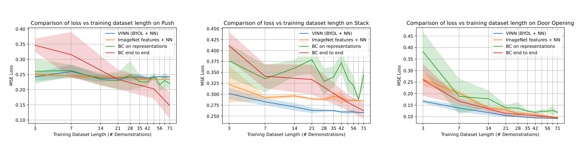{.nostretch fig-align="center" width="100%"}

::: {.small-math .arrow-bullets}
▶ Test MSE of predicted actions vs. number of training demonstrations, on Pushing, Stacking and Door Opening (left to right). The models are trained on subsets of the original dataset.

▶ **With few demonstrations (fewer than about 20), VINN (blue) is best** on Stacking and Door Opening. Behavioral cloning trained end-to-end (red) only catches up, or wins on Pushing, once it has many demonstrations.

:::

::: {.tiny-font .absolute bottom="0" left="0"}
[The Surprising Effectiveness of Representation Learning for Visual Imitation.]{.red} Pari, Shafiullah, Arunachalam, Pinto. RSS 2022
:::

## VINN results: real-robot door opening

::::: columns
::: {.column width="38%"}
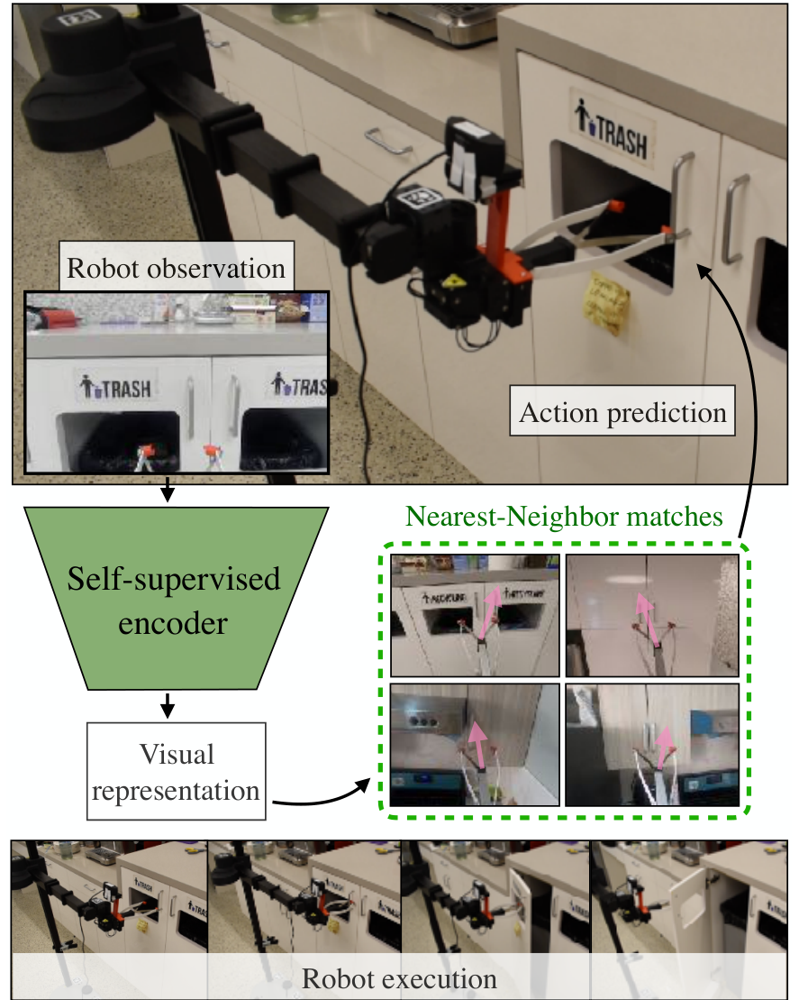{.nostretch fig-align="center" height="460"}
:::

::: {.column .small-math .arrow-bullets width="62%"}
▶ Hello-Robot Stretch opening cabinet doors, 30 trials on three cabinets, from randomized start positions:

| Method | Handle grasped | Door opened |
|---|---|---|
| BC (end-to-end) | 0% | 0% |
| BC on BYOL representations | 56.7% | 53.3% |
| ImageNet features + NN | 20% | 0% |
| VINN (BYOL + NN) | **80%** | **80%** |

▶ Generalization to occlusions (10 trials, one cabinet, door-opening success):

| Modification | BC-rep | VINN |
|---|---|---|
| None | **90%** | 80% |
| Signs and handle covered | 10% | **70%** |
| ... and one bin covered | 0% | **50%** |
| ... and both bins covered | 0% | 0% |

▶ A good offline MSE is not sufficient: ImageNet + NN is close on MSE, but never opens the door.

::: fragment
▶ So empirically, decoupling helps. [Can we show *when* and *why* it helps?]{.red}
:::
:::
:::::

::: {.tiny-font .absolute bottom="0" left="0"}
[The Surprising Effectiveness of Representation Learning for Visual Imitation.]{.red} Pari, Shafiullah, Arunachalam, Pinto. RSS 2022
:::

## Can we show theoretically that representation learning helps?

::: {.small-math .arrow-bullets}
▶ **Tasks** $\mu$: MDPs that share states, actions ($K$ of them) and horizon $H$, but differ in cost and initial state. Each task has an expert $\pi^*_\mu$. We get $n$ expert state-action samples from each of $T$ training tasks.

▶ **Policy class**:

-   Shared representation $\phi \in \Phi$ with $\phi : \mathcal{S} \to \mathbb{R}^d$, $\|\phi(s)\|_2 \le R$. Could be a deep network.
-   Task-specific **linear** head: $\pi_{\phi, W}(a \mid s) = \mathrm{softmax}(W \phi(s))_a$, with $W \in \mathbb{R}^{K \times d}$, $\|W\|_F \le 1$.

▶ **Bi-level optimization**: the outer problem picks the shared representation, the inner problem is ordinary single-task behavioral cloning with $\phi$ frozen:

$$
\hat\phi = \arg\min_{\phi \in \Phi} \; \frac{1}{T} \sum_{t=1}^{T} \; \min_{\pi \in \Pi_\phi} \; \frac{1}{n} \sum_{j=1}^{n} -\log \pi\big(a^t_j \mid s^t_j\big)
$$

▶ Since each head appears in only one task's loss, this is the same as jointly training $\phi$ with $T$ separate heads. The bi-level form is what makes the analysis easier.

▶ **New task (test time):** freeze $\hat\phi$ and solve the same problem as the inner one, i.e. fit only a linear head $\pi_{\hat\phi, x}$, on a dataset $x = \{(s_j, a_j)\}_{j=1}^n$ of expert demonstrations from a new task $\mu$.
:::

::: {.tiny-font .absolute bottom="0" left="0"}
[Provable Representation Learning for Imitation Learning via Bi-level Optimization.]{.red} Arora, Du, Kakade, Luo, Saunshi. ICML 2020
:::

## Representation learning for behavioral cloning: the guarantee

::: {.small-math .arrow-bullets}
▶ **Assumptions:** experts are deterministic. *Realizability:* there is a $\phi^* \in \Phi$ such that every expert $\pi^*_\mu$ is matched with probability at least $1 - \gamma$ by some linear head on top of $\phi^*$ (with $\gamma < 1/2$).

▶ **Theorem.** With probability $1 - \delta$ over the training data, the expected cost $J_\mu$ on a new task satisfies

$$
\mathbb{E}_{\mu}\, \mathbb{E}_{x}\, J_\mu(\pi_{\hat\phi, x}) - \mathbb{E}_{\mu}\, J_\mu(\pi^*_\mu) \;\le\; H^2 \big(2\gamma + \epsilon_{\text{gen}}\big),
\qquad
\epsilon_{\text{gen}} = c\,\frac{G(\Phi(\mathcal{S}))}{T \sqrt{n}} + c'\,\frac{R\sqrt{K}}{\sqrt{n}} + c''\sqrt{\frac{\ln(4/\delta)}{T}}
$$

where $G(\Phi(\mathcal{S}))$ is the Gaussian complexity (how "rich" a function class is) of the representation class on all $nT$ training states.

::: fragment
▶ To get error $H^2 \gamma + \epsilon$ it is enough to have

$$
T = O\!\left(\frac{H^4 R^2 \log|\Phi|}{\epsilon^2}\right) \text{ tasks, and } \;
n = O\!\left(\frac{H^4 R^2 K}{\epsilon^2}\right) \text{ samples per task.}
$$

Learning from scratch on the new task alone needs $n = O\big(H^4 R^2 \max\{\log|\Phi|,\, K\} / \epsilon^2\big)$.
:::
:::

::: {.tiny-font .absolute bottom="0" left="0"}
[Provable Representation Learning for Imitation Learning via Bi-level Optimization.]{.red} Arora, Du, Kakade, Luo, Saunshi. ICML 2020
:::

## Takeaways from the theory

::: {.small-math .arrow-bullets}
▶ The cost of learning a rich representation ($\log|\Phi|$, or its Gaussian complexity) is paid **once, shared across the $T$ tasks**. Each new task only pays for its linear head, i.e. for the number of actions $K$. Representation learning helps when $\log|\Phi| \gg K$.

▶ The $H^2$ factor is the usual compounding-error penalty of behavioral cloning (Ross et al. 2011), the same as in the single-task analysis.

▶ The paper proves a similar result for the **observation-alone** setting (no expert actions; match state-visitation distributions instead), which is harder.

▶ **Caveats:**

-   It needs a single $\phi^*$ that is good for *all* tasks ($\gamma$ small), and new tasks drawn from the same distribution as the training tasks.
-   $\phi$ is learned from the imitation losses of related tasks. The result does not directly certify representations pretrained on unrelated self-supervised objectives (correspondence for Dense Object Nets, BYOL for VINN). For those, the empirical evidence is still ahead of the theory.
:::

## CURL: contrastive learning as an auxiliary task for RL from pixels

::: {.small-math .arrow-bullets}
▶ **Problem:** model-free RL from pixels (e.g. SAC on images) is far less sample efficient than the same algorithm on the true low-dimensional state. Previous fixes add a reconstruction loss (SAC+AE) or learn a latent world model (PlaNet, Dreamer, SLAC).

▶ **CURL's idea:** keep the model-free RL algorithm, and add a **contrastive (InfoNCE) loss on the shared convolutional encoder**, trained jointly with the RL loss on the same replay batches. SAC is used on DeepMind Control, data-efficient Rainbow on Atari. The two losses have equal weight, with no extra tuning.
:::

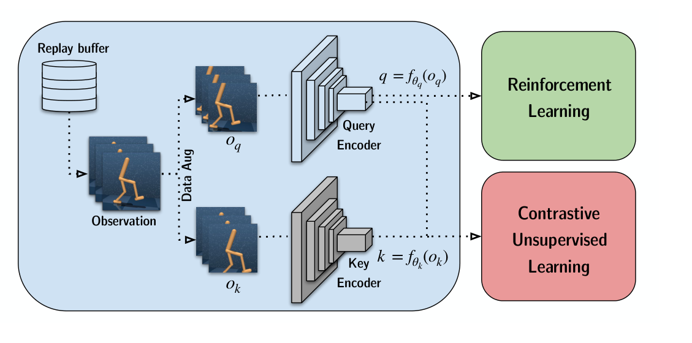{.nostretch fig-align="center" width="620"}

::: {.tiny-font .absolute bottom="0" left="0"}
[CURL: Contrastive Unsupervised Representations for Reinforcement Learning.]{.red} Srinivas, Laskin, Abbeel. ICML 2020
:::

## The CURL objective

::::: columns
::: {.column .small-math .arrow-bullets width="60%"}
▶ **Positive pair:** two random $84\times 84$ crops $o_q, o_k$ of the same $100\times 100$ frame stack. The same crop is applied to every frame of the stack, so the jitter is consistent over time and motion is preserved.

▶ **Momentum key encoder** (as in MoCo): $\theta_k \leftarrow m\,\theta_k + (1-m)\,\theta_q$, with a stop-gradient on $k = f_{\theta_k}(o_k)$.

▶ **Bilinear similarity** $q^\top W k$ with learned $W$, and the InfoNCE loss
$$
\mathcal{L}_q = -\log \frac{\exp(q^\top W k_+)}{\exp(q^\top W k_+) + \sum_{i} \exp(q^\top W k_i)}
$$

▶ The negatives $k_i$ are the keys of the *other* observations in the minibatch, so the loss is a cross-entropy over a $B \times B$ matrix of logits. There is no memory bank.

▶ This is the *contrastive* family from the taxonomy: random crop decides which invariance is learned.
:::

::: {.column width="40%"}
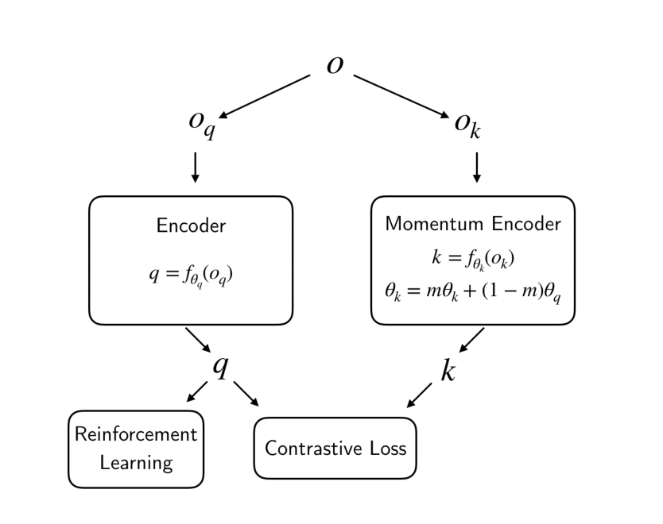{.nostretch fig-align="center" width="90%"}

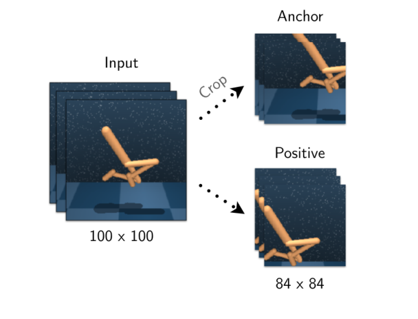{.nostretch fig-align="center" width="60%"}
:::
:::::

::: {.tiny-font .absolute bottom="0" left="0"}
[CURL: Contrastive Unsupervised Representations for Reinforcement Learning.]{.red} Srinivas, Laskin, Abbeel. ICML 2020
:::

## CURL results: DeepMind Control and Atari 100k

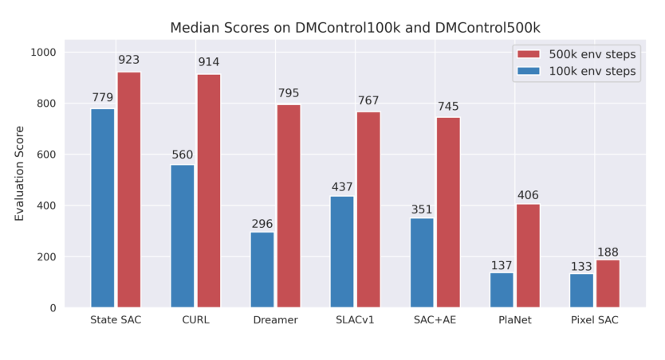{.nostretch fig-align="center" width="560"}

::: {.small-math .arrow-bullets}
▶ **DeepMind Control (6 tasks):** at 100k steps, CURL's median score is 1.9x Dreamer's, and Dreamer needs 4.5x more steps to reach it. At 500k steps, CURL matches the median score of SAC trained on the true state.

▶ **Atari 100k (26 games):** median human-normalized score of 17.5%, against 16.1% for data-efficient Rainbow and 14.4% for SimPLe (model-based). CURL improves on Rainbow in 19 of 26 games, but its *mean* score is below SimPLe's (38.1% vs. 44.3%).
:::

::: {.tiny-font .absolute bottom="0" left="0"}
[CURL: Contrastive Unsupervised Representations for Reinforcement Learning.]{.red} Srinivas, Laskin, Abbeel. ICML 2020
:::

## What matters in CURL: the ablations

::: {.small-math .arrow-bullets}
▶ **Frame stacks, not single frames:** contrasting whole stacks (spatial *and* temporal) beats contrasting single frames, except on reacher and ball-in-cup, where a single image is enough to solve the task.

▶ **Reward-free features:** if critic gradients are stopped before the CNN, so that the encoder is trained *only* by the contrastive loss, learning is still near optimal on most tasks. The exception is cheetah.

▶ **The contrastive loss alone helps:** augmenting only the contrastive branch, and feeding un-augmented images to SAC, still improves pixel SAC by about 2x (mean). Augmenting SAC's inputs too helps further.

▶ **Design choices:** a momentum key encoder beats sharing the query encoder, and bilinear similarity beats cosine similarity.

▶ **The remaining gap to state SAC** tracks how well the true state can be regressed from a stack of 3 frames. When the pixels don't contain the state, no representation can fix it.
:::

::: {.tiny-font .absolute bottom="0" left="0"}
[CURL: Contrastive Unsupervised Representations for Reinforcement Learning.]{.red} Srinivas, Laskin, Abbeel. ICML 2020
:::

## CURL in hindsight: augmentation vs. contrastive loss

::: {.small-math .arrow-bullets}
▶ A few weeks later, **RAD** (Laskin et al. 2020) and **DrQ** (Kostrikov et al. 2020) fed the random crops *directly* to the RL losses, with no contrastive term, and beat CURL on both DeepMind Control and Atari. Much of CURL's gain came from the augmentation itself.

▶ **The authors' response:** with a dense reward, optimizing the RL objective on augmented data directly is better. Without rewards, or to learn one task-agnostic representation for many tasks, you need a reward-free objective like CURL's.

▶ **Links to today's lecture:**

-   Like the Arora et al. analysis, the payoff of a reward-free representation is largest when it is *shared* across tasks.
-   The crop-based invariance is exactly the "augmentation bias" listed in the taxonomy table.

:::

::: {.tiny-font .absolute bottom="0" left="0"}
[CURL: Contrastive Unsupervised Representations for Reinforcement Learning.]{.red} Srinivas, Laskin, Abbeel. ICML 2020
:::

## SPR: Self-Predictive Representations

::: {.small-math .arrow-bullets}
▶ **Idea:** make the representation *temporally predictive*. From $z_t = f_o(s_t)$ and the actions actually taken, predict the agent's **own future latent states** $K$ steps ahead. Everything happens in latent space: no pixel reconstruction, and no negative pairs.

▶ **Setting:** an auxiliary loss on top of data-efficient Rainbow, trained online on Atari 100k, as for CURL. CURL asks for invariance *within* one frame stack. SPR asks for predictability *across time*, given the actions.
:::

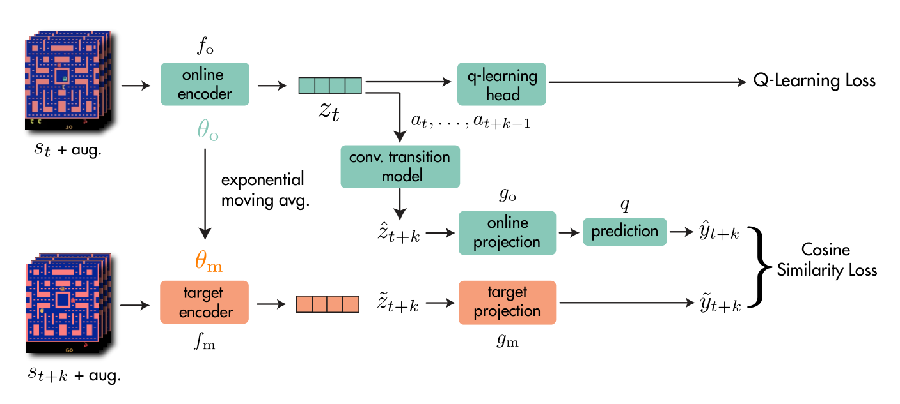{.nostretch fig-align="center" width="720"}

::: {.tiny-font .absolute bottom="0" left="0"}
[Data-Efficient Reinforcement Learning with Self-Predictive Representations.]{.red} Schwarzer, Anand, Goel, Hjelm, Courville, Bachman. ICLR 2021
:::

## The SPR objective

::: {.small-math .arrow-bullets}
▶ **Transition model:** $\hat z_{t+k+1} = h(\hat z_{t+k}, a_{t+k})$ for $k = 0, \dots, K-1$, starting from $\hat z_t = z_t$. $h$ is a small convolutional network on the $64\times 7\times 7$ feature map, with the action appended as a one-hot input, rolled out for $K = 5$ steps.

▶ **Targets:** $\tilde z_{t+k} = f_m(s_{t+k})$, from a target encoder whose weights are an exponential moving average (EMA) of the online ones, $\theta_m \leftarrow \tau\,\theta_m + (1-\tau)\,\theta_o$. No gradients flow into it.

▶ **Projections, as in BYOL:** $\hat y_{t+k} = q\big(g_o(\hat z_{t+k})\big)$ and $\tilde y_{t+k} = g_m(\tilde z_{t+k})$. The loss is a negative cosine similarity, added to the Q-learning loss:
$$
\mathcal L^{\text{SPR}} = -\sum_{k=1}^{K} \frac{\tilde y_{t+k}^\top\, \hat y_{t+k}}{\|\tilde y_{t+k}\|_2\, \|\hat y_{t+k}\|_2},
\qquad
\mathcal L = \mathcal L^{\text{RL}} + \lambda\, \mathcal L^{\text{SPR}}, \quad \lambda = 2
$$

▶ **Augmentation** (DrQ-style random shifts and color jitter) is applied independently to every observation, so SPR also enforces consistency across views. 

▶ With $K = 0$ (no dynamics), SPR reduces to BYOL used as an auxiliary loss.
:::

::: {.tiny-font .absolute bottom="0" left="0"}
[Data-Efficient Reinforcement Learning with Self-Predictive Representations.]{.red} Schwarzer, Anand, Goel, Hjelm, Courville, Bachman. ICLR 2021
:::

## SPR results on Atari 100k

::::: columns
::: {.column .small-math .win-rows width="48%"}
| Method | Mean HNS | Median HNS | Superhuman games |
|---|---|---|---|
| SimPLe | 0.443 | 0.144 | 2 |
| DER | 0.285 | 0.161 | 2 |
| CURL | 0.381 | 0.175 | 2 |
| DrQ | 0.357 | 0.268 | 2 |
| SPR (no aug.) | 0.463 | 0.307 | 5 |
| SPR | **0.704** | **0.415** | **7** |
:::

::: {.column .small-math .arrow-bullets width="52%"}
▶ Human-normalized score: $\text{HNS} = \frac{\text{agent} - \text{random}}{\text{human} - \text{random}}$, averaged over 26 games with 100k interaction steps each, about 2 hours of play.

▶ The median is **55% above the previous best** (DrQ), and SPR beats DrQ on 23 of 26 games. Even without augmentation, SPR beats every prior method.

▶ **Evaluation caveat:** the median HNS depends on a handful of games. The authors also report DQN-normalized scores, and evaluate over 100 episodes and 10 seeds.
:::
:::::

::: {.tiny-font .absolute bottom="0" left="0"}
[Data-Efficient Reinforcement Learning with Self-Predictive Representations.]{.red} Schwarzer, Anand, Goel, Hjelm, Courville, Bachman. ICLR 2021
:::

## What matters in SPR: the ablations

::::: columns
::: {.column .small-math .win-rows width="42%"}
| Variant (all with aug.) | Median HNS |
|---|---|
| SPR | **0.415** |
| 1-step SPR | 0.301 |
| Non-temporal SPR (BYOL-like) | 0.271 |
| SPR without projections | 0.171 |
| Quadratic (unnormalized L2) loss | 0.040 |
| Rainbow (controlled) | 0.346 |

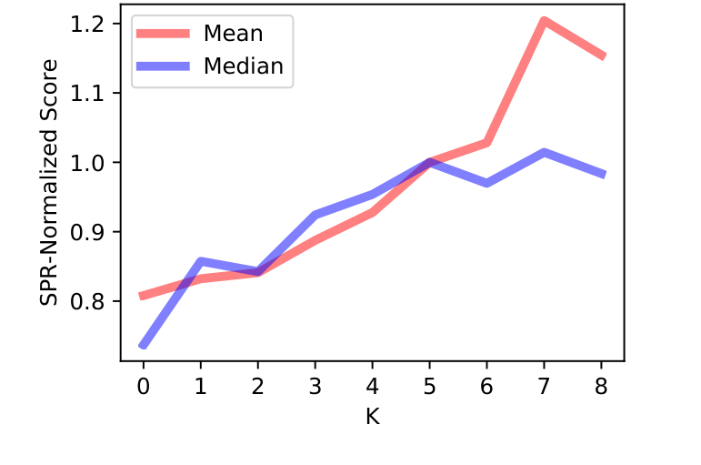{.nostretch fig-align="center" width="78%"}
:::

::: {.column .small-math .arrow-bullets width="58%"}
▶ **Dynamics modeling is key:** performance grows with the prediction depth $K$ up to about 5 (plot, normalized to SPR's score).

▶ **Avoiding collapse:** with an unnormalized L2 loss the representation collapses, as in DeepMDP. Using the online encoder as target, without a stop-gradient, drops the median to 0.278. The authors hypothesize that the RL loss also counters collapse, which would explain why $\tau = 0$ works here but not in BYOL.

▶ **Projections matter:** they let the loss shape most of the network, not just the 80k-parameter conv encoder.

▶ SPR beats both temporal and non-temporal contrastive variants, including CURL.

::: fragment
▶ **Future work in the paper:** apply SPR to unlabeled data from many MDPs. That's what SGI does next.
:::
:::
:::::

::: {.tiny-font .absolute bottom="0" left="0"}
[Data-Efficient Reinforcement Learning with Self-Predictive Representations.]{.red} Schwarzer, Anand, Goel, Hjelm, Courville, Bachman. ICLR 2021
:::

## Pretraining representations for data-efficient RL

::: {.small-math .arrow-bullets}
▶ **From CURL and SPR:** both add reward-free losses *during* RL, but the encoder still starts **tabula rasa** on every task. It overfits, and it is far less sample efficient than humans, who bring visual and dynamics priors. Can the same kind of objectives **pretrain** the encoder instead?

▶ One fix is unsupervised *exploration* pretraining (APT, VISR, CPT), but it needs 250M to 4B environment steps, i.e. months to years of real-time experience.

▶ **SGI's idea:** pretrain the encoder **offline and without rewards**, on a small dataset of arbitrary quality (random, exploratory, or logs from earlier agents), and then fine-tune it with RL on the task.

▶ **Benchmark:** the same as for CURL and SPR, Atari 100k with the median human-normalized score.

▶ **Questions a good representation should answer**, none of which involve reward or a particular policy:

-   If I take action $a$ in state $s$, which state $s'$ comes next? (forward dynamics: **S**, i.e. SPR)
-   If I went from $s$ to $s'$, which action $a$ did I take? (inverse dynamics: **I**)
-   Which action takes me from $s$ to another state $s'$ as soon as possible? (goal-conditioned RL: **G**)
:::

::: {.tiny-font .absolute bottom="0" left="0"}
[Pretraining Representations for Data-Efficient Reinforcement Learning.]{.red} Schwarzer, Rajkumar, Noukhovitch, Anand, Charlin, Hjelm, Bachman, Courville. NeurIPS 2021
:::

## SGI = SPR + Goal-conditioned RL + Inverse dynamics

::: {.small-math .arrow-bullets}
▶ All three objectives share one convolutional encoder, $z_t = f_o(s_t)$.

▶ **S: the SPR loss from the previous slides**, i.e. $K$-step latent prediction $\hat z_{t+k+1} = h(\hat z_{t+k}, a_{t+k})$ against an EMA target encoder, with a cosine loss. It is now applied to the offline dataset, with no RL loss alongside it.

▶ **G: goal-conditioned RL.** Learn $Q(s_t, a, g)$ from synthetic rewards for reaching goal $g$. Goals are sampled in hindsight, from future states or other trajectories, plus noise. Structurally this is the same kind of problem as the downstream task: learning to control the environment.

▶ **I: inverse dynamics.** Predict $p(a_{t+k} \mid \hat y_{t+k}, \tilde y_{t+k+1})$ with a two-layer MLP and cross-entropy, reusing SPR's online and target projections. As a classification task, it cannot collapse to a constant representation.

▶ **Pretraining** sums the three losses. **Fine-tuning *is* the SPR agent** (Rainbow plus the SPR loss), initialized from the pretrained weights, with the learning rates of the pretrained encoder and dynamics model reduced by 100x.
:::

::: {.tiny-font .absolute bottom="0" left="0"}
[Pretraining Representations for Data-Efficient Reinforcement Learning.]{.red} Schwarzer, Rajkumar, Noukhovitch, Anand, Charlin, Hjelm, Bachman, Courville. NeurIPS 2021
:::

## SGI results on Atari 100k

::::: columns
::: {.column .small-math .win-rows width="45%"}
| Method | Median HNS | Pretraining data |
|---|---|---|
| *No pretraining* | | |
| SPR (no pretraining) | 0.415 | 0 |
| SGI-None | 0.343 | 0 |
| *Exploration data* | | |
| APT | 0.475 | 250M |
| SGI-E | 0.456 | 6M |
| *Offline data (mixed DQN)* | | |
| ATC-M | 0.204 | 3M |
| BC-M | 0.548 | 3M |
| SGI-M | 0.679 | 3M |
| SGI-M/L | **0.753** | 6M |
:::

::: {.column .small-math .arrow-bullets width="55%"}
▶ **Versus SPR alone (0.415):** offline pretraining on 3M steps of mixed data lifts the median to 0.679. SGI-None (0.343) is SGI's setup without pretraining, so the gain comes from pretraining. SGI-M/L (a large ResNet, 6M steps) approaches human-level data efficiency.

▶ SGI matches exploration-based pretraining with roughly 40x less data, and beats the contrastive pretraining baseline ATC on the same data.

▶ **Data quality matters, but expert data is not required.** Gains grow from random, to exploratory, to weak, to mixed DQN data, with diminishing returns. This is unlike imitation, where data quality is everything.

▶ **Pretraining unlocks bigger networks.** The small Nature CNN barely benefits from pretraining. Large ResNets struggle when trained from scratch, but shine once pretrained.
:::
:::::

::: {.tiny-font .absolute bottom="0" left="0"}
[Pretraining Representations for Data-Efficient Reinforcement Learning.]{.red} Schwarzer, Rajkumar, Noukhovitch, Anand, Charlin, Hjelm, Bachman, Courville. NeurIPS 2021
:::

## What matters in SGI: the ablations

::::: columns
::: {.column .small-math .win-rows width="40%"}
| Pretraining objectives | Median HNS |
|---|---|
| None | 0.343 |
| S | 0.009 |
| G | 0.060 |
| I | 0.411 |
| S+G | 0.029 |
| G+I | 0.512 |
| S+I | 0.629 |
| S+G+I | **0.679** |

| Fine-tuning scheme | Median HNS |
|---|---|
| Naive (free weights) | 0.429 |
| Frozen encoder | 0.499 |
| Reduced LRs | **0.679** |
:::

::: {.column .small-math .arrow-bullets width="60%"}
▶ **Combining objectives helps:** performance increases as objectives are added. No single objective covers the MDP.

▶ **Inverse dynamics is critical.** Without it (S, G, S+G), the representations *collapse*: the cosine similarity between representations of different states approaches 1. S alone collapses offline (0.009), although SPR did not collapse online. The SPR paper credits the RL loss partly for that, and offline there is no RL loss, so inverse dynamics, a classification task, has to play that role. Curiously, adding SPR still pulls representations towards collapse, yet improves fine-tuning. Why is an open question.

▶ **Fine-tuning must be gentle.** Letting the pretrained weights change freely is better than no pretraining, but worse than freezing them. Early RL gradients overwrite the pretrained features, similar to catastrophic forgetting. Small learning rates on the pretrained parts work best.

▶ **Auxiliary losses during fine-tuning:** keeping SPR raises the median from 0.452 to 0.679, consistent with SPR's own online gains. Using all three losses during fine-tuning gives no further benefit.
:::
:::::

::: {.tiny-font .absolute bottom="0" left="0"}
[Pretraining Representations for Data-Efficient Reinforcement Learning.]{.red} Schwarzer, Rajkumar, Noukhovitch, Anand, Charlin, Hjelm, Bachman, Courville. NeurIPS 2021
:::

## SGI: takeaways and links to today's lecture

::: {.small-math .arrow-bullets}
▶ **CURL, then SPR, then SGI:** first augmentation-invariant contrastive learning, then latent temporal prediction without negatives, then the same predictive objectives used for offline, reward-free pretraining.

▶ **The same recipe as VINN and Florence et al.:** a reward-free representation learned from cheap data, followed by a small amount of task-specific learning. Here the second stage is RL, not behavioral cloning.

▶ **Versus imitation:** behavioral cloning pretraining on the same mixed data (BC-M, then fine-tuned) is a strong baseline, but loses to SGI. Reward-free dynamics objectives extract more from non-expert data than copying its actions does.

▶ **Versus MR.Q (next):** in both, predictive dynamics objectives shape the encoder. SGI pretrains *offline* and fine-tunes *per task*. MR.Q trains *online and jointly* across hundreds of tasks.

▶ **Caveats:**

-   Discrete-action Atari only.
-   Fine-tuning hyperparameters are delicate: with naive fine-tuning, most of the gain disappears.
-   The relationship between representation collapse, diversity and downstream performance is not understood. ATC's representations are more diverse than SGI's, but perform worse.
:::

::: {.tiny-font .absolute bottom="0" left="0"}
[Pretraining Representations for Data-Efficient Reinforcement Learning.]{.red} Schwarzer, Rajkumar, Noukhovitch, Anand, Charlin, Hjelm, Bachman, Courville. NeurIPS 2021
:::

## Multitask RL: is it the world model or the representation?

::: {.small-math .arrow-bullets}
▶ **Multitask RL:** tasks $\tau \sim p(\tau)$ share the action space (and typically the state space), but differ in dynamics $T_\tau$ and rewards $R_\tau$. A *single* policy $\pi(a \mid s, \tau)$, conditioned on a language embedding $e(\tau)$ of the task, maximizes $\mathbb{E}_{\tau \sim p(\tau)}\, \mathbb{E}_\pi \big[\sum_t \gamma^t r_t\big]$.

▶ **Why it is hard:** the data mixture is non-stationary, tasks interfere through the shared parameters, and gradients from different tasks may conflict. On top of that, RL has bootstrapped targets, which lead to representation collapse and loss of plasticity.

▶ The strongest multitask agents are **world-model** methods (Dreamer, TD-MPC2, Newt). They bundle two things:

-   *predictive latent learning*: predict future latents, rewards and values,
-   *planning*: optimize actions over imagined rollouts.

Which of the two produces the gains?

::: fragment
▶ **Hypothesis:** mostly the representation that the predictive objectives induce, not the planning.

▶ **Pilot evidence (single task):** making plain PPO bigger does not help on HalfCheetah or Humanoid, and can even hurt. PPO with model-based representations is better at every network size: predictive supervision lets larger networks use their capacity.
:::
:::

::: {.tiny-font .absolute bottom="0" left="0"}
[Representation Learning Enables Scalable Multitask Deep Reinforcement Learning.]{.red} Obando-Ceron, Li, Fujimoto, Bacon, Courville, Castro. arXiv 2026
:::

## Pilot: scaling PPO with and without predictive representations

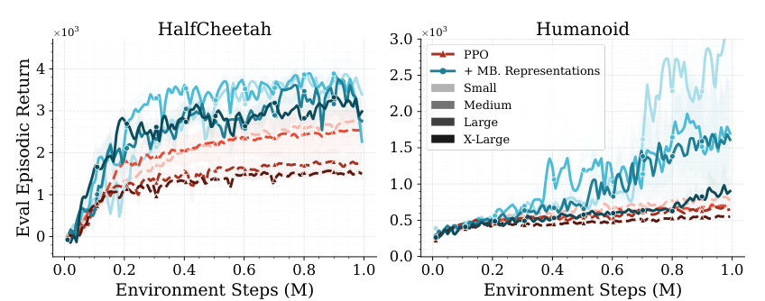{.nostretch fig-align="center" width="80%"}

::: {.small-math .arrow-bullets}
▶ Plain PPO (red, dashed) gets *worse* as the network grows from Small to X-Large. PPO with model-based representations (blue) is better at every size, and on Humanoid the gap widens with scale.
:::

::: {.tiny-font .absolute bottom="0" left="0"}
[Representation Learning Enables Scalable Multitask Deep Reinforcement Learning.]{.red} Obando-Ceron, Li, Fujimoto, Bacon, Courville, Castro. arXiv 2026
:::

## MR.Q: predictive objectives without planning

::: {.small-math .arrow-bullets}
▶ **Model-free actor-critic in a learned latent space** (TD3-style):

$$
z_t = \phi_\xi(s_t, \tau), \qquad \text{actor } \pi_\psi(a \mid z_t), \qquad \text{twin critics } Q_{\theta_1}(z_t, a),\; Q_{\theta_2}(z_t, a)
$$

The critics are trained by temporal-difference learning against slowly updated target networks, and the actor maximizes the critics' estimates.

▶ **Auxiliary predictive heads** predict the next latent, the reward and the termination flag from $(z_t, a_t)$:

$$
(z_t, a_t) \mapsto (\hat z_{t+1},\, \hat r_t,\, \hat d_t),
\qquad
\mathcal{L}_{\text{MR.Q}} = \mathcal{L}_{\text{TD}} + \lambda\, \mathcal{L}_{\text{predictive}}
$$

Their gradients flow back into the encoder $\phi_\xi$. That is the *only* use of the model.

▶ **Contrast with TD-MPC2 and Newt:** similar latent prediction losses, but the model is also used for MPC over imagined trajectories at decision time, $\max_{a_{t:t+H}} \sum_{k=0}^{H} \gamma^k \hat r_{t+k} + \gamma^{H+1} \hat V_{t+H+1}$. 

▶ MR.Q (Fujimoto et al. 2025) was designed for single tasks. This paper evaluates it, unchanged, in the multitask regime.
:::

::: {.tiny-font .absolute bottom="0" left="0"}
[Representation Learning Enables Scalable Multitask Deep Reinforcement Learning.]{.red} Obando-Ceron, Li, Fujimoto, Bacon, Courville, Castro. arXiv 2026
:::

## MR.Q vs. a world model on MMBench

::: {.small-math .arrow-bullets}
▶ **Benchmark:** the language-conditioned MMBench protocol from Newt, spanning 10 domains (DMControl, MetaWorld, ManiSkill, MuJoCo, RoboDesk, OGBench, Box2D, Atari, ...). The main evaluation is at **10M environment steps**, not the usual 100M, so that sample efficiency is visible.

▶ **Across all 10 domains**, MR.Q matches or beats Newt, in both sample efficiency and final score.

▶ **Longer training:** the advantage persists up to 50M steps (DMControl Ext, MetaWorld).

▶ **From pixels** (a frozen DINOv2 encoder feeding the agent): MR.Q still wins in all 5 domains tested. Even with strong pretrained features, the shared embedding must still be adapted across tasks.

▶ **200 tasks in one agent:** normalized score 0.11 vs 0.08 at 2M steps (+37%), and a consistent lead during training. Both converge to similar final scores.

▶ **Scaling:** MR.Q improves smoothly with model size, data, and update-to-data ratio. Newt is more sensitive to small models, less data, and gains less from more gradient updates per step.

▶ **Wall-clock:** no imagined rollouts, so MR.Q reaches higher scores much earlier in training time.
:::

::: {.tiny-font .absolute bottom="0" left="0"}
[Representation Learning Enables Scalable Multitask Deep Reinforcement Learning.]{.red} Obando-Ceron, Li, Fujimoto, Bacon, Courville, Castro. arXiv 2026
:::

## MR.Q vs. Newt: learning curves

::: {.small-math}
**Per environment step** (all 10 MMBench domains, state-based, 10M steps):

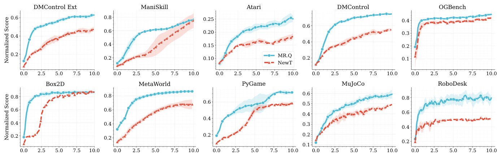{.nostretch fig-align="center" width="76%"}

**Per hour of wall-clock training time** (5 domains, same 10M-step budget):

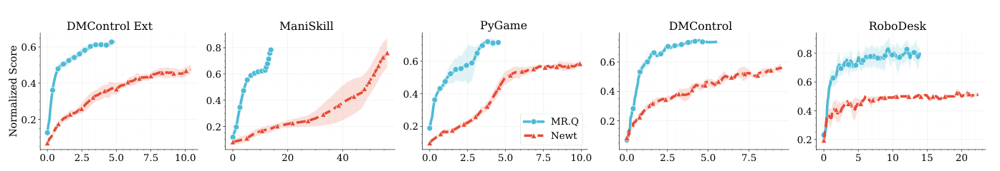{.nostretch fig-align="center" width="76%"}
:::

::: {.tiny-font .absolute bottom="0" left="0"}
[Representation Learning Enables Scalable Multitask Deep Reinforcement Learning.]{.red} Obando-Ceron, Li, Fujimoto, Bacon, Courville, Castro. arXiv 2026
:::

## Why it works: ablating the predictive representation

::: {.small-math .arrow-bullets}
▶ **Ablation:** remove the encoder and its predictive losses entirely. This leaves plain TD3 on the raw state concatenated with the 512-dimensional language embedding.

▶ **A surprise:** a well-tuned encoder-free TD3 already matches or beats Newt in all 4 domains tested. Explicit world modeling is not a prerequisite for multitask RL. MR.Q beats TD3 in 3 of the 4 domains and matches it in the fourth.

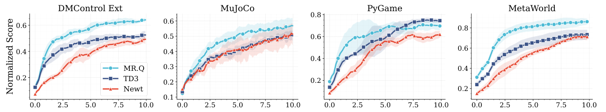{.nostretch fig-align="center" width="95%"}
:::

::: {.tiny-font .absolute bottom="0" left="0"}
[Representation Learning Enables Scalable Multitask Deep Reinforcement Learning.]{.red} Obando-Ceron, Li, Fujimoto, Bacon, Courville, Castro. arXiv 2026
:::

## Without predictive losses: representation geometry

::: {.small-math .arrow-bullets}
▶ PCA of the features at the end of training, colored by task. "95%-d" is the number of principal components needed to explain 95% of the variance.

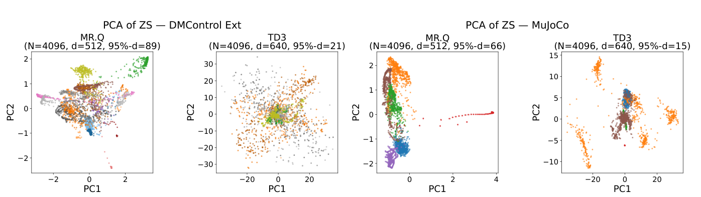{.nostretch fig-align="center" width="95%"}

▶ With the predictive losses, tasks are well separated in the latent space. Without them, the features collapse onto a few directions, and the effective rank (SRank) is much lower.
:::

::: {.tiny-font .absolute bottom="0" left="0"}
[Representation Learning Enables Scalable Multitask Deep Reinforcement Learning.]{.red} Obando-Ceron, Li, Fujimoto, Bacon, Courville, Castro. arXiv 2026
:::

## Without predictive losses: training dynamics

::: {.small-math .arrow-bullets}
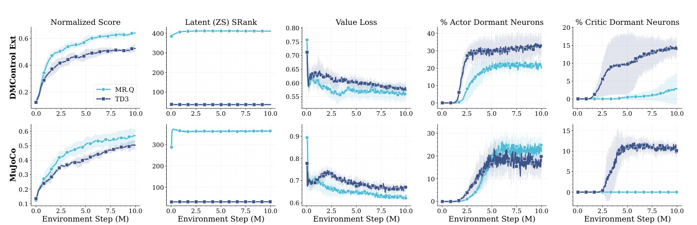{.nostretch fig-align="center" width="95%"}

▶ **Optimization:** without the predictive losses, SRank collapses, the value loss is higher, and many more actor and critic neurons become **dormant** (never active). The capacity is wasted and plasticity is lost, which is especially harmful when the task mixture keeps shifting.
:::

::: {.tiny-font .absolute bottom="0" left="0"}
[Representation Learning Enables Scalable Multitask Deep Reinforcement Learning.]{.red} Obando-Ceron, Li, Fujimoto, Bacon, Courville, Castro. arXiv 2026
:::

## Transfer, takeaways, and links to today's lecture

::: {.small-math .arrow-bullets}
▶ **Few-shot transfer:** pretrain on 200 tasks for 10M steps, then fine-tune individually with online RL on 28 held-out tasks.

| | zero-shot | 100k steps | 200k steps |
|---|---|---|---|
| MR.Q | 0.13 | 0.55 | 0.62 |
| Newt | 0.09 | 0.48 | 0.55 |

MR.Q is better on 17 of the 28 tasks at the end of fine-tuning.
:::

::::: columns
::: {.column .small-math .arrow-bullets width="50%"}
▶ **Links to today:**

-   The **amortization** argument from Arora et al.: one representation is shared across many tasks, and each task only learns what sits on top of it.
-   **Predicting dynamics as a self-supervised signal**, playing the role of correspondence for Dense Object Nets and of BYOL for VINN.
:::

::: {.column .small-math .arrow-bullets width="50%"}
▶ **Caveats:**

-   An RL preprint, not imitation learning.
-   Purely empirical: the authors state that the mechanism is not yet understood.
-   Continuous-control and arcade benchmarks only; long-horizon tasks are untested.
-   Absolute normalized scores on the 200-task benchmark are still low.
:::
:::::

::: {.tiny-font .absolute bottom="0" left="0"}
[Representation Learning Enables Scalable Multitask Deep Reinforcement Learning.]{.red} Obando-Ceron, Li, Fujimoto, Bacon, Courville, Castro. arXiv 2026
:::

## Today’s Agenda

::: grey-text
-   Representation Learning for Imitation

    -   Is it better to separate representation learning from policy learning?
    -   Pretraining representations for data-efficient RL
    -   Does representation learning make multitask RL scale?
:::

-   Provable generalization

    -   PAC-Bayes generalization bounds

-   Robustness and safety

    -   Robustness as stability

## Why generalization bounds?

::: {.small-math .arrow-bullets}
▶ Data $z \sim \mathcal{D}$ from an **unknown** distribution, training set $S = \{z_i\}_{i=1}^N \sim \mathcal{D}^N$, loss $l(h; z) \in [0, 1]$ of hypothesis $h$:

$$
\underbrace{l_{\mathcal{D}}(h) = \mathbb{E}_{z \sim \mathcal{D}}\, l(h; z)}_{\text{true expected loss}}
\qquad\qquad
\underbrace{l_S(h) = \frac{1}{N} \sum_{i=1}^N l(h; z_i)}_{\text{training loss}}
$$

▶ We minimize $l_S$, but we care about $l_{\mathcal{D}}$. A **generalization bound** has the form $l_{\mathcal{D}}(h) \le l_S(h) + \epsilon(N, \delta, \text{complexity})$.

▶ **PAC = Probably Approximately Correct.** "Approximately": the gap is at most $\epsilon$. "Probably": the bound holds with probability at least $1 - \delta$ over the random draw of $S$, since an unrepresentative training set can always happen.

▶ Classical bounds (VC dimension, Rademacher complexity, uniform convergence over the whole class) grow with the size of the hypothesis class. For networks with millions of parameters they are **vacuous**: the bound exceeds 1.

▶ **PAC-Bayes** instead measures how far the learned solution moved away from a *prior*. This gives non-vacuous bounds even for neural networks (Dziugaite & Roy 2017).

▶ For robotics: certify, before deployment, that a policy will succeed on new environments with high probability.
:::

## PAC-Bayes ingredients

::: {.small-math .arrow-bullets}
▶ **Prior** $P_0$ over parameters $w$, chosen *before* seeing $S$. It can encode domain knowledge, and does not need to be "true" in any Bayesian sense.

▶ **Posterior** $P$: any distribution chosen *after* seeing $S$. It does not need to be the Bayesian posterior.

▶ **Stochastic hypothesis:** at test time, sample $w \sim P$ and use $h_w$. Losses are averaged over $P$:

$$
l_S(P) = \frac{1}{N} \sum_{z \in S} \mathbb{E}_{w \sim P}\big[l(h_w; z)\big],
\qquad
l_{\mathcal{D}}(P) = \mathbb{E}_{z \sim \mathcal{D}}\, \mathbb{E}_{w \sim P}\big[l(h_w; z)\big]
$$

▶ **Complexity** = KL divergence from the prior: $\mathbb{D}(P \| P_0) = \mathbb{E}_{w \sim P}\left[\log \frac{P(w)}{P_0(w)}\right] \ge 0$.

▶ In practice both are diagonal Gaussians, $P = \mathcal{N}(\mu, \mathrm{diag}(\sigma^2))$ and $P_0 = \mathcal{N}(\mu_0, \mathrm{diag}(\sigma_0^2))$, with the closed form

$$
\mathbb{D}(P \| P_0) = \frac{1}{2} \sum_{j=1}^{d} \left( \frac{\sigma_j^2}{\sigma_{0,j}^2} + \frac{(\mu_j - \mu_{0,j})^2}{\sigma_{0,j}^2} - 1 + \log \frac{\sigma_{0,j}^2}{\sigma_j^2} \right)
$$

This is differentiable in $(\mu, \sigma)$, so the bound can be optimized by gradient descent with the reparameterization trick $w = \mu + \sigma \odot \varepsilon$, $\varepsilon \sim \mathcal{N}(0, I)$.
:::

## PAC-Bayes generalization bounds

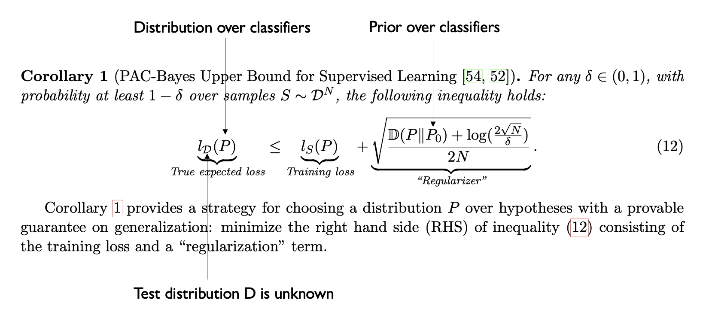{fig-align="center"}

::: {.tiny-font .absolute bottom="0" left="0"}
[PAC-Bayes Control: Learning Policies that Provably Generalize to Novel Environments.]{.red} Majumdar, Farid, Sonar. IJRR 2021
:::

## Reading the PAC-Bayes bound

::: {.small-math .arrow-bullets}
▶ The bound holds **simultaneously for every posterior** $P$. So we can choose $P$ by minimizing the right-hand side, and the guarantee still holds for the minimizer.

▶ **Training = minimizing the bound:** fit the training data, but pay for moving away from the prior. With Gaussians, the $(\mu - \mu_0)^2 / \sigma_0^2$ term is weight decay towards $\mu_0$.

▶ For a fixed KL, the gap shrinks roughly as $1/\sqrt{N}$.

▶ The KL term is small when the **prior is already good** (e.g. trained on separate data) or when the **posterior can be wide**, i.e. the training loss is insensitive to noise in $w$ (flat minima).

▶ **No test set is needed:** everything on the right-hand side is computable from $S$, $P$ and $P_0$.

▶ The guarantee is for the *stochastic* hypothesis: an average over $w \sim P$ as well as over $z \sim \mathcal{D}$.

▶ It requires losses in $[0, 1]$ and $N \ge 8$. This form follows, via Pinsker's inequality, from the tighter statement $\mathbb{D}\big(l_S(P) \,\|\, l_{\mathcal{D}}(P)\big) \le \frac{1}{N}\big(\mathbb{D}(P \| P_0) + \log \frac{2\sqrt{N}}{\delta}\big)$, a KL between Bernoulli distributions (Maurer 2004).
:::

## PAC-Bayes Bound Applied to Control

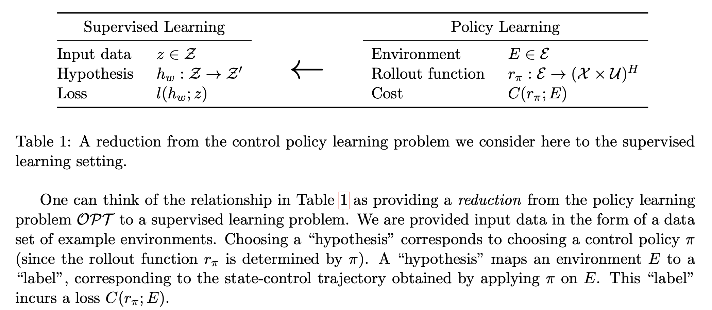{fig-align="center"}

::: {.tiny-font .absolute bottom="0" left="0"}
[PAC-Bayes Control: Learning Policies that Provably Generalize to Novel Environments.]{.red} Majumdar, Farid, Sonar. IJRR 2021
:::

## PAC-Bayes control: what is guaranteed, and under which assumptions

::: {.small-math .arrow-bullets}
▶ **Environments** $E$ (obstacle layout, object geometry, initial conditions) are drawn i.i.d. from an unknown distribution $\mathcal{D}$. The training set is $S = \{E_i\}_{i=1}^N$, and policies can be rolled out on each of them (in simulation).

▶ **Cost** $C(r_\pi; E) \in [0, 1]$. For example, cost 1 on collision within the horizon and 0 otherwise, so that $C_{\mathcal{D}}(P)$ is the *probability of failure* on a new environment.

▶ **Theorem (PAC-Bayes control).** With probability at least $1 - \delta$ over $S \sim \mathcal{D}^N$, for every $P$:

$$
\underbrace{C_{\mathcal{D}}(P)}_{\text{true expected cost}} \;\le\; \underbrace{C_S(P)}_{\text{training cost}} + \sqrt{\frac{\mathbb{D}(P \| P_0) + \log \frac{2\sqrt{N}}{\delta}}{2N}}
$$

Given the reduction, the proof is one line: it is the supervised bound with environments as data.
:::

::: {.tiny-font .absolute bottom="0" left="0"}
[PAC-Bayes Control: Learning Policies that Provably Generalize to Novel Environments.]{.red} Majumdar, Farid, Sonar. IJRR 2021
:::

## PAC-Bayes control: what the bound does not say

::: {.small-math .arrow-bullets}
-   The guarantee is on the *expected* cost over new environments, not a per-environment guarantee. A particular environment can still fail.
-   The prior must not depend on $S$: either designed by hand, or trained on separate data (other environments, demonstrations).
-   If test environments come from a different distribution $\mathcal{D}' \neq \mathcal{D}$, the bound does not apply. The paper has a distributionally robust extension for a KL ball around $\mathcal{D}$.
-   $C_S(P)$ is an expectation over $w \sim P$. In practice it is estimated by sampling many policies, which adds a sample-convergence term to the final bound.
:::

## PAC-Bayes Example

:::::: columns
::: {.column width="55%"}
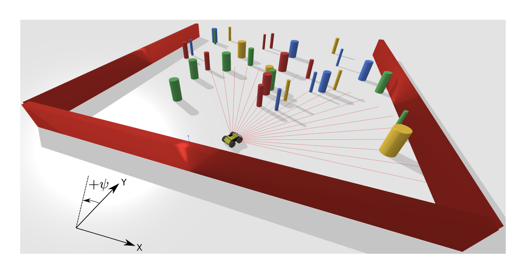{fig-align="center"}

::: small-math
| $N$ (training envs) | 100 | 500 | 1000 | 10000 |
|---|---|---|---|---|
| PAC-Bayes bound | 0.178 | 0.135 | 0.121 | 0.096 |
| True cost (estimate) | 0.087 | 0.084 | 0.088 | 0.083 |
:::
:::

::: {.column .small-math .arrow-bullets width="45%"}
▶ Differential-drive robot at a fixed speed of 2.5 m/s, with 20 depth rays over $\pm 60°$ and 5 m range.

▶ Environments: 20 to 40 cylinders with random positions and radii, inside three walls.

▶ Reactive policy $u_{\text{diff}} = K \cdot \hat y$, where $\hat y$ holds the inverse ray distances: turn away from obstacles that are close.

▶ Policy space: 50 hand-designed gain vectors $K$ with a uniform prior, or continuous $K$ with a Gaussian prior.

▶ Cost 1 if the robot collides within 100 steps.

▶ With only $N = 100$ environments, the policy is guaranteed (with probability 0.99) an expected success rate of at least 82.2%. The true rate is about 91.3%.
:::
::::::

::: {.tiny-font .absolute bottom="0" left="0"}
[PAC-Bayes Control: Learning Policies that Provably Generalize to Novel Environments.]{.red} Majumdar, Farid, Sonar. IJRR 2021
:::

## Generalization guarantees for imitation learning

::: {.small-math .arrow-bullets}
▶ **Stage 1, prior from demonstrations:** a conditional VAE with encoder $q(z \mid o, a)$ and decoder policy $\pi_{\theta, z}(a \mid o)$. After training, freeze the decoder weights $\theta^*$. Each latent $z$ now indexes a policy, and $P_0 = p(z) = \mathcal{N}(0, I)$ is a prior over policies that captures the multi-modal expert behavior.

▶ **Stage 2, PAC-Bayes fine-tuning** on a *fresh* set of $N$ environments: a posterior $P = \mathcal{N}(\mu, \mathrm{diag}(\sigma^2))$ over $z$, chosen by minimizing the PAC-Bayes bound. Rollouts go through a black-box physics simulator, so gradients are estimated with Natural Evolution Strategies.

▶ **Final certificate** with the tighter KL-inverse bound, where $\mathbb{D}$ is the KL between Bernoulli distributions:

$$
C_{\mathcal{D}}(P) \le \mathbb{D}^{-1}\!\left(\bar C_S(P) \,\Big\|\, \frac{\mathbb{D}(P \| P_0) + \log \frac{2\sqrt{N}}{\delta}}{N}\right),
\qquad
\mathbb{D}^{-1}(p \| c) = \sup\{q \in [0, 1] : \mathbb{D}(p \| q) \le c\}
$$

▶ **Why the prior matters:** a prior learned by imitation is already close to good policies, so the posterior only needs to move a little. The KL term stays small, and the bound is tight.

▶ Mug grasping: the prior succeeds 83.3% of the time. With $N = 500$ environments, the posterior is guaranteed (with probability 0.99) at least 93.0% expected success, and achieves 98.4% in simulation.
:::

::: {.tiny-font .absolute bottom="0" left="0"}
[Generalization Guarantees for Imitation Learning.]{.red} Ren, Veer, Majumdar. CoRL 2020.
:::

## [PAC-Bayes Control for Visuomotor Policies]{.medium}



::: {.tiny-font .absolute bottom="0" left="0"}
[Generalization Guarantees for Imitation Learning.]{.red} Ren, Veer, Majumdar. CoRL 2020.
:::

## Today’s Agenda

::: grey-text
-   Representation Learning for Imitation

    -   Is it better to separate representation learning from policy learning?
    -   Pretraining representations for data-efficient RL
    -   Does representation learning make multitask RL scale?

-   Provable generalization

    -   PAC-Bayes generalization bounds
:::

-   Robustness and safety

    -   Robustness as stability

## Background: closed-loop dynamics and stability

::: {.small-math .arrow-bullets}
▶ A policy turns a controlled system into an **autonomous** one: $\dot x = f(x, \pi(x)) =: f_{cl}(x)$, or $x_{t+1} = f_{cl}(x_t)$ in discrete time.

▶ An **equilibrium** $x^*$ satisfies $f_{cl}(x^*) = 0$. Typically it is the goal state.

▶ **Stable** (in the sense of Lyapunov): start close, stay close. For every $\epsilon > 0$ there is a $\delta > 0$ such that $\|x(0) - x^*\| < \delta \Rightarrow \|x(t) - x^*\| < \epsilon$ for all $t \ge 0$.

▶ **Asymptotically stable:** stable, and $x(t) \to x^*$ for every start close enough to $x^*$.

▶ **Exponentially stable:** $\|x(t) - x^*\| \le c\, e^{-\lambda t}\, \|x(0) - x^*\|$ for some $c, \lambda > 0$.

▶ **Region of attraction:** the set of initial states from which $x(t) \to x^*$. *Global* stability means the region of attraction is the whole state space.

::: fragment
▶ **Why imitation learning cares:** a behavioral cloning policy has no reason to return to the demonstrations after a perturbation, so errors compound. Encoding demonstrations as a *stable dynamical system* whose attractor is the goal (like the DMPs from week 4) guarantees recovery from perturbations by construction.
:::
:::

## Stability definitions, illustrated

::::: columns
::: {.column width="55%"}
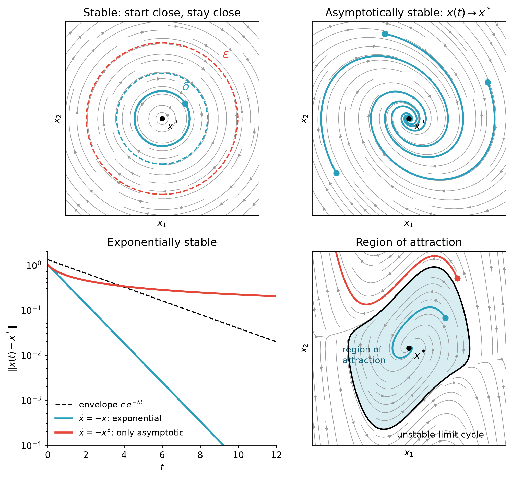{.nostretch fig-align="center" width="100%"}
:::

::: {.column .small-math .arrow-bullets width="45%"}
▶ **Stable, not asymptotically:** the undamped oscillator $\ddot x = -x$. Starting in the $\delta$-ball, it stays in the $\epsilon$-ball, but circles forever and never settles.

▶ **Asymptotically stable:** with damping, every trajectory spirals into $x^*$: $\ddot x = -x - 0.5\,\dot x$.

▶ **Exponential vs. only asymptotic:** $\dot x = -x$ stays below an envelope $c\,e^{-\lambda t}$, while $\dot x = -x^3$ converges like $1/\sqrt{t}$, slower than any exponential.

▶ **Region of attraction:** for Van der Pol in reverse time, $x^*$ is stable only locally. Trajectories starting inside the unstable limit cycle converge; those outside escape.
:::
:::::

## What does it mean for a policy to be robust?

• The system (policy, dynamics) must be such that the policy will achieve its goal point, even if a family of disturbances/noise affect it

:::::: columns
::: {.column width="40%"}
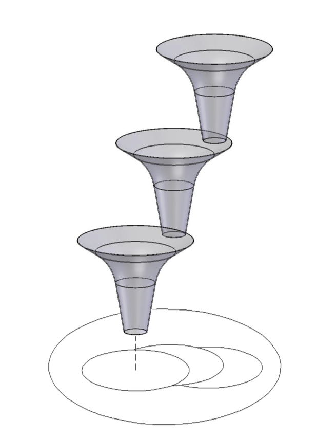{fig-align="center" height="350"}
:::

:::: {.column .small-math .arrow-bullets width="60%"}
 

▶ Each **funnel** is a region of attraction around a nominal trajectory, stabilized by a time-varying LQR controller and certified by a Lyapunov function (verified with sums-of-squares optimization).

▶ Any state inside a funnel's inlet is guaranteed to exit through its outlet, despite bounded disturbances.

▶ **Composition:** chain the funnels so that each outlet fits inside the next inlet. A tree of funnels grown backwards from the goal covers the reachable states, which gives a feedback policy with a certificate.

::: small-math
Composition of robust policies
:::
::::
::::::

::: {.tiny-font .absolute bottom="0" left="0"}
[LQR-Trees: Feedback Motion Planning on Sparse Randomized Trees.]{.red} Tedrake, RSS 2009.
:::

## Robustness as stability of dynamical systems

-   [Global asymptotic stability to a goal]{.red}: the region of attraction includes all states. The system will converge to the goal, no matter where it starts from.

 

-   How to ensure global asymptotic stability:
    -   Show that there exists a positive energy (Lyapunov) function that
    -   Decreases over time along the system trajectories
    -   And will become 0 at the convergence point

## Lyapunov's theorem

::: {.small-math .arrow-bullets}
▶ Let $x^* = 0$ be an equilibrium of $\dot x = f(x)$. Suppose there is a continuously differentiable function $V$ with:

-   $V(0) = 0$ and $V(x) > 0$ for $x \neq 0$: $V$ is positive definite, an "energy".
-   $\dot V(x) = \nabla V(x)^\top f(x) < 0$ for $x \neq 0$: the energy strictly decreases along every trajectory.

Then $x^* = 0$ is **asymptotically stable**. If in addition $V$ is **radially unbounded**, i.e. $V(x) \to \infty$ as $\|x\| \to \infty$, it is **globally** asymptotically stable.

▶ Variants:

-   $\dot V \le 0$ only: stable (in the sense of Lyapunov), but not necessarily convergent.
-   $\dot V \le -\alpha V$ with $\alpha > 0$: exponentially stable, since $V(x(t)) \le e^{-\alpha t} V(x(0))$.

▶ **Key point:** no need to solve the ODE. The condition is checked pointwise on $V$ and $f$.

▶ Sublevel sets $\{x : V(x) \le c\}$ on which $\dot V < 0$ are invariant: trajectories never leave them. These give inner estimates of the region of attraction, i.e. the funnels.

▶ Converse theorems say that if $x^*$ is asymptotically stable, such a $V$ exists. *Finding* it is the hard part, which motivates learning it.
:::

## Examples of Lyapunov functions

::::: columns
::: {.column .small-math .arrow-bullets width="50%"}
[Linear systems]{.underline}

▶ $\dot x = A x$, and try $V(x) = x^\top P x$ with $P \succ 0$:

$$
\dot V = \dot x^\top P x + x^\top P \dot x = x^\top (A^\top P + P A)\, x
$$

▶ Pick any $Q \succ 0$ and solve the **Lyapunov equation**

$$
A^\top P + P A = -Q
$$

A solution $P \succ 0$ exists iff $A$ is Hurwitz (all eigenvalues have negative real part). Then $\dot V = -x^\top Q x < 0$: globally exponentially stable.

▶ The LQR cost-to-go $x^\top P x$ is a Lyapunov function for the LQR closed loop.
:::

::: {.column .small-math .arrow-bullets width="50%"}
[Damped pendulum]{.underline}

▶ $m l^2 \ddot\theta = -m g l \sin\theta - b \dot\theta$, with friction $b > 0$.

▶ Total energy as $V$:

$$
V = \tfrac{1}{2} m l^2 \dot\theta^2 + m g l (1 - \cos\theta)
$$

$$
\dot V = m l^2 \dot\theta \ddot\theta + m g l \sin\theta\, \dot\theta = -b\, \dot\theta^2 \le 0
$$

▶ Only $\dot V \le 0$: the energy stops decreasing whenever $\dot\theta = 0$. **LaSalle's invariance principle** completes the argument: trajectories converge to the largest invariant set inside $\{\dot\theta = 0\}$, which only contains the equilibria. So the pendulum settles at the bottom, from every state except those converging to the upright equilibrium.
:::
:::::

## Example: stable dynamical systems learned from demonstrations

::: {.small-math .arrow-bullets}
▶ **SEDS** (Stable Estimator of Dynamical Systems): model the demonstrated motion as $\dot x = f_\theta(x)$, a Gaussian mixture regression

$$
f_\theta(x) = \sum_{k=1}^{K} h_k(x)\, (A_k x + b_k), \qquad h_k(x) \ge 0, \quad \textstyle\sum_k h_k(x) = 1
$$

▶ Use the quadratic Lyapunov function $V(x) = (x - x^*)^\top (x - x^*)$. Fit the mixture by maximum likelihood on the demonstrations, **subject to** the constraints

$$
b_k = -A_k x^*, \qquad A_k + A_k^\top \prec 0 \quad \text{for all } k
$$

which guarantee $\dot V < 0$ everywhere except at $x^*$. Every rollout reaches the goal, from any start, even after perturbations.

▶ **Limitation:** a quadratic $V$ means the distance to the goal must decrease monotonically. Demonstrations that temporarily move away from the goal (e.g. going around an obstacle) cannot be fit accurately.

▶ **Fix:** learn a richer $V$ together with $f$. This is what the next two papers do.
:::

::: {.tiny-font .absolute bottom="0" left="0"}
[Learning Stable Nonlinear Dynamical Systems With Gaussian Mixture Models.]{.red} Khansari-Zadeh, Billard. T-RO 2011
:::

## [Two examples of learning Lyapunov functions]{.medium}

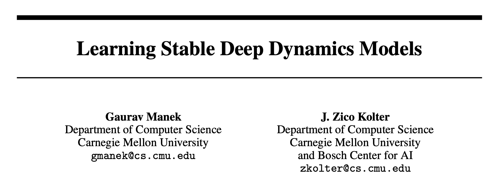{height="300"}

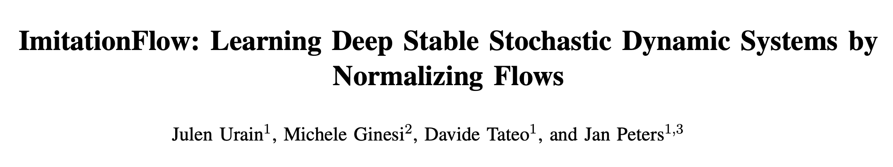

## Learning stable deep dynamics models

::: {.small-math .arrow-bullets}
▶ Learn a nominal dynamics model $\hat f(x)$ (any neural network) **and** a Lyapunov function $V(x)$ jointly. Stability holds *by construction*, not through a penalty.

▶ **$V$ is positive definite by construction:** $V(x) = \sigma\big(g(x) - g(0)\big) + \epsilon \|x\|^2$, where $g$ is an input-convex neural network (ICNN) and $\sigma$ a smoothed ReLU. Since $g$ is convex, $V$ has no spurious local minima.

▶ **Project** $\hat f$ onto the set of dynamics that decrease $V$ at rate $\alpha$, i.e. that satisfy $\nabla V^\top f \le -\alpha V$:

$$
f(x) = \hat f(x) - \nabla V(x)\, \frac{\mathrm{ReLU}\big(\nabla V(x)^\top \hat f(x) + \alpha V(x)\big)}{\|\nabla V(x)\|_2^2}
$$

▶ If $\hat f$ already decreases $V$ fast enough, it is left unchanged. Otherwise, only the component along $\nabla V$ that violates the condition is removed. Check: $\nabla V^\top f = \nabla V^\top \hat f - \mathrm{ReLU}(\nabla V^\top \hat f + \alpha V) \le -\alpha V$.

▶ Everything is differentiable, so $\hat f$ and $V$ are trained end-to-end by regression on observed $(x, \dot x)$ pairs. The learned system is **globally exponentially stable for any parameter values**.
:::

::: {.tiny-font .absolute bottom="0" left="0"}
[Learning Stable Deep Dynamics Models.]{.red} Manek, Kolter. NeurIPS 2019
:::

## ImitationFlow: stability through a learned diffeomorphism

::: {.small-math .arrow-bullets}
▶ **Idea:** stability is easy to guarantee in a simple space. Choose latent dynamics with a known stable attractor, e.g. a linear stochastic system

$$
dz = -K z\, dt + \Sigma\, dW, \qquad K \succ 0
$$

whose deterministic part converges to $z = 0$.

▶ **Learn a diffeomorphism** $x = \Psi_\theta(z)$ with a normalizing flow: a smooth, invertible network with a tractable Jacobian determinant. The goal is then $x^* = \Psi_\theta(0)$.

▶ **Stability transfers:** trajectories in $x$ are the images of convergent latent trajectories. If $V(z)$ is a Lyapunov function in latent space, then $V\big(\Psi_\theta^{-1}(x)\big)$ is one in robot space.

▶ **Training:** maximize the likelihood of demonstrated trajectories. The change-of-variables formula gives exact log-likelihoods through the flow.

▶ **Result:** stochastic, stable motion policies that reproduce complex demonstration shapes, including motions a quadratic $V$ could not represent.
:::

::: {.tiny-font .absolute bottom="0" left="0"}
[ImitationFlow: Learning Deep Stable Stochastic Dynamic Systems by Normalizing Flows.]{.red} Urain, Ginesi, Tateo, Peters. IROS 2020
:::

## Contraction theory basics

::: {.small-math .arrow-bullets}
▶ **Lyapunov:** convergence to a *known point* $x^*$. **Contraction:** all trajectories converge *to each other*, exponentially fast. The system forgets its initial conditions. This suits tracking time-varying trajectories, where there is no fixed equilibrium.

▶ **Differential dynamics:** for a virtual displacement $\delta x$ between two infinitesimally close trajectories of $\dot x = f(x, t)$,

$$
\dot{\delta x} = \frac{\partial f}{\partial x}(x, t)\, \delta x
$$

▶ **Contraction metric** $M(x, t) \succ 0$: a differential Lyapunov function $\delta x^\top M\, \delta x$. If, for all $x$ and $t$,

$$
\dot M + \frac{\partial f}{\partial x}^{\!\top} M + M\, \frac{\partial f}{\partial x} \preceq -2\lambda M
$$

then $\|\delta x\|_M$ shrinks as $e^{-\lambda t}$, so any two trajectories converge to each other exponentially (Lohmiller & Slotine 1998).

▶ **For control:** a *control contraction metric* certifies that some feedback controller makes the closed loop contracting. The system is then *stabilizable*: any feasible trajectory can be tracked.

▶ **Singh et al.:** when learning a dynamics model from data, constrain it to be stabilizable, i.e. to admit a contraction metric. This regularizer yields better-conditioned models that are better for trajectory generation and tracking, especially with little data.
:::

## Stability via Contraction Theory



::: {.tiny-font .absolute bottom="0" left="0"}
[Learning Stabilizable Nonlinear Dynamics with Contraction-Based Regularization.]{.red} Singh, Richards, Sindhwani, Slotine, Pavone. IJRR 2020
:::

## Summary

::: {.small-math .arrow-bullets}
▶ **Representation learning:**

-   Separating the representation from the policy lets cheap data without action labels do most of the work: correspondence (Dense Object Nets), BYOL (VINN), and dynamics objectives (SGI, MR.Q).
-   Theory (Arora et al.): a representation shared across $T$ tasks amortizes its complexity, so each new task only pays for a small head.
-   In RL, predictive objectives prevent representation collapse and let larger networks and multitask agents use their capacity.

▶ **Provable generalization:**

-   PAC-Bayes bounds certify the expected cost on *new environments* from training environments alone.
-   Minimizing the bound is the training algorithm. A good prior, e.g. one learned from demonstrations, makes the bound tight.

▶ **Robustness as stability:**

-   Lyapunov functions certify convergence to a goal, and funnels certify regions of attraction that can be composed.
-   Stability can be built into learned dynamical systems by construction: constrained mixtures (SEDS), projection onto a learned $V$ (Manek & Kolter), or a learned diffeomorphism (ImitationFlow).
-   Contraction certifies convergence between trajectories, which suits tracking and learning stabilizable models.
:::