## Today’s Agenda

-   Six ways to put a foundation model in the control loop

-   Vision-language-action models (VLAs)

    -   Discrete tokens, diffusion chunks, flow matching
    -   What changed in 2025–2026

-   Hierarchical VLAs

-   Code as policies and agentic robot control

-   World-model planning

-   World-action models

-   Video planning with inverse dynamics models

## Six ways to put a foundation model in the loop

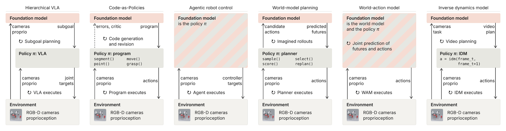{fig-align="center" width="100%"}

::: {.small-math .arrow-bullets}
▶ Every column has the same environment (RGB-D cameras, proprioception) and the same goal (actions on the robot). They differ in **where the foundation model sits** and **what crosses the interface** below it.
:::

## Reading the figure

::: {.small-math .arrow-bullets}
| Family | The foundation model... | What it sends down | What executes |
|---|---|---|---|
| **Hierarchical VLA** | plans subgoals for a learned low-level policy | a language subgoal, every ~1&nbsp;s | that policy (often a VLA) at 10–50 Hz; possibly the same model, decoding twice |
| **Code as Policies** | writes a program, revises it on errors | code | the program, calling perception and motion APIs |
| **Agentic control** | is the policy | targets: points, poses, constraints | a classical controller |
| **World-model planning** | predicts futures for candidate actions | predicted futures and scores | a sampling-based planner (MPC) |
| **World-action model** | is the world model *and* the policy | actions, predicted jointly with the future | the robot directly |
| **Inverse dynamics** | generates a video plan | future frames | an inverse dynamics model, $a_t = \mathrm{idm}(I_t, I_{t+1})$ |

▶ Recurring questions for each family: what data does it need, how fast does it run?
:::

# Vision-language-action models

## Why VLAs?

::: {.small-math .arrow-bullets}
▶ **Vision-language models** (GPT-4V, Gemini, LLaVA, PaliGemma) can look at a cluttered desk and say where the cup is. They have no body: no output reaches the motors.

▶ **The VLA idea:** take a pretrained vision-language model and give it one more output modality, *actions*. Train end-to-end on robot demonstrations.

▶ **The hope:** the model's understanding of scenes and instructions, learned from the web, carries over to physical tasks that were never demonstrated.
:::

::: {.tiny-font .absolute bottom="0" left="0"}
:::

## The shared loop

::: {.small-math .arrow-bullets}
▶ **Inputs:** camera images through a vision encoder, the instruction ("pick up the red cup") as text tokens, optionally the robot state through a small projection.

▶ **Backbone:** a transformer, usually initialized from a pretrained VLM, grounds the instruction in the scene: which object is the red cup?

▶ **Action head:** outputs a **chunk** of $H$ future actions. A controller tracks them, new images arrive, repeat.

▶ **Training:** behavioral cloning on demonstrations $(o_t, \ell, q_t, a_{t:t+H})$:

$$
\max_\theta \; \mathbb{E}_{\mathcal{D}} \left[ \log \pi_\theta\left(a_{t:t+H} \mid o_t, \ell, q_t\right) \right]
$$

▶ VLAs differ in the backbone, **how actions are represented**, the data mix, and how much of each chunk runs before replanning.
:::

## Four ways to output actions

::: rep-table
| Action head | Advantages | Disadvantages |
|---|---|---|
| **Discrete tokens**: each action dimension binned (e.g. 256 bins), predicted as a token [RT-1, RT-2, OpenVLA, MolmoAct]{.grey-text} | Reuses the language model's output layer and cross-entropy loss. Autoregression captures correlations between dimensions. | Resolution limited by the bins. One forward pass per token, so slow. Low control rate. |
| **Compressed tokens (FAST)**: DCT + Byte-Pair Encoding over a whole chunk [π0-FAST, MolmoAct 2 pretraining]{.grey-text} | Keeps the language-model loss. About 30 tokens per arm per 1-second chunk, so high-frequency data trains well. | Still autoregressive decoding through the full VLM: slower inference than an action expert. |
| **Diffusion chunks**: a small head denoises a sequence of continuous actions [Octo; Diffusion Policy from Week 1]{.grey-text} | Continuous, multi-modal, produces whole chunks. | Many denoising steps. The head is usually small and trained from scratch. |
| **Flow-matching action expert**: a separate transformer, attending to the VLM, integrates a velocity field from noise to an action chunk [π0, π0.5, π0.7, MolmoAct 2, Rho]{.grey-text} | Continuous, multi-modal, high frequency (up to 50 Hz). The expert can be much smaller than the VLM. | A second network to train. Still several integration steps per chunk. |
:::

::: {.small-math .arrow-bullets}
:::

## The precursor: RT-1

::::: columns
::: {.column .small-math .arrow-bullets width="64%"}
▶ **Data:** 130k successful teleoperated episodes, 700+ tasks, 13 robots, 17 months. Behavioral cloning.

▶ **Architecture (35M parameters, no LLM):**

-   Instruction: a fixed Universal Sentence Encoder vector, no reasoning.
-   Six 300×300 images through an ImageNet EfficientNet-B3, 81 tokens each.
-   **FiLM:** the instruction rescales visual features per channel, $\tilde F = \gamma \odot F + \beta$: "open the drawer" emphasizes the handle.
-   **TokenLearner** compresses 81 tokens to 8 learned summaries, $z_k = \sum_i \alpha_{ki} F_i$: 486 tokens become 48.

▶ **Output:** 11 action dimensions (arm, gripper, base, mode), 256 bins each, at about 3 Hz.
:::

::: {.column width="36%"}
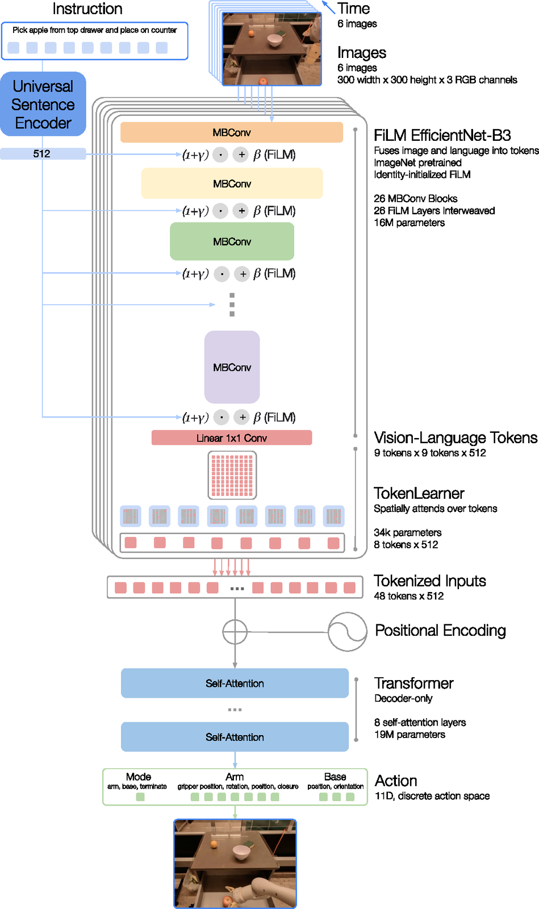{.nostretch fig-align="center" height="530"}
:::
:::::

::: {.tiny-font .absolute bottom="0" left="0"}
[RT-1: Robotics Transformer for Real-World Control at Scale.]{.red} Brohan et al. RSS 2023
:::

## What RT-1 showed

::: {.small-math .arrow-bullets}
▶ One transformer can replace many task-specific policies and still run closed-loop.

▶ Success: about 97% on seen tasks, 76% on unseen instructions, 83% with distractors, 59% in new backgrounds. **More robot data bought robustness, not environment generalization.**

▶ **Task diversity beats repetition:** removing *different tasks* hurt more than removing as many episodes of repeated tasks.

▶ **A bottleneck:** 8 summaries per image can lose small objects and precise geometry.

▶ **Semantics come only from the robot data:** RT-1 has no idea what a "Taylor Swift" is.
:::

::: {.tiny-font .absolute bottom="0" left="0"}
[RT-1: Robotics Transformer for Real-World Control at Scale.]{.red} Brohan et al. RSS 2023
:::

## PaLM-E: putting a robot inside a language model

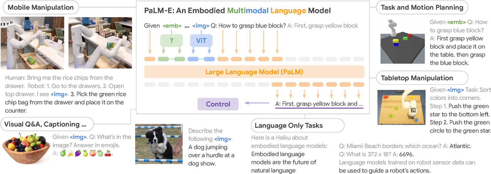{.nostretch fig-align="center" width="95%"}

::: {.small-math .arrow-bullets}
▶ **Idea:** inject continuous observations into a pretrained LLM (PaLM) as if they were words. Images go through a ViT, robot state through an MLP, and both are projected into the token embedding space. Text and observations are interleaved into "multimodal sentences".
:::

::: {.tiny-font .absolute bottom="0" left="0"}
[PaLM-E: An Embodied Multimodal Language Model.]{.red} Driess et al. ICML 2023
:::

## PaLM-E: training, and what's missing

::: {.small-math .arrow-bullets}
▶ **Training:** one model on web text, vision-language tasks and embodied tasks (planning, embodied question answering, affordance and failure prediction). Largest: 562B (PaLM 540B with ViT-22B).

▶ **Positive transfer:** the mixture beats robot data alone, and the largest model keeps most of its language ability.

▶ **Output: language**, such as plans ("1. go to the drawer, 2. open it, ..."). **What's missing:** it decodes no motor commands, so low-level policies, as in SayCan, must execute them.

▶ RT-2 closes this gap; one of its two backbones is PaLM-E 12B.
:::

::: {.tiny-font .absolute bottom="0" left="0"}
[PaLM-E: An Embodied Multimodal Language Model.]{.red} Driess et al. ICML 2023
:::

## RT-2: actions as another language

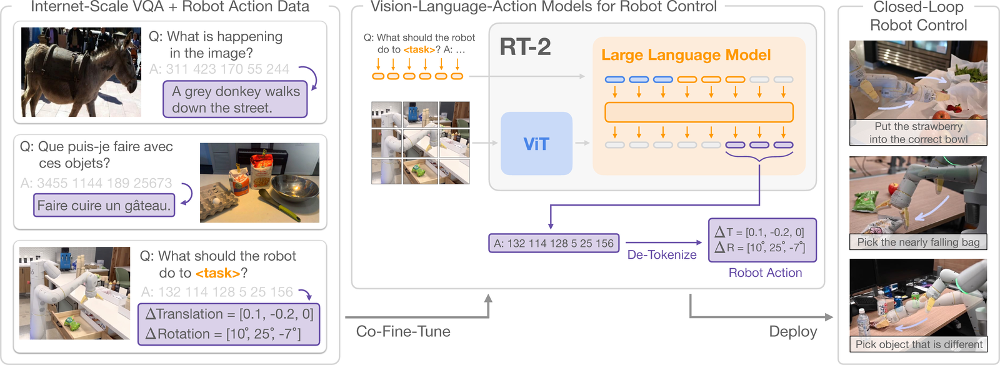{.nostretch fig-align="center" width="95%"}

::: {.small-math .arrow-bullets}
▶ **Trick:** write the robot action as text. A VLM already answers "Which object is the dinosaur?" with "the green toy". RT-2 answers "Pick up the dinosaur" with "128 91 241 5 101 127 217": 8 numbers (terminate, $\Delta$position, $\Delta$rotation, gripper), each discretized into 256 bins.

▶ **Co-fine-tuning** (left of the figure): keep web vision-language data in the mix while training on robot data, so the model doesn't forget what it knew.
:::

::: {.tiny-font .absolute bottom="0" left="0"}
[RT-2: Vision-Language-Action Models Transfer Web Knowledge to Robotic Control.]{.red} Brohan et al. CoRL 2023 · [project page](https://robotics-transformer2.github.io/){target="_blank"}
:::

## RT-2: decoding actions

::: {.small-math .arrow-bullets}
▶ **Autoregressive decoding** over the action tokens, given the current image $I$ and instruction $\ell$:

$$
p(a_1, \dots, a_8 \mid I, \ell) = \prod_{i=1}^{8} p(a_i \mid I, \ell, a_1, \dots, a_{i-1})
$$

so, for example, the $y$ translation can depend on the $x$ translation already chosen. Decoding is restricted to valid action tokens.

▶ **Which tokens?** PaLI-X (5B, 55B) already has single tokens for integers up to 1000, so it reuses them. PaLM-E (12B) does not, so RT-2 overwrites 256 rarely used tokens and redefines them as action bins.

▶ Too large to run on the robot: images were sent to a cloud TPU and actions came back at a few Hz.
:::

::: {.tiny-font .absolute bottom="0" left="0"}
[RT-2: Vision-Language-Action Models Transfer Web Knowledge to Robotic Control.]{.red} Brohan et al. CoRL 2023 · [project page](https://robotics-transformer2.github.io/){target="_blank"}
:::

## RT-2: what transfer looks like

::::: columns
::: {.column .small-math .arrow-bullets width="56%"}
▶ **"Move the Coke can to Taylor Swift":** no Taylor Swift in the robot data, so RT-2 had to combine a web concept with the "move" skill. It did, slowly and awkwardly.

▶ **Emergent capabilities** (about 6k trials): placing objects on a number or icon, picking the smallest object, picking an improvised hammer (a rock) with chain-of-thought.

▶ **Ablation:** from scratch < fine-tuned VLM < co-fine-tuned with web data. RT-2 also coined the name **vision-language-action model**.

▶ **What did not transfer:** new *motions*. RT-2 generalizes over objects and concepts, not skills absent from the robot data: later, the main argument for world-action models.
:::

::: {.column width="44%"}
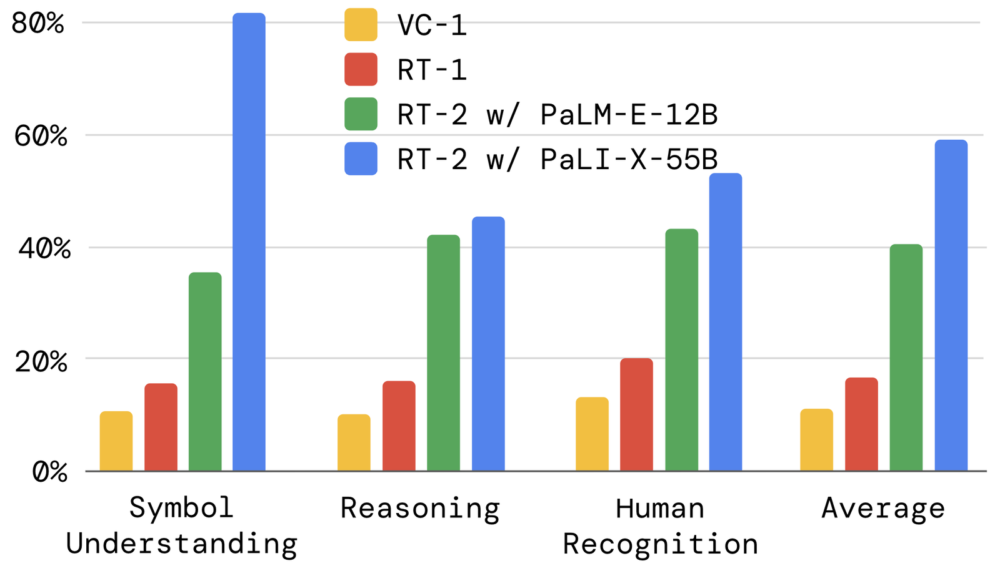{.nostretch fig-align="center" width="100%"}

[Success on emergent-skill evaluations: RT-2 with either backbone is far ahead of RT-1 and of a policy on pretrained visual features (VC-1).]{.grey-text .tiny-font}
:::
:::::

::: {.tiny-font .absolute bottom="0" left="0"}
[RT-2: Vision-Language-Action Models Transfer Web Knowledge to Robotic Control.]{.red} Brohan et al. CoRL 2023
:::

## How fine is 256 bins?

::: columns
::: {.column .small-math .arrow-bullets width="55%"}
▶ An offline experiment from the blog: take recorded actions from three LIBERO demonstrations, round each dimension to the nearest bin, measure the translation error.

▶ **Resolution depends on both the number of bins and the range they cover.** And smaller one-step errors need not give a smaller final error: per-step errors can reinforce or cancel over a trajectory.
:::

::: {.column .small-math width="45%"}
| Bins per dimension | Full-range RMSE | Clipped RMSE |
|---|---|---|
| 16 | 0.0324 | 0.0290 |
| 64 | 0.0075 | 0.0126 |
| 256 | 0.0019 | 0.0105 |
:::
:::

::: {.tiny-font .absolute bottom="0" left="0"}
[From RT-1 to MolmoAct 2: A brief history of VLAs.]{.red} @starlitmatcha, blog post, 2026
:::

## FAST: compress, then tokenize

::: {.small-math .arrow-bullets}
▶ **Problem with binning chunks:** bin every dimension at every step and a 1-second chunk becomes hundreds of tokens (700 for bimanual T-shirt folding at 50 Hz). Consecutive tokens are nearly identical, so each next token carries almost no information. With naive tokens, policies make no progress on 20 Hz bussing or 50 Hz shirt folding.

▶ **FAST** (frequency-space action sequence tokenization): normalize the chunk, apply a **discrete cosine transform (DCT) to each dimension**, scale and round (most high-frequency coefficients become 0), flatten **low frequencies first**, then compress with **Byte-Pair Encoding**. The steps are invertible.
:::

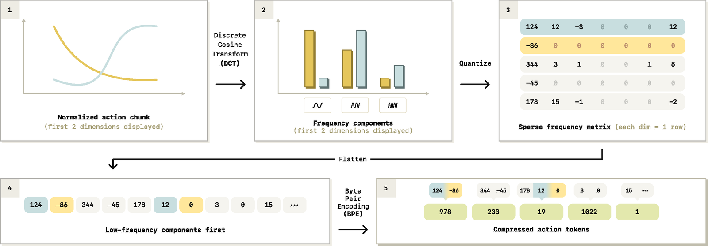{.nostretch fig-align="center" width="80%"}

::: {.tiny-font .absolute bottom="0" left="0"}
[FAST: Efficient Action Tokenization for Vision-Language-Action Models.]{.red} Pertsch et al. RSS 2025
:::

## π0-FAST: autoregressive π0

::: columns
::: {.column .small-math .arrow-bullets width="58%"}
▶ FAST gives about **30 tokens per arm** per 1-second chunk, largely independent of the control rate.

▶ **π0-FAST:** π0's PaliGemma 3B backbone (flow-matching π0 comes later today) predicts FAST tokens autoregressively, without an action expert. Trained on the 10k-hour π0 mixture, it **matches flow-matching π0**, including laundry folding, with **5x fewer GPU hours**.

▶ **Cost:** about 750 ms per chunk versus 100 ms for flow-matching π0 on a 4090. It decodes 30–60 tokens through the full language model instead of running 10 flow steps through a 300M expert.

▶ **FAST+:** a universal tokenizer whose Byte-Pair Encoding is trained on 1M real robot action trajectories. It matches per-dataset tokenizers.
:::

::: {.column .small-math width="42%"}
| Dataset (rate) | Naive | FAST |
|---|---|---|
| BridgeV2 (5 Hz) | 35 | 20 |
| DROID (15 Hz) | 105 | 29 |
| Bussing (20 Hz) | 140 | 28 |
| Shirt fold (50 Hz, 2 arms) | 700 | 53 |

[Average tokens per 1-second chunk.]{.grey-text .tiny-font}
:::
:::

::: {.tiny-font .absolute bottom="0" left="0"}
[FAST: Efficient Action Tokenization for Vision-Language-Action Models.]{.red} Pertsch et al. RSS 2025
:::

## Open X-Embodiment and RT-X

::: {.small-math .arrow-bullets}
▶ Can one robot's demonstrations help another? **Open X-Embodiment** pools over 1M trajectories from 22 embodiments and 21 institutions, with actions mapped to a common 7-D space (frames and conventions still differ). Retraining on 9 embodiments gives **RT-1-X** and **RT-2-X**.

▶ **Transfer works:** on five labs' small datasets (below), RT-1-X beats both the lab's own method and single-dataset RT-1 by 50% in mean success. On skills seen only in other labs' data, RT-2-X succeeds about 3× as often as RT-2.

▶ **But it needs capacity:** on the large Bridge and Google datasets, RT-1-X underfits; only the 55B RT-2-X improves.
:::

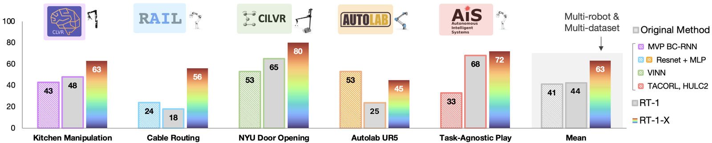{.nostretch fig-align="center" width="82%"}

::: {.tiny-font .absolute bottom="0" left="0"}
[Open X-Embodiment: Robotic Learning Datasets and RT-X Models.]{.red} Open X-Embodiment Collaboration. ICRA 2024
:::

## OpenVLA: an open RT-2

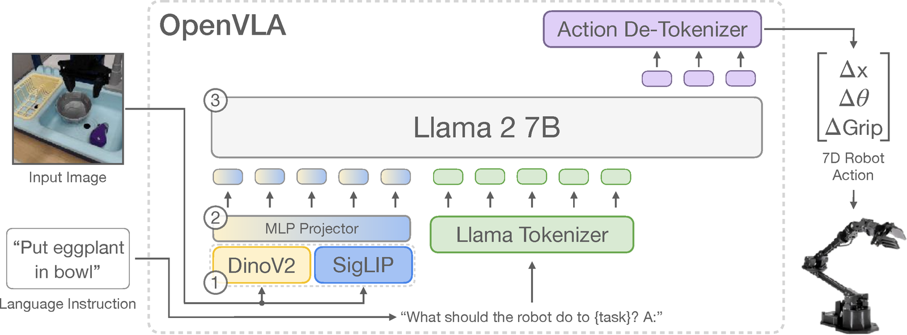{.nostretch fig-align="center" width="62%"}

::: {.small-math .arrow-bullets}
▶ **7B, open weights**, trained on 970k Open X-Embodiment episodes. Prismatic-7B: **SigLIP** (semantics) and **DINOv2** (spatial) features projected into **Llama 2**.

▶ **Actions:** 7-D, one step at a time, autoregressive like RT-2. 256 bins per dimension over the 1st–99th percentile, written into Llama's 256 least-used tokens.

▶ **Result:** 16.5 points above the 55B RT-2-X on 29 tasks (WidowX and Google robots), though the training data differ.

▶ **Caveat:** RT-2-X stays better on semantic tasks. Fine-tuning dropped web data, so **better robot performance does not imply the web knowledge was kept.**
:::

::: {.tiny-font .absolute bottom="0" left="0"}
[OpenVLA: An Open-Source Vision-Language-Action Model.]{.red} Kim et al. CoRL 2024
:::

## Octo: a diffusion action head

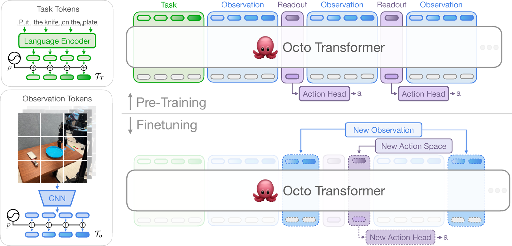{.nostretch fig-align="center" width="54%"}

::: {.small-math .arrow-bullets}
▶ **Open generalist policy:** pretrained on 800k trajectories from 25 Open X-Embodiment datasets. Octo-Small (27M) and Octo-Base (93M). Instruction (T5 encoder) *or* goal image, plus camera images.

▶ **Readout tokens** collect information inside the transformer. A small diffusion head reads them and denoises a continuous **action chunk**. The transformer runs once per prediction; the repeated denoising happens in the small head.

▶ **Modular** (bottom of the figure): new inputs or a new action head can be added at fine-tuning while keeping the pretrained transformer. Fine-tuned with ~100 demonstrations per task: 72% average success across six setups, versus 20% from scratch.
:::

::: {.tiny-font .absolute bottom="0" left="0"}
[Octo: An Open-Source Generalist Robot Policy.]{.red} Octo Model Team. RSS 2024
:::

## Why a diffusion head and not MSE regression?

::: {.small-math .arrow-bullets}
▶ **Why not regress actions with MSE?** To reach a cup behind an obstacle, half the demonstrations go left and half go right.

$$
\arg\min_{f} \; \mathbb{E}\big[\|a - f(o)\|^2\big] = \mathbb{E}[a \mid o]
$$

▶ The conditional mean of "left" and "right" is "straight into the obstacle".

▶ Diffusion and flow matching **sample** one mode instead of averaging them. Same argument as Diffusion Policy and implicit BC in Week 1.
:::

::: {.tiny-font .absolute bottom="0" left="0"}
[Octo: An Open-Source Generalist Robot Policy.]{.red} Octo Model Team. RSS 2024
:::

## π0: a VLM plus an action expert

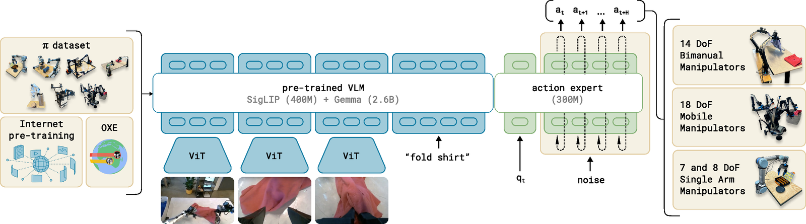{.nostretch fig-align="center" width="94%"}

::: {.small-math .arrow-bullets}
▶ **Backbone:** PaliGemma, a 3B VLM. **Action expert:** a narrower, randomly initialized transformer (~300M) that follows Gemma's architecture and attends to the VLM's keys and values.

▶ **Inputs:** multiple camera images, the instruction, and the robot state $q_t$. **Output:** a chunk of 50 future continuous actions, for control up to 50 Hz.

▶ **Data:** Internet-scale VLM pretraining, open robot datasets (OXE), and PI's own dexterous data from many robot types. Pretrained once, then post-trained on specific tasks (laundry, bussing, box assembly).
:::

::: {.tiny-font .absolute bottom="0" left="0"}
[π0: A Vision-Language-Action Flow Model for General Robot Control.]{.red} Black et al. RSS 2025
:::

## π0: flow matching for action chunks

::: {.small-math .arrow-bullets}
▶ **Flow matching:** interpolate between noise $\epsilon \sim \mathcal{N}(0, I)$ and the true chunk $A$, and regress the velocity:

$$
A^\tau = \tau A + (1-\tau)\,\epsilon, \qquad
\mathcal{L}(\theta) = \mathbb{E}_{\tau, \epsilon}\left[\big\| v_\theta(A^\tau, \tau, o) - (A - \epsilon) \big\|^2\right]
$$

At inference, start from noise and integrate $v_\theta$ for about 10 steps. The VLM runs once; only the expert is iterated.

▶ **Open question the chunk creates:** how much of the 50-step chunk to execute before predicting again. Executing more is smoother but uses older observations. Real-time chunking, two slides on, is one answer.
:::

::: {.tiny-font .absolute bottom="0" left="0"}
[π0: A Vision-Language-Action Flow Model for General Robot Control.]{.red} Black et al. RSS 2025
:::

## π0: autonomous laundry folding



::: {.tiny-font .absolute bottom="0" left="0"}
[π0: A Vision-Language-Action Flow Model for General Robot Control.]{.red} Black et al. RSS 2025. Uncut autonomous rollout, Physical Intelligence.
:::

## Chunks under latency

::::: columns
::: {.column .small-math .arrow-bullets width="50%"}
▶ A chunk takes longer than a control step to compute, so it arrives $d$ steps after inference starts. π0's KV prefill alone takes 46 ms on a 4090; a step at 50 Hz is 20 ms.

▶ **Synchronous** (the default): execute $s$ actions, stop, wait. Stopping changes the robot's dynamics, a distribution shift.

▶ **Naive asynchronous:** switch to the next chunk when it's ready. It may pick another mode (below the obstacle, not above): a jump.

▶ **Temporal ensembling** (ACT): averaging two modes heads into the obstacle, as with MSE regression.
:::

::: {.column width="50%"}
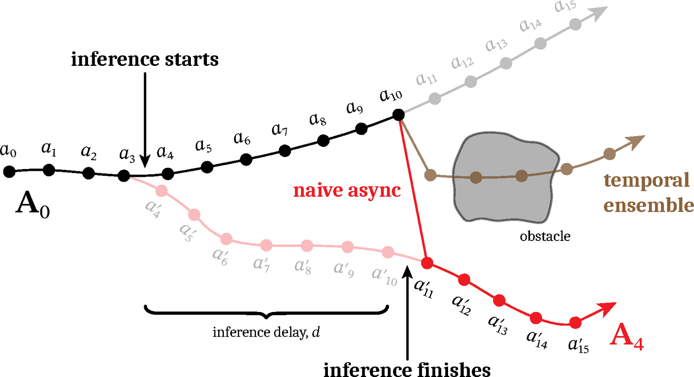{.nostretch fig-align="center" width="100%"}
:::
:::::

::: {.tiny-font .absolute bottom="0" left="0"}
[Real-Time Execution of Action Chunking Flow Policies.]{.red} Black, Galliker, Levine. NeurIPS 2025
:::

## RTC: freeze, then inpaint

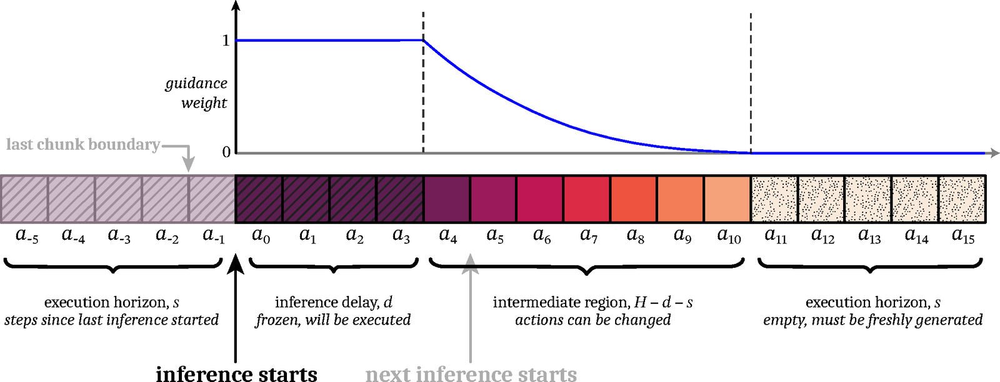{.nostretch fig-align="center" width="50%"}

::: {.small-math .arrow-bullets}
▶ **Real-time chunking (RTC):** generate the next chunk while executing the current one. The first $d$ actions are **frozen** (weight 1): they execute before the new chunk arrives. The rest of the overlap gets **exponentially decaying** weights; the last $s$ actions are free.

▶ **Inpainting by guidance:** at each flow step, pull the predicted final chunk $\hat A^1 = A^\tau + (1-\tau)\,v$ toward the old chunk $Y$, weighted by $W$:
$$
v \leftarrow v + \min\!\Big(\beta, \tfrac{1-\tau}{\tau\, r_\tau^2}\Big)\,(Y - \hat A^1)^\top \operatorname{diag}(W)\, \tfrac{\partial \hat A^1}{\partial A^\tau}
$$
No retraining, for any diffusion or flow policy; the cost is a backward pass per flow step. The soft overlap matters when $d$ is small: a short frozen prefix can't keep the new chunk on the same strategy.

[$\tau$: flow time (0 = noise, 1 = clean chunk); $v$: the policy's flow-matching velocity field; $r_\tau^2 = \frac{(1-\tau)^2}{\tau^2 + (1-\tau)^2}$; $\beta$ caps the guidance weight (≈5), which is otherwise infinite at $\tau = 0$.]{.grey-text .small-math}
:::

::: {.tiny-font .absolute bottom="0" left="0"}
[Real-Time Execution of Action Chunking Flow Policies.]{.red} Black, Galliker, Levine. NeurIPS 2025
:::

## RTC: results, and at training time

::::: columns
::: {.column .small-math .arrow-bullets width="52%"}
▶ **Real robot** (π0.5 at 50 Hz, 6 bimanual tasks such as lighting a candle): with +100 or +200 ms of added latency, RTC's throughput **does not drop**. Synchronous inference degrades linearly; temporal ensembling oscillates until the protective stop triggers.

▶ **Training-time RTC:** simulate the delay in training. The first $d$ actions are given clean ($\tau = 1$) and only the rest are denoised, with $d$ random. No new parameters, no backward pass at inference.

▶ It beats inference-time RTC for $d \geq 2$ in simulation (bottom) and matches it on real π0.6 tasks at lower latency (108 vs. 135 ms), but loses the soft overlap.
:::

::: {.column width="48%"}
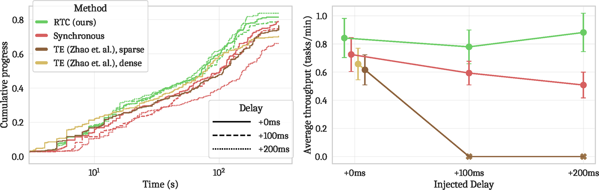{.nostretch fig-align="center" width="100%"}

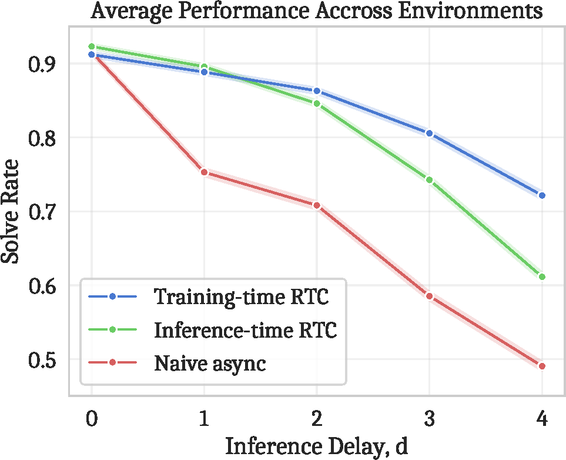{.nostretch fig-align="center" width="62%"}
:::
:::::

::: {.tiny-font .absolute bottom="0" left="0"}
[Real-Time Execution of Action Chunking Flow Policies.]{.red} Black et al. NeurIPS 2025. [Training-Time Action Conditioning for Efficient Real-Time Chunking.]{.red} Black et al. 2025
:::

## MolmoAct: reasoning in space

::::: columns
::: {.column .small-math .arrow-bullets width="50%"}
▶ **MolmoAct:** instead of mapping observations directly to actions, predict three things in sequence, all as tokens:

1.  **Depth:** a 10×10 grid of discrete codes (from Depth Anything v2, compressed by a VQ-VAE). Training targets only; no depth estimator runs at test time.
2.  **A visual trace:** up to 5 image-space points for the intended end-effector path.
3.  **Actions:** a chunk of 8 discretized actions.

▶ The intermediate predictions can be inspected, and a user can steer the robot by drawing a different trace. But they add latency, and a plausible trace doesn't guarantee correct execution.
:::

::: {.column width="50%"}
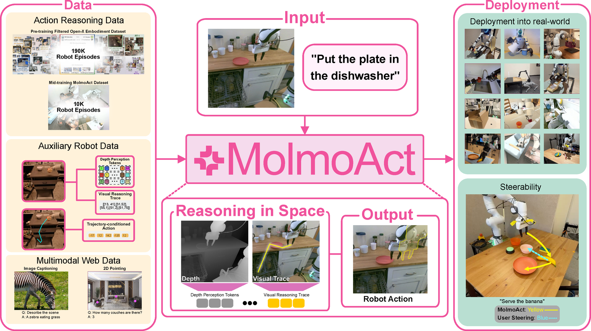{.nostretch fig-align="center" width="100%"}
:::
:::::

::: {.tiny-font .absolute bottom="0" left="0"}
[MolmoAct: Action Reasoning Models that can Reason in Space.]{.red} Lee et al. 2025
:::

## MolmoAct 2: making it deployable

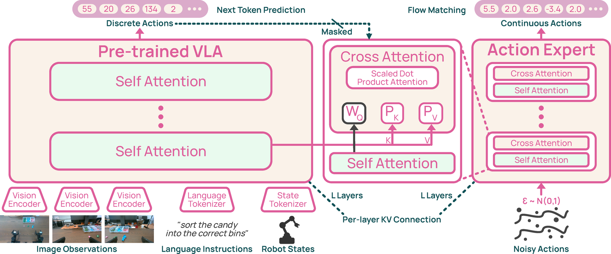{.nostretch fig-align="center" width="62%"}

::: {.small-math .arrow-bullets}
-   **Molmo2-ER** backbone, specialized for spatial and embodied reasoning (3.3M-sample corpus).
-   Pretraining predicts discrete action tokens (**OpenFAST**, an open FAST tokenizer; see the FAST slide). Post-training grafts a **flow-matching DiT action expert** with the same depth as the VLM (36 layers). Each expert layer cross-attends to the corresponding VLM layer's keys and values.
-   **MolmoAct2-Think:** depth is re-predicted only for grid cells whose image content changed. The cost of reasoning scales with scene change, not with all 100 tokens.
-   **Fully open:** weights, code, and data, including 720 hours of bimanual YAM teleoperation.
:::

::: {.tiny-font .absolute bottom="0" left="0"}
[MolmoAct2: Action Reasoning Models for Real-World Deployment.]{.red} Fang et al. 2026
:::

## π0.5: subtask, then actions

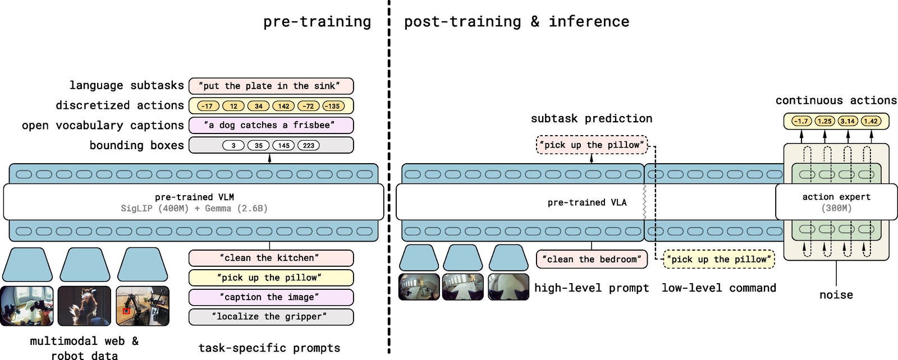{.nostretch fig-align="center" width="92%"}

::: {.small-math .arrow-bullets}
▶ **Hierarchical inference inside one network:** at each step the model first writes the next subtask as text, $\hat\ell_t \sim \pi_\theta(\cdot \mid o_t, \ell)$, then generates an action chunk conditioned on it, $A_t \sim \pi_\theta(\cdot \mid o_t, \hat\ell_t)$.

▶ **Result:** the first end-to-end learned system to clean kitchens and bedrooms in **homes it has never seen**: long-horizon, multi-stage tasks.
:::

::: {.tiny-font .absolute bottom="0" left="0"}
[π0.5: a Vision-Language-Action Model with Open-World Generalization.]{.red} Physical Intelligence (Black et al.). CoRL 2025
:::

## π0.5: it's the data mixture

::::: columns
::: {.column .small-math .arrow-bullets width="50%"}
▶ **Same architecture family as π0.** The change is **co-training on heterogeneous data**:

-   ~400 hours of mobile manipulators in ~100 homes
-   **ME:** static robots in many other environments
-   **CE:** cross-embodiment lab data
-   **WD:** web data (captions, question answering, detection)
-   subtask labels ("pick up the pillow") and verbal instructions from supervisors
:::

::: {.column width="50%"}
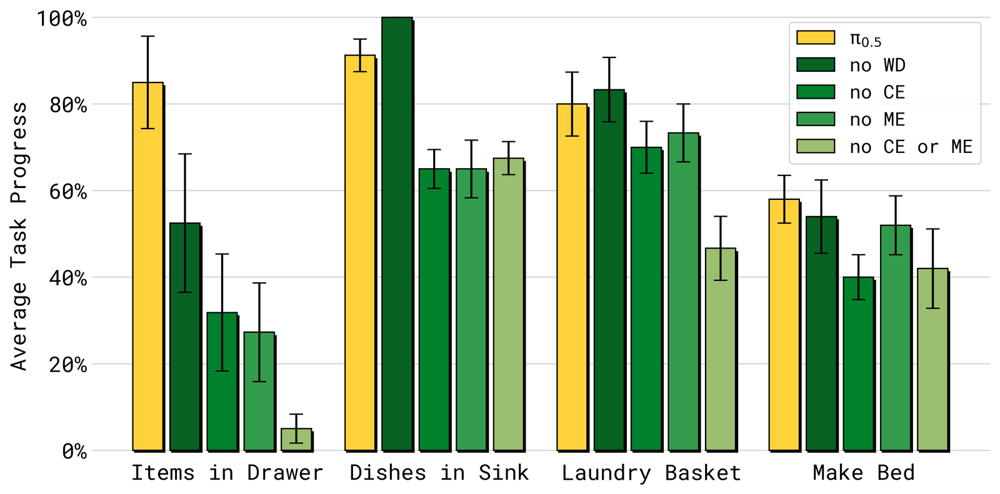{.nostretch fig-align="center" width="100%"}

[Task progress in unseen homes when one data source is removed from training.]{.grey-text .tiny-font}
:::
:::::

::: {.small-math .arrow-bullets}
▶ **Ablations:** removing ME or CE hurts, and removing both is worst. Removing web data mainly hurts unseen object categories and subtask inference. Subtask labels help even when the model doesn't predict subtasks at run time.
:::

::: {.tiny-font .absolute bottom="0" left="0"}
[π0.5: a Vision-Language-Action Model with Open-World Generalization.]{.red} Physical Intelligence (Black et al.). CoRL 2025
:::

## MEM: memory at two time scales

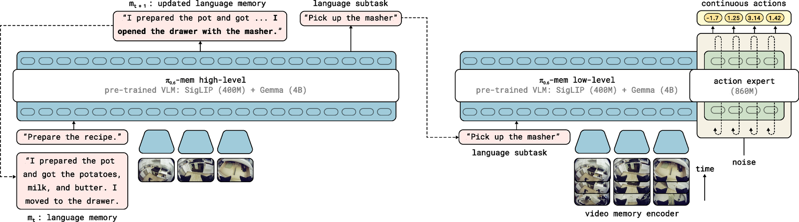{.nostretch fig-align="center" width="80%"}

::: {.small-math .arrow-bullets}
▶ **Why memory:** to resolve self-occlusion (where is the object my arm now hides?), to count (how many scoops?), and to track progress (which recipe steps are done?). Most VLAs, π0.5 included, see only the current frame; Week 5's LSTMs were the classic answer. Stacking past frames into the backbone breaks the 300 ms real-time limit at 4 frames.

▶ **Factorize by time scale**, reusing π0.5's high-level/low-level split. The high-level policy writes the next subtask $l_{t+1}$ *and* rewrites a language memory $m_{t+1}$; both see only $K \ll T$ recent frames:
$$
\pi_{\text{HL}}(l_{t+1}, m_{t+1} \mid o_{t-K:t}, m_t, g), \qquad \pi_{\text{LL}}(a_{t:t+H} \mid o_{t-K:t}, l_{t+1}, g)
$$
Short-term memory lives in pixels, long-term memory in text.
:::

::: {.tiny-font .absolute bottom="0" left="0"}
[MEM: Multi-Scale Embodied Memory for Vision Language Action Models.]{.red} Torne et al. 2026
:::

## MEM: video and language memory

::::: columns
::: {.column .small-math .arrow-bullets width="54%"}
▶ **Video encoder** (right, top): every 4th ViT layer attends across time for the same patch, costing $O(Kn^2 + nK^2)$ instead of $O(n^2K^2)$ for $K$ frames of $n$ patches. Upper layers keep only current-frame tokens, so the backbone sees no more tokens than a memoryless VLA: under 300 ms at 16 frames (right, bottom), and up to 54 s of history after post-training.

▶ **Language memory:** the high-level policy rewrites its own compressed summary ("I placed three bowls in the top right cabinet"), trained on targets written by an LLM. Simply concatenating past subtasks works worse: long lists of repeats are out of distribution.
:::

::: {.column width="46%"}
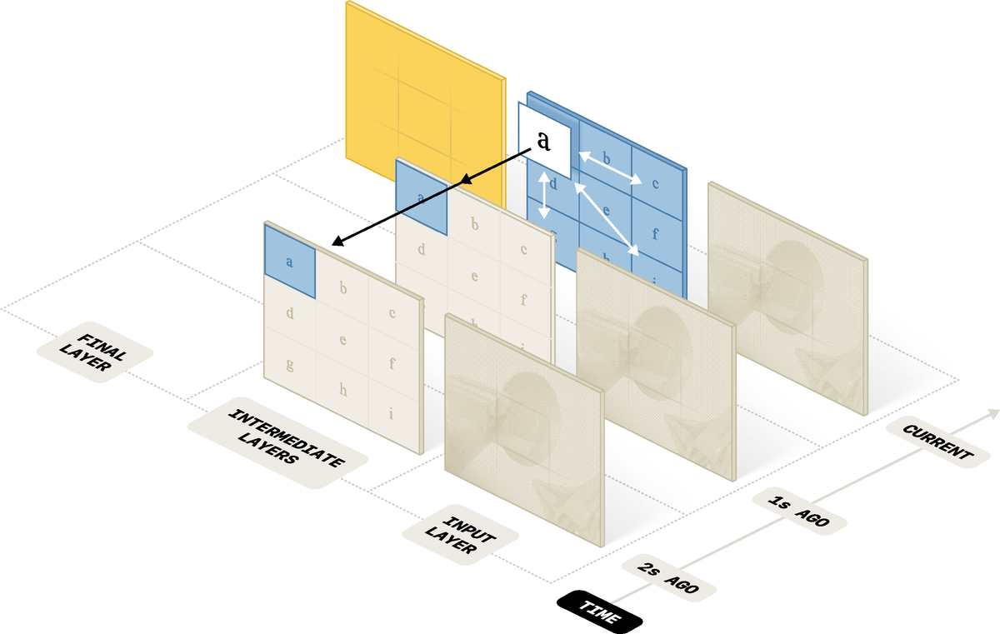{.nostretch fig-align="center" width="82%"}

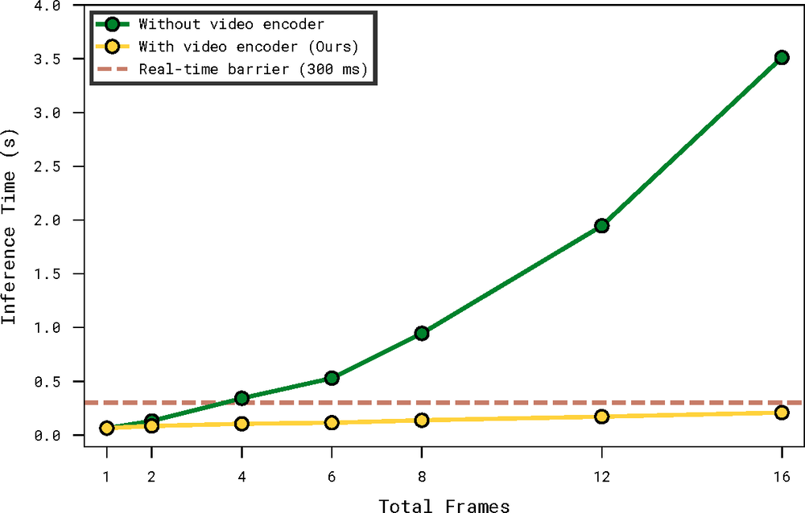{.nostretch fig-align="center" width="74%"}
:::
:::::

::: {.tiny-font .absolute bottom="0" left="0"}
[MEM: Multi-Scale Embodied Memory for Vision Language Action Models.]{.red} Torne et al. 2026
:::

## MEM: what memory buys

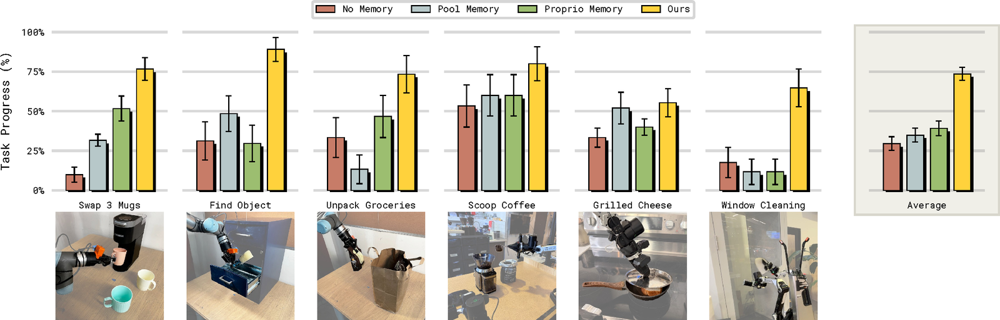{.nostretch fig-align="center" width="72%"}

::: {.small-math .arrow-bullets}
▶ **Core memory tests** (above): memoryless π0.6 guesses. Pooling past frames or keeping past robot states helps only on easy tasks; MEM is strong on all six (about 73% versus 29%).

▶ **Long tasks, up to 15 minutes** (recipe setup, kitchen cleanup): task progress roughly doubles, from 35% to 70%. Removing either memory breaks them.

▶ **In-context adaptation:** after a failed grasp or a fridge door that opens the other way, it changes strategy (+62 points on the fridge). **No cost** on tasks that need no memory. **π0.7** adopts this encoder and matches the MEM specialists out of the box.
:::

::: {.tiny-font .absolute bottom="0" left="0"}
[MEM: Multi-Scale Embodied Memory for Vision Language Action Models.]{.red} Torne et al. 2026
:::

## π0.7: steer it with the prompt

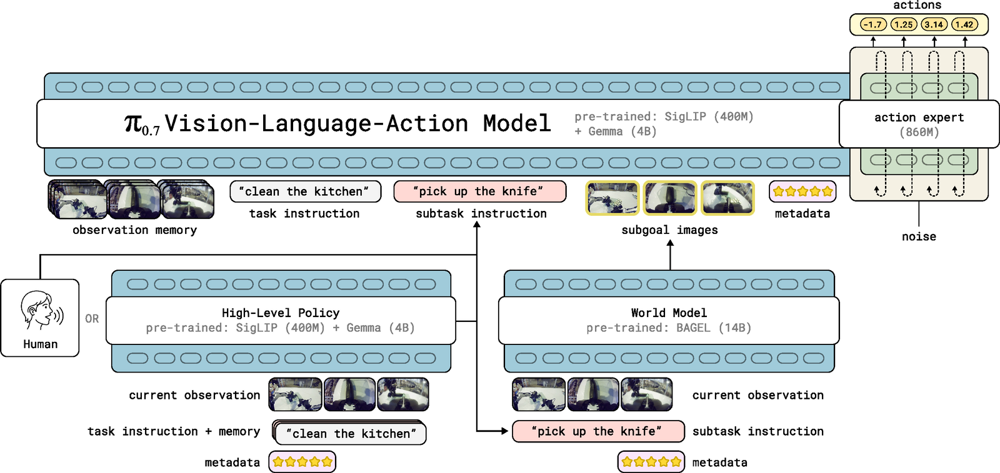{.nostretch fig-align="center" width="76%"}

::: {.small-math .arrow-bullets}
▶ **About 5B parameters:** Gemma 3 4B backbone, the MEM video-history encoder (previous slides; up to 6 past frames per camera, compressed to a fixed number of tokens), and an 860M flow-matching action expert. **The architecture barely changes. The prompt does.** Subtasks come from a high-level policy or a human; subgoal images come from a separate world model.
:::

::: {.tiny-font .absolute bottom="0" left="0"}
[π0.7: a Steerable Generalist Robotic Foundation Model with Emergent Capabilities.]{.red} Physical Intelligence. 2026
:::

## π0.7: what goes in the prompt

::: {.small-math .arrow-bullets}
▶ Besides the task $\ell$, the context $\mathcal{C}_t$ can contain:

-   a **subtask instruction** $\hat\ell_t$ ("open the fridge door"), from a high-level policy or a human coach
-   **subgoal images** of the near future, from a separate image-editing world model (initialized from BAGEL, 14B)
-   **episode metadata:** speed, quality (1–5), mistakes
-   the **control mode:** joints or end-effector

$$
\max_\theta \; \mathbb{E}_{\mathcal{D}} \left[\log \pi_\theta\left(a_{t:t+H} \mid o_{t-T:t},\, \mathcal{C}_t\right)\right]
$$

▶ Each component is **randomly dropped** in training, so any subset works at test time.

▶ **A subgoal image makes it almost inverse dynamics**, which is so much easier that subgoal images appear in only 25% of training examples.
:::

::: {.tiny-font .absolute bottom="0" left="0"}
[π0.7: a Steerable Generalist Robotic Foundation Model with Emergent Capabilities.]{.red} Physical Intelligence. 2026
:::

## π0.7: learning from failures

::::: columns
::: {.column .small-math .arrow-bullets width="58%"}
▶ **Train on almost everything:** failed episodes, demonstrations with mistakes, autonomous rollouts, RL data from π\*0.6, egocentric human video. Each episode is labeled with speed, quality and mistakes; at test time, prompt for "fast, quality 5, no mistakes".

▶ This is **return-conditioned behavioral cloning** (offline RL, Week 3), so don't expect it to beat the best episodes in the data.

▶ **Reported (PI's own evaluation):** matches RL-fine-tuned specialists (e.g. an espresso machine) by distilling their rollouts; follows verbal coaching on new tasks; folds laundry zero-shot on a robot never trained on it.
:::

::: {.column width="42%"}
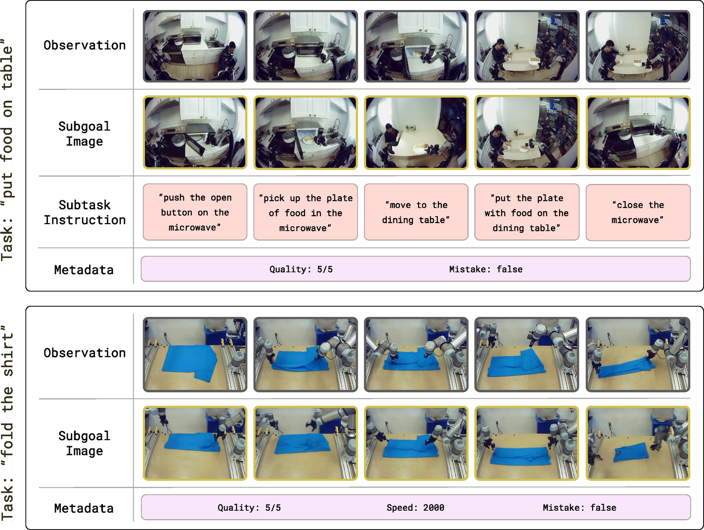{.nostretch fig-align="center" width="100%"}

[Two training episodes with their full context: subgoal images, subtask instructions, and metadata.]{.grey-text .tiny-font}
:::
:::::

::: {.tiny-font .absolute bottom="0" left="0"}
[π0.7: a Steerable Generalist Robotic Foundation Model with Emergent Capabilities.]{.red} Physical Intelligence. 2026
:::

## Rho: robot first, then the task

::: {.small-math .arrow-bullets}
▶ **Open weights, about 5B:** a 4.68B Phi VLM (**Phi-Phy**) plus a 542M flow-matching expert that outputs end-effector poses.

▶ **The key is the training schedule:**

1.  **Pretrain** on 3,200+ hours from a dozen-plus mostly dual-arm robots, plus 10% vision-language data.
2.  **Embodiment midtraining:** ~300 hours of *one* robot: learn the robot, not a task.
3.  **Fine-tune** on 100–300 target-task demonstrations.

▶ **Corrections after deployment** (Week 9): a small **latent policy** picks the frozen expert's initial noise from the observation, trained on as few as 15 corrected episodes.

▶ Reported to match or beat π0.5, GR00T N1.7 and MolmoAct 2 on three robots (their evaluation).
:::

::: {.tiny-font .absolute bottom="0" left="0"}
[Rho: A Foundation for Efficiently Adaptable VLA Models.]{.red} Microsoft Research. 2026
:::

## Rho: midtraining halves the data

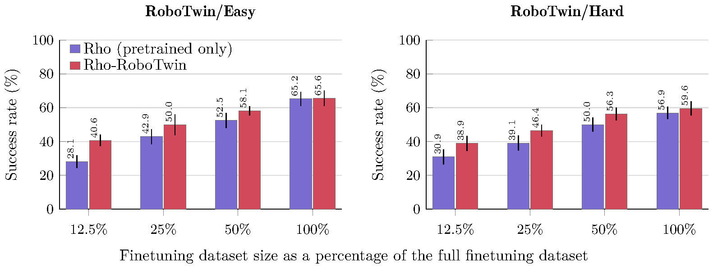{.nostretch fig-align="center" width="80%"}

::: {.small-math .arrow-bullets}
▶ **Controlled test in simulation (RoboTwin):** midtrain on 45 tasks of one dual-arm robot, then fine-tune on 5 held-out tasks with 12.5% to 100% of their demonstrations.

▶ **Midtrained with 25% of the data ≈ base model with 50%.** The gain is largest in the low-data regime and disappears once fine-tuning data is plentiful.
:::

::: {.tiny-font .absolute bottom="0" left="0"}
[Rho: A Foundation for Efficiently Adaptable VLA Models.]{.red} Microsoft Research. 2026
:::

## The VLA landscape

::: rep-table
| Model | Backbone | Action output | Distinctive idea | Open |
|---|---|---|---|---|
| **RT-2** (2023) | PaLI-X 55B / PaLM-E 12B | discrete tokens, 1 step | actions as text, co-fine-tuning | no |
| **OpenVLA** (2024) | Llama 2 7B, SigLIP + DINOv2 | discrete tokens, 1 step | open RT-2 on OXE data | yes |
| **Octo** (2024) | small transformer, 27–93M | diffusion chunk | readout tokens, modular heads | yes |
| **π0** (2024) | PaliGemma 3B | flow expert, 50-step chunk | VLM plus action expert | yes |
| **π0-FAST** (2025) | PaliGemma 3B | FAST tokens, autoregressive | frequency-space tokenization | yes |
| **TRI LBM** (2025) | DiT on CLIP ViT-B/16 features | diffusion chunk | Diffusion Policy, blind A/B tests | no |
| **ManiFlow** (2025) | DiT-X from scratch, point clouds or images | flow chunk, 1–2 steps | consistency flow training | yes |
| **π0.5** (2025) | π0 architecture | subtask text, then flow | heterogeneous co-training | yes |
| **MolmoAct 2** (2026) | Molmo2-ER | flow DiT, per-layer KV | adaptive depth reasoning, fully open data | yes |
| **π0.6-MEM** (2026) | π0.6 (Gemma 3 4B) | flow matching | video and language memory, 15-minute tasks | no |
| **π0.7** (2026) | Gemma 3 4B, ~5B total | flow matching | prompt with subgoal images and metadata | API |
| **Rho** (2026) | Phi-Phy 4.68B | flow, end-effector poses | embodiment midtraining, latent policy | yes |
| **GR00T N1.7** (2026) | Cosmos-Reason 2B | diffusion-transformer head | last VLA before GR00T 2 | yes |
:::

::: {.small-math .arrow-bullets}
:::

## TRI LBM: Diffusion Policy at scale

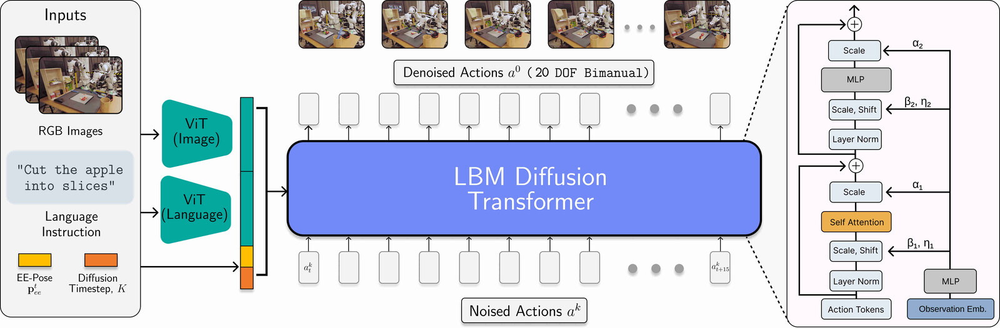{.nostretch fig-align="center" width="86%"}

::: {.small-math .arrow-bullets}
▶ **Large Behavior Model (LBM):** Week 1's Diffusion Policy, made multitask. A Diffusion Transformer (8 blocks, width 768, DDIM) is conditioned through adaLN on CLIP ViT-B/16 image features, CLIP text features and the end-effector pose, over 2 observation steps. No VLM backbone.

▶ **Output:** 16 steps of 20-D bimanual actions; it runs at 10 Hz and executes 8 steps before replanning.

▶ **Data:** about 1,700 hours of demonstrations, more than 500 internal tasks plus a subset of Open X-Embodiment. **Recipe:** pretrain on everything, fine-tune per task, and compare with a single-task policy of the same architecture trained from scratch.
:::

::: {.tiny-font .absolute bottom="0" left="0"}
[A Careful Examination of Large Behavior Models for Multitask Dexterous Manipulation.]{.red} TRI LBM Team. 2025
:::

## LBM: how to evaluate a policy

::: {.small-math .arrow-bullets}
▶ **Blind A/B tests:** the evaluator doesn't know which policy runs. Each initial condition is run once per policy, in random order.

▶ **Reproducible starts:** the operator matches the scene to an overlay of the target image (below). Binary rubric questions, re-checked by a second team.

▶ **Sample sizes:** 50 real rollouts per task, policy and condition, 200 per simulated task, on tasks tuned to about 50% success. Results are Bayesian posteriors.

▶ **Why 50 isn't a lot** (our arithmetic): at $p = 0.5$ the standard error is $\sqrt{0.25/50} \approx 0.07$, a 95% interval of $\pm 14$ points. The authors warn that many papers may be "measuring statistical noise".
:::

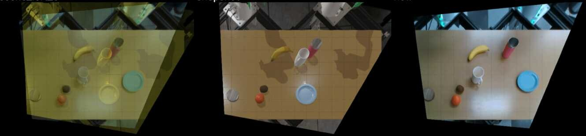{.nostretch fig-align="center" width="58%"}

::: {.tiny-font .absolute bottom="0" left="0"}
[A Careful Examination of Large Behavior Models for Multitask Dexterous Manipulation.]{.red} TRI LBM Team. 2025
:::

## LBM: what pretraining buys

::::: columns
::: {.column .small-math .arrow-bullets width="56%"}
▶ **Seen tasks:** the fine-tuned LBM is the same or better than single-task on 3/3 real and 15/16 simulated tasks; significantly better on 3/16 nominally but **10/16 under distribution shift**. The gain is mostly robustness.

▶ **Unseen tasks:** better in aggregate. In simulation it matches from-scratch training with **under 30% of the task data** (dashed line, right).

▶ **More pretraining data helps** (right), most when task data is scarce.

▶ **Caveats, as reported:** without fine-tuning it doesn't beat single-task policies in the real world, and a data-normalization bug was found after the evaluations.
:::

::: {.column width="44%"}
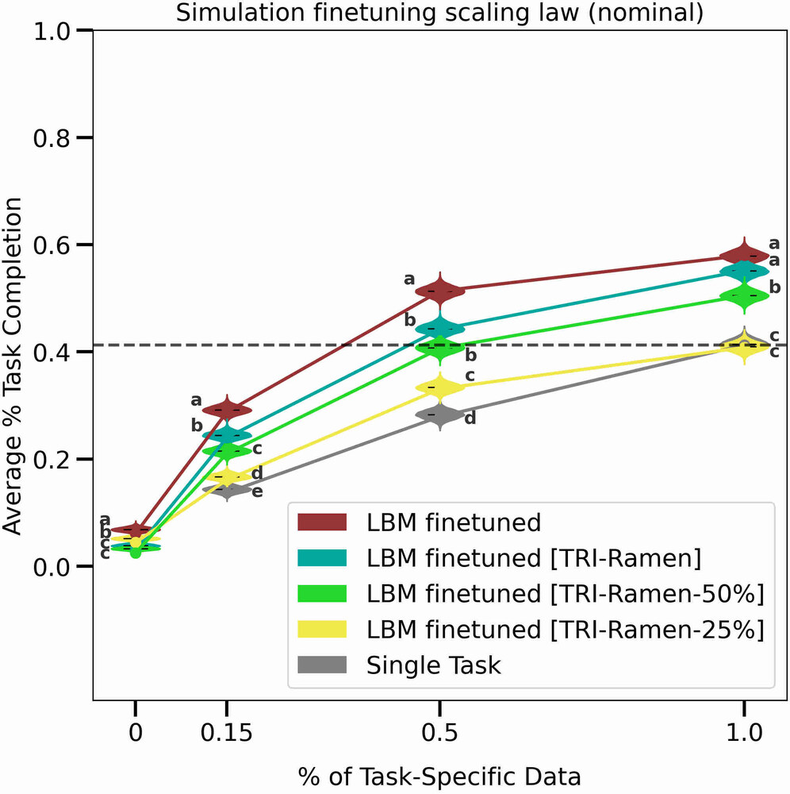{.nostretch fig-align="center" width="92%"}

::: {.grey-text .tiny-font}
Task completion on 5 unseen simulated tasks against the fraction of task data. TRI-Ramen: TRI's own data only; -50% and -25%: fewer pretraining tasks.
:::
:::
:::::

::: {.tiny-font .absolute bottom="0" left="0"}
[A Careful Examination of Large Behavior Models for Multitask Dexterous Manipulation.]{.red} TRI LBM Team. 2025
:::

## ManiFlow: few-step flow, no VLM

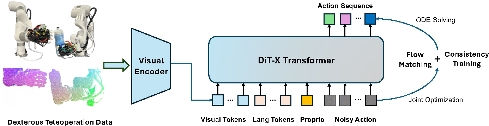{.nostretch fig-align="center" width="80%"}

::: {.small-math .arrow-bullets}
▶ **Like LBM, no VLM:** an imitation policy trained per task from scratch, on 10–100 simulated demonstrations or about 50–80 real ones. Inputs: a 2D image (ResNet-18) or a **3D point cloud** (the DP3 encoder), plus language and robot state.

▶ **DiT-X:** action tokens cross-attend to visual and language tokens. AdaLN-Zero, driven by the flow time $t$ and step size $\Delta t$, scales and shifts the cross-attention too, not only self-attention as in DiT. It learns faster than DiT or MDT blocks on 10 MetaWorld tasks.
:::

::: {.tiny-font .absolute bottom="0" left="0"}
[ManiFlow: A General Robot Manipulation Policy via Consistency Flow Training.]{.red} Yan et al. CoRL 2025 · [project page](https://maniflow-policy.github.io){target="_blank"}
:::

## ManiFlow: consistency flow training

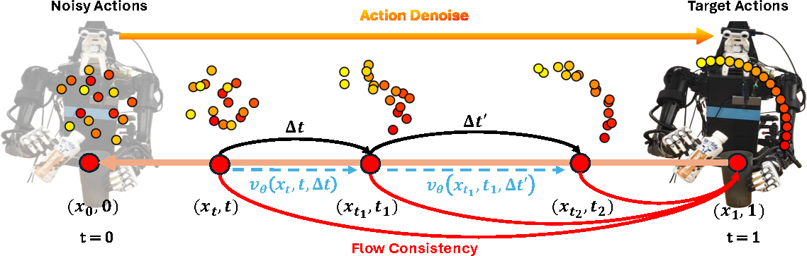{.nostretch fig-align="center" width="68%"}

::: {.small-math .arrow-bullets}
$$
\mathcal{L} = \big\|v_\theta(x_t, t, 0) - (x_1 - x_0)\big\|^2 + \big\|v_\theta(x_t, t, \Delta t) - \tilde v\big\|^2, \quad \tilde v = \frac{\tilde x_1 - x_t}{1-t}, \quad \tilde x_1 = x_{t_1} + (1-t_1)\, v_{\theta^-}(x_{t_1}, t_1, \Delta t')
$$

▶ **Step size as an input**, as in shortcut models: the velocity from $x_t$ must land where an EMA copy $\theta^-$, starting from the later point $x_{t_1}$, says the chunk ends. This straightens the flow. $\tilde x_1$ is the same one-step estimate as RTC's $\hat A^1$.

▶ **No pretrained teacher**, unlike Consistency Policy's distillation. Flow time is sampled from a Beta distribution, as in π0.

▶ On 5 bimanual RoboTwin tasks: **1 step 63.7%**, 10 steps 61.9%, against DP3 at 42.7% with 10 steps.
:::

::: {.tiny-font .absolute bottom="0" left="0"}
[ManiFlow: A General Robot Manipulation Policy via Consistency Flow Training.]{.red} Yan et al. CoRL 2025 · [project page](https://maniflow-policy.github.io){target="_blank"}
:::

## ManiFlow: real robots

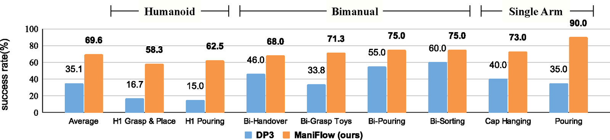{.nostretch fig-align="center" width="86%"}

::: {.small-math .arrow-bullets}
▶ **8 tasks on 3 platforms:** a Franka with a gripper, bimanual xArms with Ability hands, and a Unitree H1 humanoid with dexterous hands; about 50–80 demonstrations per task on the arms.

▶ **69.6% versus DP3's 35.1%** on average (above). With unseen objects: 67.4% versus 31.1%.

▶ DP3 is a point-cloud diffusion policy with the same inputs, so the comparison isolates the action generator: consistency flow and DiT-X against diffusion denoising.
:::

::: {.tiny-font .absolute bottom="0" left="0"}
[ManiFlow: A General Robot Manipulation Policy via Consistency Flow Training.]{.red} Yan et al. CoRL 2025 · [project page](https://maniflow-policy.github.io){target="_blank"}
:::

## ManiFlow vs. π0: small data

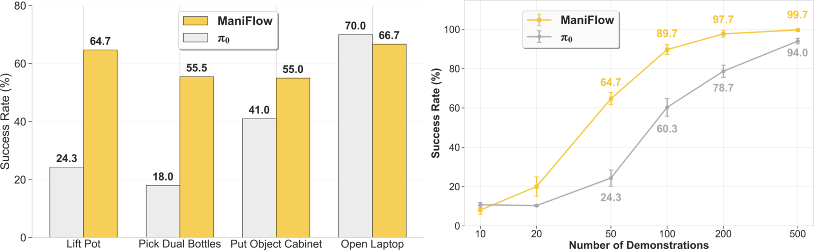{.nostretch fig-align="center" width="78%"}

::: {.small-math .arrow-bullets}
▶ **RoboTwin 2.0 with domain randomization** (clutter, new objects, lighting, table height), 50 demonstrations per task: ManiFlow from scratch on point clouds beats fine-tuned π0 on 3 of 4 tasks (left; lift pot 64.7 vs. 24.3).

▶ **Lift-pot scaling** (right): 97.7% at 200 demonstrations; π0 reaches 94.0% at 500.

▶ **Caveats:** simulation only; different inputs (point clouds vs. π0's multi-view images); one policy per task. It fails on contact-rich, force-dependent tasks such as compliant insertion. Flex-π later uses it as its 3D baseline.
:::

::: {.tiny-font .absolute bottom="0" left="0"}
[ManiFlow: A General Robot Manipulation Policy via Consistency Flow Training.]{.red} Yan et al. CoRL 2025 · [project page](https://maniflow-policy.github.io){target="_blank"}
:::

# Hierarchical VLAs

::: {.small-math .arrow-bullets}
▶ **The criterion:** a high level breaks the task into subgoals a person could read (a skill name, a sentence), and a learned low-level policy executes each one at a faster rate. The two levels can be separate models (SayCan, Hi Robot, MEM) or one model that decodes twice (RT-H, π0.5).
:::

## SayCan: an LLM picks a skill

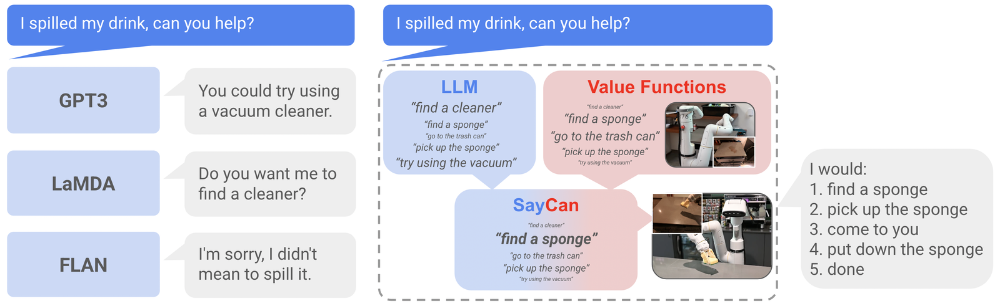{.nostretch fig-align="center" width="92%"}

::: {.small-math .arrow-bullets}
▶ **Setup:** a library of skills $\{\pi_k\}$, each with a text description $\ell_k$ ("find a sponge", "pick up the sponge") and a value function from RL that estimates whether it would succeed from the current state $s$.

▶ **Left:** an LLM alone gives a sensible answer that this robot can't execute. **Right:** SayCan scores each skill by how useful the LLM finds it *and* how likely the value function says it is to succeed.
:::

::: {.tiny-font .absolute bottom="0" left="0"}
[Do As I Can, Not As I Say: Grounding Language in Robotic Affordances.]{.red} Ahn et al. CoRL 2022
:::

## SayCan: useful × possible

::: {.small-math .arrow-bullets}
▶ **Choose the next skill** by combining what is useful with what is possible:

$$
k^\star = \arg\max_k \; \underbrace{p_{\text{LLM}}(\ell_k \mid \text{instruction}, \text{steps so far})}_{\text{"Say": useful for the task}} \;\cdot\; \underbrace{p(\text{success} \mid s, \ell_k)}_{\text{"Can": affordance}}
$$
:::

::::: columns
::: {.column .small-math .arrow-bullets width="56%"}
▶ Execute $\pi_{k^\star}$, append $\ell_{k^\star}$ to the history, repeat. "I spilled my drink, can you help?" becomes find a sponge, pick it up, go to the spill, ...

▶ With PaLM on 101 instructions in a real kitchen: 84% correct plans, 74% successful executions.

▶ **Limits:** the robot can only do what is on the menu. The LLM never sees the image, only the affordance scores. Plans are open-loop with respect to what actually happened (Inner Monologue later adds feedback).
:::

::: {.column width="44%"}
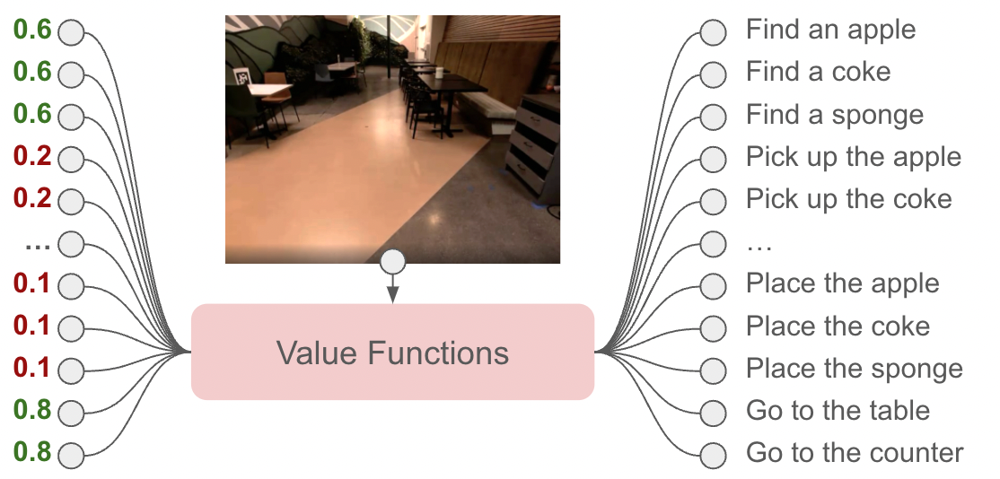{.nostretch fig-align="center" width="100%"}

[The "Can" term: value functions score every skill from the current image. Nothing graspable is in view, so the navigation skills score high.]{.grey-text .tiny-font}
:::
:::::

::: {.tiny-font .absolute bottom="0" left="0"}
[Do As I Can, Not As I Say: Grounding Language in Robotic Affordances.]{.red} Ahn et al. CoRL 2022
:::

## RT-H: language motions

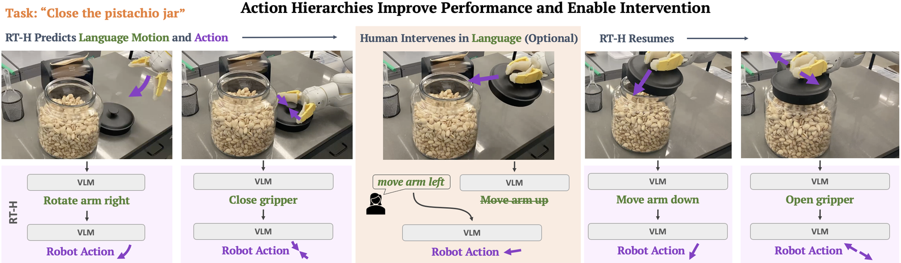{.nostretch fig-align="center" width="80%"}

::: {.small-math .arrow-bullets}
▶ **Problem:** "pick coke can" and "pour cup" share little at the task level, but they share low-level motions.

▶ **Language motions** ("move arm forward", "close gripper"). **One model, two queries:** predict the language motion from task and image, then the action from task, image and motion.

▶ **Interventions in language** (middle): a human corrects the robot by saying the right motion. This beats training on teleoperated corrections.

▶ Unlike SayCan, the intermediate language is low-level and comes from the same network as the actions.
:::

::: {.tiny-font .absolute bottom="0" left="0"}
[RT-H: Action Hierarchies Using Language.]{.red} Belkhale et al. RSS 2024
:::

## Hi Robot: a VLM that talks to a VLA

::::: columns
::: {.column .small-math .arrow-bullets width="60%"}
▶ **Decompose the policy** into a high-level VLM and a low-level VLA, communicating in language:

$$
\hat\ell_t \sim p^{\text{hi}}\big(\cdot \mid I_t^{1:n}, \ell_t\big), \qquad
A_t \sim p^{\text{lo}}\big(\cdot \mid I_t^{1:n}, \hat\ell_t, q_t\big)
$$

▶ $\ell_t$ is an open-ended prompt or user feedback ("can you make me a vegetarian sandwich?", "that's not trash"). $\hat\ell_t$ is a short atomic command ("pick up the lettuce"). The low level is π0.

▶ **Two rates:** the high level runs about once a second or immediately on new user input. The low level produces action chunks at high frequency. This is the figure's "subgoal planning / VLA executes" loop.
:::

::: {.column width="40%"}
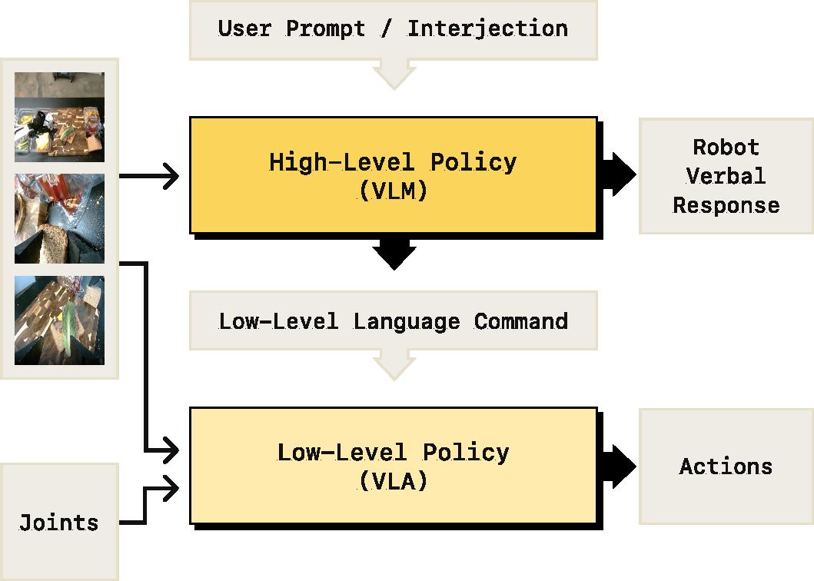{.nostretch fig-align="center" width="100%"}
:::
:::::

::: {.tiny-font .absolute bottom="0" left="0"}
[Hi Robot: Open-Ended Instruction Following with Hierarchical Vision-Language-Action Models.]{.red} Shi et al. ICML 2025
:::

## Hi Robot: training the high level

::: {.small-math .arrow-bullets}
▶ **Training data for the high level:** demonstrations are segmented and labeled with atomic skills. A large VLM is then prompted to invent plausible user prompts and interjections that could have preceded each segment. The synthetic data is what makes it follow open-ended requests.

▶ **Result:** over 40% higher instruction accuracy than using GPT-4o as the high-level policy with the same π0 low level, across table bussing, sandwich making, and grocery shopping.

▶ **Contrast with π0.5:** there one network predicts both the subtask and the actions. Here they are two models running at different rates.
:::

::: {.tiny-font .absolute bottom="0" left="0"}
[Hi Robot: Open-Ended Instruction Following with Hierarchical Vision-Language-Action Models.]{.red} Shi et al. ICML 2025
:::

## What should the high level send down?

::: {.small-math .arrow-bullets}
| Interface | Example | Precise? | Who can produce it |
|---|---|---|---|
| Choice from a skill menu | SayCan | no | any LLM |
| Language subgoal | Hi Robot, π0.5 | no | VLM, or a human coach |
| Language motion | RT-H | somewhat | the policy itself, or a human |
| Image-space trace, depth | MolmoAct | somewhat | the policy itself |
| Subgoal image | π0.7 | yes | an image-generation world model |
| Video plan | UniPi (last family) | yes | a video generation model |

▶ Going down the table, the interface carries more information about *how*, and the low level gets closer to inverse dynamics. It also gets more expensive to produce, and harder for a human to write.
:::

# Code as policies and agentic control

## Code as Policies: write the policy

::::: columns
::: {.column .small-math .arrow-bullets width="55%"}
▶ A code-writing LLM, few-shot prompted with commands and their code, writes **policy code** for a new command.

▶ The code calls **perception APIs** (`segment`, `point`) and **control primitives** (`move`, `grasp`), with loops, arithmetic, NumPy and Shapely.

▶ **Hierarchical code generation:** the LLM writes any undefined function it calls, recursively.

▶ **What code gives you:** geometric reasoning ("blocks in a line, 10 cm apart"), precise values for vague words ("faster"), reactive loops.

▶ **Dashed arrow:** later systems feed execution errors back, and the model revises the program.
:::

::: {.column width="45%"}
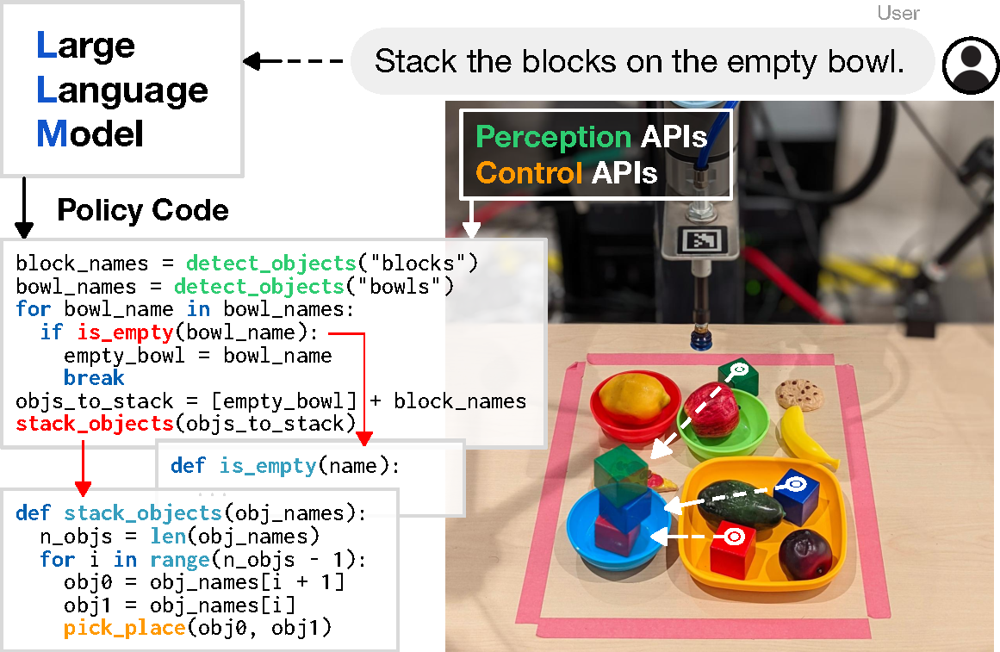{.nostretch fig-align="center" width="100%"}

[Generated policy code calls perception and control APIs, and the undefined helpers (`is_empty`, `stack_objects`) are written by the LLM in turn.]{.grey-text .tiny-font}
:::
:::::

::: {.tiny-font .absolute bottom="0" left="0"}
[Code as Policies: Language Model Programs for Embodied Control.]{.red} Liang et al. ICRA 2023 · [project page and videos](https://code-as-policies.github.io/){target="_blank"}
:::

## Where code stops working

::: {.small-math .arrow-bullets}
▶ **Bounded by the APIs:** it perceives only what the detectors describe and does only what the primitives allow.

▶ **No learning:** behavior comes from the prompt; the robot doesn't improve with practice.

▶ **No dexterity:** nobody, human or LLM, knows the code for folding a shirt.

▶ **Week 5 connection:** imitation as program induction, but the program comes from a language command, not from demonstrations.

▶ **Still the right tool** for logic and geometry over known objects ("put the red blocks in the matching bowl") and for orchestrating learned skills.
:::

::: {.tiny-font .absolute bottom="0" left="0"}
[Code as Policies: Language Model Programs for Embodied Control.]{.red} Liang et al. ICRA 2023
:::

## Agentic control: emitting targets

::: {.small-math .arrow-bullets}
▶ In this column the foundation model **is** the policy, but it does not output joint commands. It outputs **targets** that a classical controller can track: points, poses, constraints.

▶ **Two examples:** MOKA (the VLM picks points on a marked image) and ReKep (the VLM writes constraints on keypoints for an optimizer).

▶ **The 2026 trend:** reasoning models now call *learned* policies as tools, instead of motion planners. GR00T 2 exposes an API that a reasoning model can call. The controller in this column is increasingly itself a foundation model.
:::

## MOKA: marked-image prompting

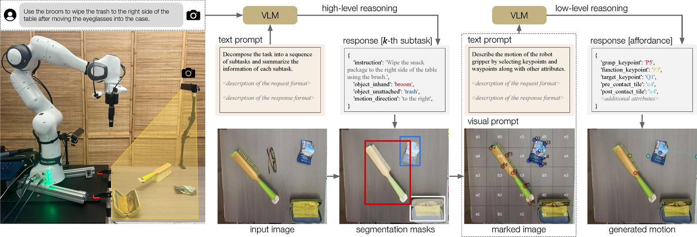{.nostretch fig-align="center" width="86%"}

::: {.small-math .arrow-bullets}
▶ **MOKA** (marking open-vocabulary keypoint affordances): a VLM (GPT-4V) first splits the task into subtasks, then, on an image overlaid with candidate keypoints and a grid, chooses a **grasp point** on the object or tool, a **function point** where the tool acts ("the tip of the broom"), a **target point**, and waypoints between them.

▶ The 2D choices are lifted to 3D with depth, and a motion planner executes them. Zero-shot, from a language instruction.

▶ **Why marks?** VLMs are poor at outputting precise coordinates but good at choosing among labeled options: a visual prompt turns a regression problem into multiple choice.
:::

::: {.tiny-font .absolute bottom="0" left="0"}
[MOKA: Open-World Robotic Manipulation through Mark-Based Visual Prompting.]{.red} Liu, Fang, Abbeel, Levine. RSS 2024
:::

## ReKep: VLM-written constraints

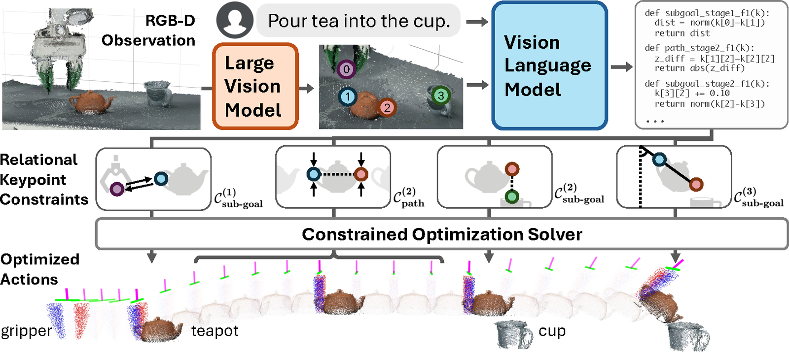{.nostretch fig-align="center" width="60%"}

::: {.small-math .arrow-bullets}
▶ **Keypoints:** candidate 3D keypoints are proposed automatically from the scene (DINOv2 features and SAM masks).

▶ **Relational keypoint constraints:** a VLM (GPT-4o) writes, for each stage of the task, Python functions of the keypoints that return a cost. E.g. for pouring: "the spout keypoint is above the cup keypoint".

▶ **An optimizer** solves for end-effector poses that satisfy the current stage's constraints. Keypoints are tracked and the optimization is re-solved continuously, so the robot reacts to disturbances.

▶ **Between Code as Policies and MOKA:** the model writes code, but the code is a cost function for an optimizer, not a sequence of motions.
:::

::: {.tiny-font .absolute bottom="0" left="0"}
[ReKep: Spatio-Temporal Reasoning of Relational Keypoint Constraints for Robotic Manipulation.]{.red} Huang et al. CoRL 2024
:::

# World-model planning

## V-JEPA 2-AC: a latent world model

::::: columns
::: {.column .small-math .arrow-bullets width="62%"}
▶ **Stage 1 (no actions):** pretrain the V-JEPA 2 encoder on over 1M hours of internet video, predicting masked video *in representation space* (JEPA, Week 11).

▶ **Stage 2 (a little robot data):** freeze it and train an **action-conditioned predictor** on 62 hours of DROID Franka video, with no rewards or task labels. It is autoregressive, with block-causal attention:

$$
\hat z_{k+1} = P_\phi\big(\hat z_{\le k},\, a_{\le k},\, s_{\le k}\big)
$$

▶ **What it buys:** dynamics that never reconstruct pixels, so capacity goes to what moves, not to texture.
:::

::: {.column width="38%"}
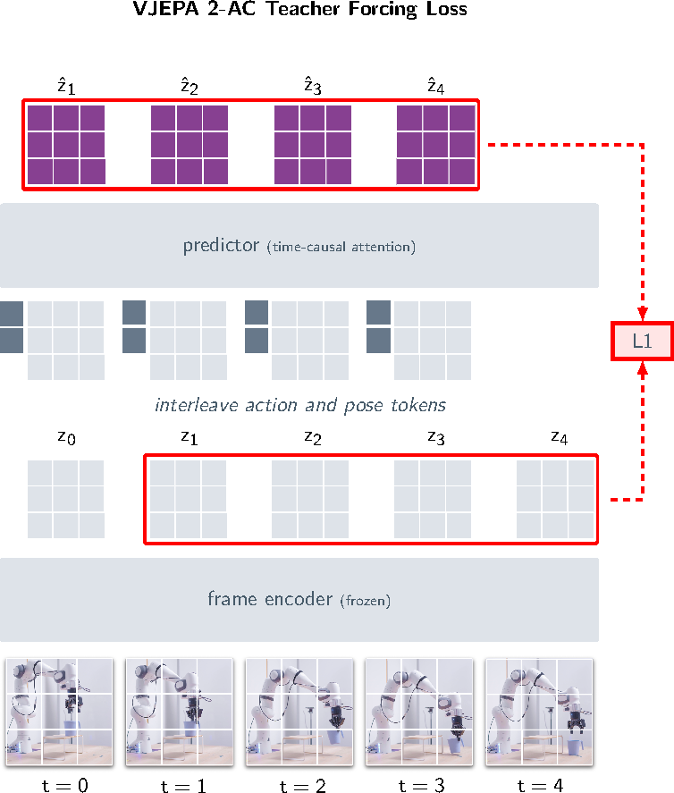{.nostretch fig-align="center" height="500"}
:::
:::::

::: {.tiny-font .absolute bottom="0" left="0"}
[V-JEPA 2: Self-Supervised Video Models Enable Understanding, Prediction and Planning.]{.red} Assran et al. 2025
:::

## Planning with V-JEPA 2-AC

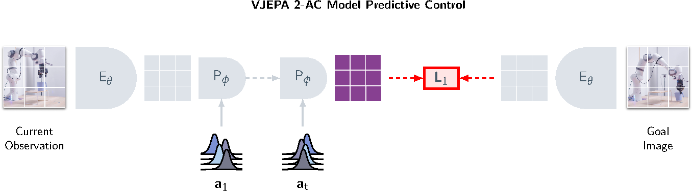{.nostretch fig-align="center" width="90%"}

::: {.small-math .arrow-bullets}
▶ **Goal as an image** $x_g$, encoded as $z_g$. Plan actions that make the imagined future look like the goal:

$$
\mathcal{E}(\hat a_{1:T}) = \big\| P_\phi(\hat a_{1:T};\, z_k, s_k) - z_g \big\|_1
$$

▶ **Cross-entropy method** (Week 2): sample action sequences from Gaussians, keep the top ones, refit, repeat. Execute the first action, observe, replan.

▶ This is the taxonomy figure's `sample()`, `score()`, `select()`, `replan()` box.
:::

::: {.tiny-font .absolute bottom="0" left="0"}
[V-JEPA 2: Self-Supervised Video Models Enable Understanding, Prediction and Planning.]{.red} Assran et al. 2025
:::

## V-JEPA 2-AC: results and limits

::::: columns
::: {.column .small-math .arrow-bullets width="55%"}
▶ **Zero-shot** on Franka arms in two labs that are not in DROID, with an uncalibrated monocular camera.

▶ **Speed:** 16 seconds per action (800 samples, 10 iterations), versus 4 minutes per action when planning with a pixel-space video model (Cosmos).
:::

::: {.column .small-math .arrow-bullets width="45%"}
| Task (Lab 2) | V-JEPA 2-AC |
|---|---|
| Reach | 100% |
| Grasp cup / box | 60% / 20% |
| Pick-and-place cup / box | 80% / 50% |

▶ **Limits:**

-   Tasks are specified by goal images. Pick-and-place needs hand-given subgoal images.
-   Predictions reach about 16 seconds into the future, so longer tasks need a hierarchy.
-   The inferred action axes rotate with the camera position.
:::
:::::

::: {.tiny-font .absolute bottom="0" left="0"}
[V-JEPA 2: Self-Supervised Video Models Enable Understanding, Prediction and Planning.]{.red} Assran et al. 2025
:::

# World-action models

## What is a world-action model?

::: {.small-math .arrow-bullets}
▶ A **VLA** models $p(a \mid o, \ell)$. A **world model** models $p(o' \mid o, a)$. A **world-action model** (WAM) models the future and the action *together*, and the predicted future is part of how the action is produced:

$$
p_\Theta(o', a \mid o, \ell)
$$

▶ Three ways to factor it, which line up with the last three columns of the figure:

| Factorization | Meaning | Family |
|---|---|---|
| $p(o' \mid o, \ell)\; q(a \mid o, o')$ | predict the future, then recover the action | inverse dynamics (UniPi) |
| $q(a \mid o, \ell)\; p(o' \mid o, a)$ | propose an action, predict its consequence, score it | world-model planning (V-JEPA 2-AC) |
| $p_\theta(o', a \mid o, \ell)$, one network | predict both jointly | world-action model |

▶ **Why now:** video generation models pretrained on web video carry priors about *motion and physics*. VLM backbones, pretrained on static image-text pairs, carry priors about *semantics*. RT-2 generalized over objects but not over new motions.
:::

::: {.tiny-font .absolute bottom="0" left="0"}
[World Action Models: A Survey.]{.red} 2026 · [World Action Models are Zero-shot Policies.]{.red} Ye et al. 2026
:::

## The historical version: GR-1

::::: columns
::: {.column .small-math .arrow-bullets width="46%"}
▶ **A small GPT-style transformer** (about 21M policy parameters) with pretrained image and language encoders.

▶ **Pretraining:** predict future Ego4D video frames, conditioned on language.

▶ **Fine-tuning:** on robot data, predict the action *and* the future image, through separate readout tokens (ACT and OBS).

▶ **Result:** on CALVIN's hardest split (train on A, B, C; test on D), 3.06 of 5 chained tasks on average; earlier methods stayed below 1.

▶ **The lesson:** predicting future frames shapes a better *policy* representation. Every WAM since scales this up on a pretrained video generation model.
:::

::: {.column width="54%"}
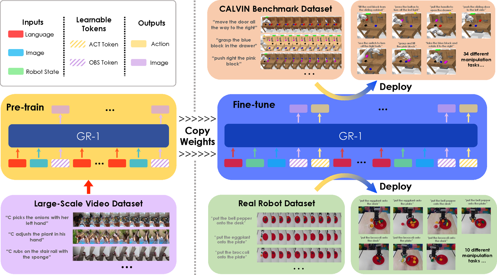{.nostretch fig-align="center" width="100%"}
:::
:::::

::: {.tiny-font .absolute bottom="0" left="0"}
[Unleashing Large-Scale Video Generative Pre-training for Visual Robot Manipulation.]{.red} Wu et al. ICLR 2024
:::

## DreamZero: video model as policy

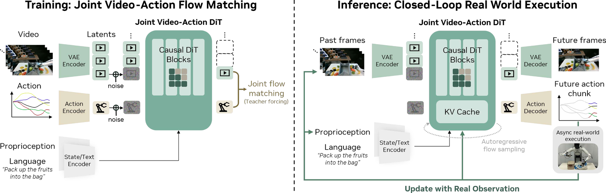{.nostretch fig-align="center" width="92%"}

::: {.small-math .arrow-bullets}
▶ **14B parameters**, initialized from the Wan 2.1 image-to-video diffusion model. One autoregressive diffusion transformer, trained with flow matching, **denoises future video latents and action chunks together**, conditioned on the instruction, proprioception, and past frames. There is no separate action head.

▶ **Making it closed-loop** (right): after each chunk is executed, the predicted frames in the KV cache are replaced by the real observations, so prediction errors don't compound. With a 38× inference speedup (decoupled video and action denoising, parallelism, caching, quantization), it produces action chunks at about **7 Hz**.
:::

::: {.tiny-font .absolute bottom="0" left="0"}
[World Action Models are Zero-shot Policies.]{.red} Ye et al. (NVIDIA) 2026
:::

## DreamZero: one network, two factors

::: {.small-math .arrow-bullets}
▶ **Their factorization ties this column to the next one:**

$$
\underbrace{\pi(o_{l:l+H},\, a_{l:l+H} \mid o_{0:l}, c, q_l)}_{\text{DreamZero}}
=
\underbrace{\pi(o_{l:l+H} \mid o_{0:l}, c, q_l)}_{\text{video prediction}}\;
\underbrace{\pi(a_{l:l+H} \mid o_{0:l+H}, q_l)}_{\text{inverse dynamics}}
$$

Both factors live in one network and are sampled together.

▶ **How it fails:** most failures are bad videos, not bad actions. **The policy faithfully executes whatever future it imagines.** Better video models should directly give better policies, and worse ones give worse policies.

▶ Vanilla VLAs, by contrast, often reach for an object and try to grasp it regardless of the instruction: they fall back on the dominant training behavior.
:::

::: {.tiny-font .absolute bottom="0" left="0"}
[World Action Models are Zero-shot Policies.]{.red} Ye et al. (NVIDIA) 2026
:::

## DreamZero: results

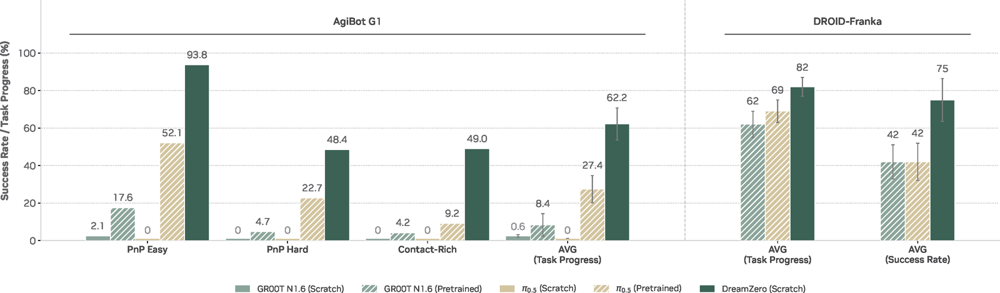{.nostretch fig-align="center" width="84%"}

[Seen tasks in new environments, versus GR00T N1.6 and π0.5, each trained from scratch or from their pretrained checkpoints.]{.grey-text .tiny-font}

::: {.small-math .arrow-bullets}
▶ **Learns from diverse, non-repetitive data** (~500 hours of real robot data), instead of many repetitions of each task.

▶ **New tasks and new places:** on AgiBot G1, 62% average task progress in new environments, versus 27% for the best pretrained VLA baseline. On 10 tasks entirely absent from training (untying shoelaces, ironing, shaking hands), 40% versus 16%.

▶ **Cross-embodiment from video only:** 10–20 minutes of video of humans or another robot doing a task, *without actions*, improves the target robot on unseen tasks by over 42% (relative).

▶ **Real-world leaderboard:** on RoboArena (April 2026 snapshot), 1750 versus 1622 for π0.5, trained on DROID alone.
:::

::: {.tiny-font .absolute bottom="0" left="0"}
[World Action Models are Zero-shot Policies.]{.red} Ye et al. (NVIDIA) 2026
:::

## GR00T 2: NVIDIA moves to a WAM

::: {.small-math .arrow-bullets}
▶ NVIDIA's previous GR00T models (up to N1.7) were VLAs. **GR00T 2 is a world-action model**, built on Cosmos and DreamZero research: it predicts future video and actions jointly.

▶ **Data:** robot data plus about 100,000 hours of human egocentric video. Runs on parallel grippers, two 22-DoF dexterous hands, and humanoids.

▶ **GR00T 2 Turbo:** a 2B video-action transformer with a more compressed video encoder, 124 ms per prediction on a Unitree G1's onboard computer.

▶ **Caveat:** announced November 9, 2026. The white paper and demos are out; code and weights are listed for December.
:::

::: {.tiny-font .absolute bottom="0" left="0"}
[GR00T 2: Scaling Robot Foundation Models for Generalization, Dexterity, and Adaptation.]{.red} NVIDIA, November 2026 · [project page](https://research.nvidia.com/labs/gear/gr00t-2/){target="_blank"}
:::

## GR00T 2: skills from humans

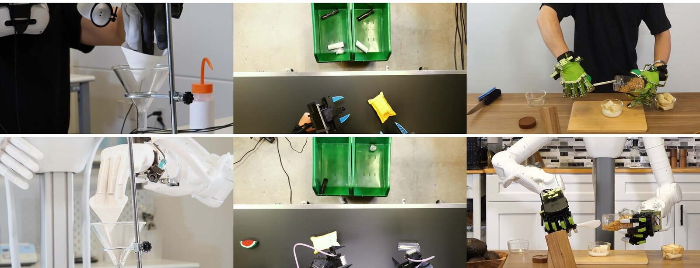{.nostretch fig-align="center" width="60%"}

[Top: the task shown by a human, with a handheld UMI gripper, and with a wearable DexUMI hand. Bottom: a robot that never practiced it doing the same task.]{.grey-text .tiny-font}

::: {.small-math .arrow-bullets}
▶ **Reported by NVIDIA:**

-   **Skills transfer from humans and devices:** tasks shown only by humans, with a handheld UMI gripper, or with a wearable DexUMI hand, carried over to robots that never practiced them.
-   **Few-shot:** on 50 tasks never seen on the target robot, 40% success zero-shot, 95% after five demonstrations per task.
-   **Agentic control:** a reasoning model calls GR00T 2 through an API and marks where to grasp on its camera image. Instruction following goes from 40% to 92%. This links the world-action column to the agentic one.
:::

::: {.tiny-font .absolute bottom="0" left="0"}
[GR00T 2: Scaling Robot Foundation Models for Generalization, Dexterity, and Adaptation.]{.red} NVIDIA, November 2026 · [project page](https://research.nvidia.com/labs/gear/gr00t-2/){target="_blank"}
:::

## Design variant: Cosmos Policy

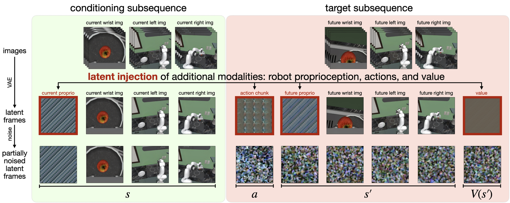{.nostretch fig-align="center" width="72%"}

::: {.small-math .arrow-bullets}
▶ **No architectural changes.** Fine-tune the Cosmos-Predict2 2B video model so that its latent "frames" also carry the robot state, the action chunk, the future state, and its **value**. Each new quantity is normalized and copied to fill a latent frame. The video model treats them as more frames to denoise.

-   As a direct policy: 98.5% on LIBERO, 67.1% on RoboCasa.
-   **With planning:** sample several candidate actions, imagine their futures, rank them by predicted value, execute the best. This is the world-model-planning column again, inside one network. It can also refine its world model and value from its own rollouts.
:::

::: {.tiny-font .absolute bottom="0" left="0"}
[Cosmos Policy: Fine-Tuning Video Models for Visuomotor Control and Planning.]{.red} Kim et al. 2026
:::

## Design variant: X-WAM

::: {.small-math .arrow-bullets}
▶ **X-WAM:** a single diffusion transformer (from Wan 2.2) jointly denoises multi-view RGB video, depth, proprioception, and actions. Actions are predicted at 4 times the video frame rate and denoised on a faster schedule than the video. About 79% on RoboCasa-GR1, ahead of Cosmos Policy and DreamZero on that leaderboard.

▶ **The column is not settled:** where the action goes in the video model, whether to keep a separate action expert, and whether to predict depth or values differ from paper to paper.
:::

::: {.tiny-font .absolute bottom="0" left="0"}
[Unified 4D World Action Modeling from Video Priors with Asynchronous Denoising.]{.red} 2026
:::

## Fast-WAM: imagine at test time?

::::: columns
::: {.column .small-math .arrow-bullets width="42%"}
▶ **The question:** are WAMs good because they *generate* the future at test time, or because they were *trained* to predict it?

▶ **Architecture:** the Wan 2.2 5B video diffusion transformer plus an action-expert transformer, sharing attention (a mixture of transformers).

-   **Training:** noisy future-video tokens are denoised alongside the action chunk. An attention mask stops action tokens from attending to future video, so no future information leaks into the actions.
-   **Test time** (C, bottom right): the future-video branch is removed. The current frame goes through the video backbone once, and the action expert reads its features.
:::

::: {.column width="58%"}
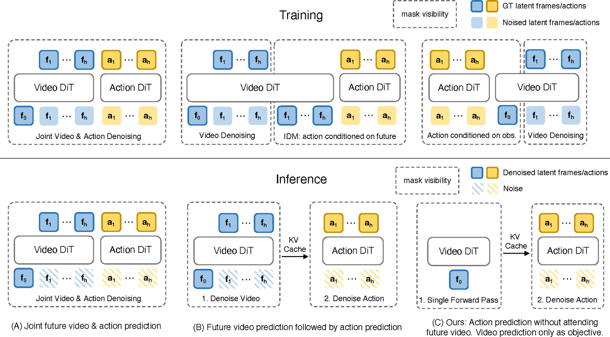{.nostretch fig-align="center" width="100%"}

[The three variants compared: (A) joint video and action denoising, (B) video, then inverse dynamics, (C) Fast-WAM, with no future video at test time.]{.grey-text .tiny-font}
:::
:::::

::: {.tiny-font .absolute bottom="0" left="0"}
[Fast-WAM: Do World Action Models Need Test-time Future Imagination?]{.red} Yuan et al. 2026
:::

## Fast-WAM: what matters

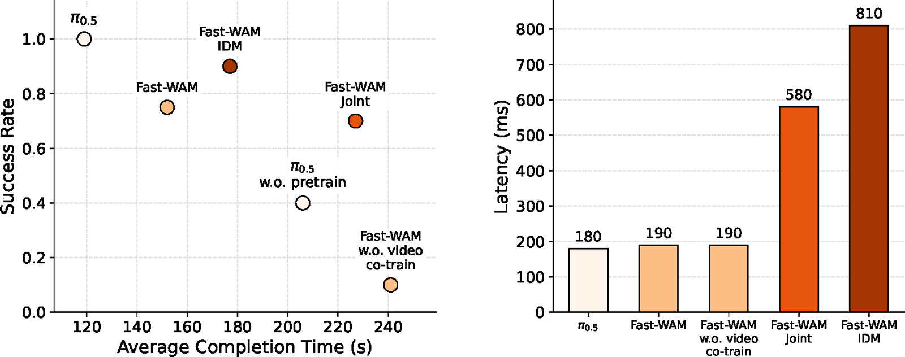{.nostretch fig-align="center" width="54%"}

[Real towel folding: success rate against completion time (upper left is better), and inference latency.]{.grey-text .tiny-font}

::: {.small-math .arrow-bullets}
▶ **Controlled comparison** of the three variants:

-   Dropping test-time imagination costs little.
-   Dropping video co-training costs much more (bottom right of the left plot).

▶ About 190 ms per chunk, over 4 times faster than imagine-then-execute WAMs, and competitive on LIBERO, RoboTwin and real tasks without embodied pretraining.

▶ **Connection to Week 11:** here video prediction acts as a **representation-learning objective**, not a planner. Flex-π, next, makes test-time imagination a choice; Dyna-2 then tests the recipe at 1M hours.
:::

::: {.tiny-font .absolute bottom="0" left="0"}
[Fast-WAM: Do World Action Models Need Test-time Future Imagination?]{.red} Yuan et al. 2026
:::

## Flex-π: RGB, 3D and DINO latents

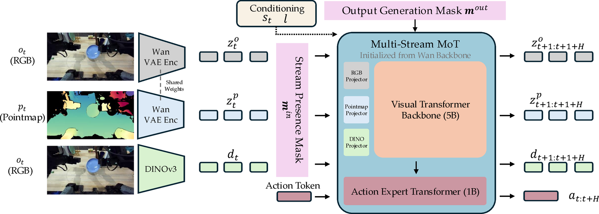{.nostretch fig-align="center" width="76%"}

::: {.small-math .arrow-bullets}
▶ **Problem:** WAMs predict RGB latents, which a VAE learned for pixel reconstruction. Nothing in them targets geometry or object semantics.

▶ **Three streams, all from the RGB cameras:** RGB through the frozen Wan-2.2 VAE; Depth Anything 3 pointmaps through the *same* VAE, which reconstructs them almost losslessly despite never seeing depth; DINOv3 patch tokens, folded 2×2 to cut tokens by 4×. No new sensors.

▶ **Model:** 6B parameters: a 5B mixture-of-transformers trunk initialized from Wan 2.2, plus a 1B action expert that reads the visual streams. Everything is trained by joint flow matching; pretraining is about 500 hours of AgiBot World.
:::

::: {.tiny-font .absolute bottom="0" left="0"}
[Flex-π: A Multi-Stream World-Action Model with Compute Flexibility.]{.red} Yan et al. 2026
:::

## Flex-π: imagination as a dial

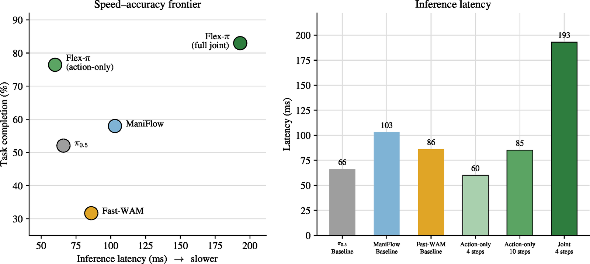{.nostretch fig-align="center" width="70%"}

::: {.small-math .arrow-bullets}
▶ **Training:** randomly drop input streams and output streams (attention masks $m^{\text{in}}, m^{\text{out}}$). **Cross-modality forcing:** still predict every future stream, observed or not. On 5 RoboTwin tasks this lifts success from about 45% to 66% (+47% relative).

▶ **Deployment:** one checkpoint, 56 input/output combinations (7 non-empty input sets × 8 output sets). Action-only takes 60 ms, faster than π0.5 (66 ms); full joint generation takes 193 ms (RTX 5090).

▶ **The answer to Fast-WAM's question:** action-only, the Fast-WAM regime, already beats every baseline (76.4 task completion). Generating the futures adds more (83.0). Training on futures does most of the work; imagining them at test time is a paid extra.
:::

::: {.tiny-font .absolute bottom="0" left="0"}
[Flex-π: A Multi-Stream World-Action Model with Compute Flexibility.]{.red} Yan et al. 2026
:::

## Flex-π: the dial in action

<video data-autoplay loop muted playsinline preload="auto" width="74%" poster="videos/flexpi-archviz.jpg" src="videos/flexpi-archviz.mp4" style="display:block; margin:0 auto;"></video>

::: {.grey-text .tiny-font}
From the project page. The same weights run four presets in turn: action-only, 3D future plus action, full joint generation, and 3D future generated without observing 3D (cross-modality forcing, ★). $m^{\text{in}}$ marks the observed streams and $m^{\text{out}}$ the generated ones; latency and real-robot task completion update with each.
:::

::: {.tiny-font .absolute bottom="0" left="0"}
[Flex-π: A Multi-Stream World-Action Model with Compute Flexibility.]{.red} Yan et al. 2026 · [project page](https://flex-pi.github.io){target="_blank"}
:::

## Flex-π: real-robot results

::: rep-table
| Task completion (%) | Flex-π joint | Flex-π action-only | ManiFlow (3D input) | π0.5 | Fast-WAM |
|---|---|---|---|---|---|
| Seen, 5 tasks | **83.0** | 76.4 | 58.0 | 52.1 | 31.7* |
| Unseen, 3 tasks | **76.1** | 70.8 | 31.5 | 43.2 | 16.9* |
| Inference latency (ms) | 193 | **60** | 103 | 66 | 86 |
:::

::: {.small-math .arrow-bullets}
▶ **Setup:** bimanual YAM arms; "unseen" means new objects and heavy clutter. **Self-repair of its own gripper** (8 ordered stages, down to a 4 mm bit in a 4.5 mm socket): all stages in 11 of 20 runs; ManiFlow 1, π0.5 none.

▶ **Unseen soft bag:** π0.5 drops from 42.8 to 17.2, Flex-π from 70.0 to 63.3. **Half the data:** action-only Flex-π matches π0.5 trained on all of it.

▶ **Caveats:** 20 rollouts per task, about ±22 points at 50% success (LBM slide), so only the large gaps count. \*Fast-WAM skipped the two hardest tasks. Simulation benchmarks are near saturation. Preprint.
:::

::: {.tiny-font .absolute bottom="0" left="0"}
[Flex-π: A Multi-Stream World-Action Model with Compute Flexibility.]{.red} Yan et al. 2026
:::

## Dyna-2: a WAM on 1M human hours

{.nostretch fig-align="center" width="64%"}

::: {.small-math .arrow-bullets}
▶ **Model:** a mixture of transformers on a video-diffusion backbone, with separate DiT layers for video and actions. The shallower action stream joins only the early video layers, which cuts latency.

▶ **Data:** over 1M hours of egocentric human video, no robot data. Pseudo-actions come from 3D hand pose: the wrist pose, plus the thumb–index aperture as the grasp.

▶ **Loss:** two flow-matching losses on a shared trunk,
$\mathcal{L}_{\text{co}} = \mathbb{E}\|u_\theta^{\text{vid}}(z_t; t, c) - (z - \varepsilon_z)\|^2 + \lambda\,\mathbb{E}\|u_\theta^{\text{act}}(a_t; t, c) - (a - \varepsilon_a)\|^2$.
$u^{\text{act}}$ never sees the noised future video $z_t$, so no frames are generated at test time: the Fast-WAM recipe.
:::

::: {.tiny-font .absolute bottom="0" left="0"}
[Dyna-2: A 1-Million-Hour Scaling Law for World-Action Models.]{.red} Dyna Robotics, August 2026 · [post](https://www.dyna.co/dyna-2){target="_blank"}
:::

## Dyna-2: human-to-robot scaling

::::: columns
::: {.column .small-math .arrow-bullets width="46%"}
▶ **Nested subsets** of 1k, 10k, 100k and 1M hours, same training configuration. Held-out human error follows a power law (MSE $\approx 0.069\, D^{-0.018}$).

▶ **Zero-shot on robots** (top): 39 unseen tasks on YAM arms. Every metric improves monotonically, with an inflection between 10k and 100k hours.

▶ **Post-trained** (bottom) on at most 10 robot hours per task (14 tasks, 3 embodiments): lockbox key turning goes from 0% (up to 100k hours) to 90% at 1M; dexterous bottle-cap untwisting from 10% to 50%.
:::

::: {.column width="54%"}
{.nostretch fig-align="center" width="100%"}

{.nostretch fig-align="center" width="76%"}

::: {.grey-text .tiny-font}
Top: zero-shot action MSE and accuracy on held-out robot data. Bottom: mean normalized on-robot score over 14 tasks after post-training.
:::
:::
:::::

::: {.tiny-font .absolute bottom="0" left="0"}
[Dyna-2: A 1-Million-Hour Scaling Law for World-Action Models.]{.red} Dyna Robotics, August 2026 · [post](https://www.dyna.co/dyna-2){target="_blank"}
:::

## Dyna-2: video is the scaling axis

::::: columns
::: {.column .small-math .arrow-bullets width="52%"}
▶ **Objective ablation** (right): joint video and action prediction beats action-only on 39 of 39 robot tasks, but only **co-training on extra unlabeled video** keeps improving with data.

▶ **Video-only scaling:** at a fixed 50k action hours, more video-only hours lower zero-shot robot error (not human error).

▶ **WAM vs. VLA** (Dyna-1, Qwen3-VL-4B), same data: 1.55× the success rate, and 87% versus 46% pass rate at unseen customer sites. Language following: 35% (action-only) to 96% (full corpus).

▶ **Caveats:** a company post, not peer reviewed; offline accuracies are small (accuracy@0.5 about 0.16); the production model differs from the scaling-study models.
:::

::: {.column width="48%"}
{.nostretch fig-align="center" width="100%"}

::: {.grey-text .tiny-font}
Zero-shot robot error and accuracy against action-labelled human hours, for three training objectives.
:::
:::
:::::

::: {.tiny-font .absolute bottom="0" left="0"}
[Dyna-2: A 1-Million-Hour Scaling Law for World-Action Models.]{.red} Dyna Robotics, August 2026 · [post](https://www.dyna.co/dyna-2){target="_blank"}
:::

# Video planning with inverse dynamics models

## UniPi: plan in video, then infer actions

::::: columns
::: {.column .small-math .arrow-bullets width="63%"}
▶ **Policy as text-conditioned video generation:** a video diffusion model, given the current frame and the instruction, generates future frames $I_{t+1}, \dots, I_{t+H}$ of the robot doing the task.

▶ **An inverse dynamics model** recovers the actions:

$$
a_t = \mathrm{idm}(I_t, I_{t+1})
$$

It is small and needs only modest action-labeled data; the video model can use video *without actions*.

▶ **Why it generalizes:** video is shared across tasks and bodies, and language composition carries over to new object–goal combinations.

▶ **Failure modes:** plans can be **physically unrealizable** for this robot; IDM errors **accumulate**, with no replanning unless you regenerate; video generation is slow.
:::

::: {.column width="37%"}
{.nostretch fig-align="center" width="100%"}
:::
:::::

::: {.tiny-font .absolute bottom="0" left="0"}
[Learning Universal Policies via Text-Guided Video Generation.]{.red} Du et al. NeurIPS 2023
:::

## Inverse dynamics vs. world-action models

::: {.small-math .arrow-bullets}
▶ Same factorization, different training:

$$
p(o_{t+1:t+H} \mid o_t, \ell)\;\; q\big(a_t \mid o_t, o_{t+1}\big)
$$

-   **Inverse dynamics (UniPi):** two separately trained models; the video model never learns what this robot can do.
-   **World-action model (DreamZero):** one network, trained jointly, re-grounded on real frames after every chunk.

▶ **Elsewhere:** Track2Act, Gen2Act and Dreamitate (Week 10) map generated human video or point tracks to robot actions. Veo-Act (2026) plans with a frontier video model, follows it with an IDM, and hands off to a VLA for contact.

▶ Inside a VLA: π0.7 with a subgoal image is inverse dynamics over one future frame.
:::

::: {.tiny-font .absolute bottom="0" left="0"}
[Learning Universal Policies via Text-Guided Video Generation.]{.red} Du et al. NeurIPS 2023 · [Veo-Act: Enhancing VLA Policies with Frontier Video Models.]{.red} 2026
:::

## Comparing the six families

::: rep-table
| Family | Where the foundation model sits | Output across the interface | Data needed | What could break |
|---|---|---|---|---|
| **Hierarchical VLA** [SayCan, Hi Robot, π0.5]{.grey-text} | above a VLA | language subgoals | robot demos with subtask labels, web data, synthetic prompts | the low-level VLA; subgoals it can't execute |
| **Code as Policies** [CaP]{.grey-text} | writes the policy | a program | none beyond prompts and APIs | anything the APIs can't express; dexterity |
| **Agentic control** [MOKA, ReKep]{.grey-text} | is the policy | points, poses, constraints | none (zero-shot) | precision of VLM outputs; contact-rich tasks |
| **World-model planning** [V-JEPA 2-AC]{.grey-text} | world model inside MPC | predicted futures and scores | lots of video, a little unlabeled robot video | slow planning; specifying goals; long horizons |
| **World-action model** [DreamZero, GR00T 2, Fast-WAM, Flex-π, Dyna-2]{.grey-text} | is world model and policy | actions, with the predicted future | robot data plus video, possibly without actions | wrong imagined futures, executed faithfully; compute |
| **Inverse dynamics** [UniPi]{.grey-text} | plans video above an IDM | future frames | video without actions, a little labeled data for the IDM | unrealizable video plans; accumulating IDM errors |
:::

## Summary

::: {.small-math .arrow-bullets}
▶ **VLAs** turned a vision-language model into a policy: actions as tokens (RT-2, OpenVLA), then as continuous chunks from a diffusion head (Octo) or a flow-matching action expert (π0 and nearly everything since).

▶ **The 2025–2026 VLA story is about data and adaptation**, not architecture: heterogeneous co-training (π0.5), training on failures with metadata (π0.7), embodiment midtraining and learning from corrections (Rho), fully open data (MolmoAct 2).

▶ **Hierarchies** differ in what the high level sends down: a skill choice, a language subgoal, a language motion, a trace, a subgoal image, a video. More detail means a low level closer to inverse dynamics.

▶ **Code and agentic control** use foundation models zero-shot, with no robot data, but stop where APIs and controllers stop: at dexterity.

▶ **Predicting the future** is the newest bet: as a planner's model (V-JEPA 2-AC), jointly with actions (DreamZero, GR00T 2), or as a training signal only (Fast-WAM). Its argument: video carries priors about motion that image-text pretraining lacks.

▶ **None of this removes the questions from earlier weeks:** compounding errors (Week 1), when to replan (Week 2), learning from bad data (Week 3), learning from human corrections (Week 9), and what representation the policy should learn (Week 11).
:::
